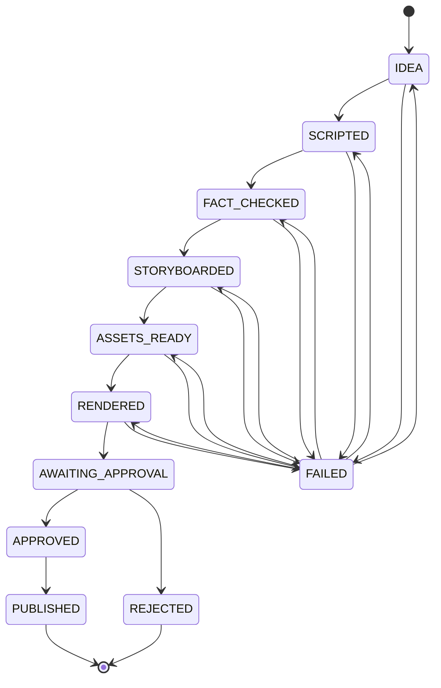

# Arquitetura e contratos (gerado)

> Gerado por `scripts/export_contracts.py`. Não edite à mão.

## Camadas

`domain` ← `application` ← `adapters` / `api`. Só `composition.py` conhece adaptadores concretos.

## Estados do vídeo

## Entidades

| Entidade | Schema |
|---|---|
| `Project` | `contracts/v1/project.schema.json` |
| `Video` | `contracts/v1/video.schema.json` |
| `Script` | `contracts/v1/script.schema.json` |
| `Scene` | `contracts/v1/scene.schema.json` |
| `Asset` | `contracts/v1/asset.schema.json` |
| `RenderJob` | `contracts/v1/renderjob.schema.json` |
| `Publication` | `contracts/v1/publication.schema.json` |
| `UsageEntry` | `contracts/v1/usageentry.schema.json` |
| `QaReport` | `contracts/v1/qareport.schema.json` |
