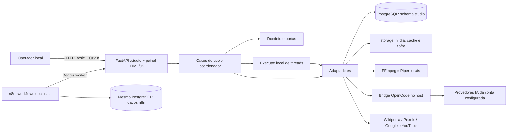
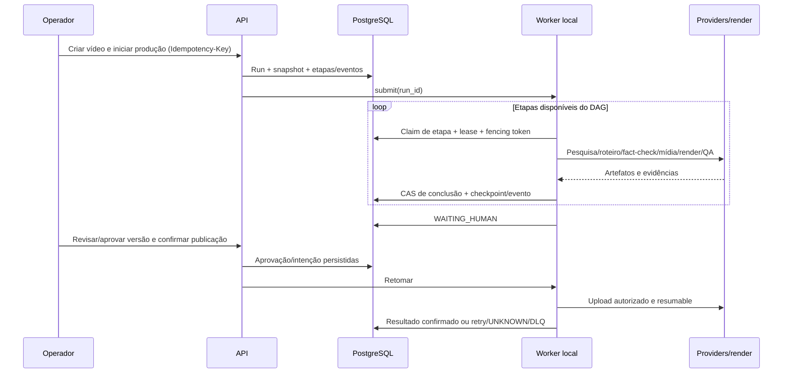

# Arquitetura operacional do Faceless Studio

**Referência:** código local `2beb90e`, revisado em 24/11/2026. Descreve implementação,
não promessa de roadmap. Complementa [estados/contratos gerados](10-arquitetura.md)
e [modelo de dados gerado](22-modelo-de-dados.md); esses snapshots têm divergências
registradas na [revisão](reviews/2026-11-24-architecture-review.md).

## Forma do sistema

Monólito modular Python: API, UI e coordenação no mesmo processo, com adaptadores
para PostgreSQL, arquivos, FFmpeg/Piper e serviços externos. Não há broker externo
de execução no Compose. n8n é integração/agendamento opcional, não o dono do DAG
de produção.

`main.py` monta `Studio(Settings.from_env())` e o router. No lifespan, tenta migrar
e recuperar runs órfãos; falha de banco degrada o Studio sem derrubar a API.
`/videos` é legado removido (410). `/health` responde 200 mesmo com
`studio_db=unavailable`; o campo `ffmpeg=true` é constante, não sonda de execução.

## Mapa de responsabilidades

Todos os caminhos abaixo são relativos a `renderer/app/studio/`, salvo indicação.

| Área | Responsabilidade / interface | Implementação de referência |
|---|---|---|
| `domain/` | Estados, contratos Pydantic, políticas de orçamento/publicação, configuração efetiva e RenderPlan | `states.py`, `production_run.py`, `effective_config.py`, `render_plan.py`, `qa_report.py` |
| `application/` | Casos de uso; portas injetadas; coordenação de efeitos | `ports.py`, `use_cases.py`, `production.py`, `budget.py` |
| `api/` | HTTP/validação/auth; projeção HTML, CSS e JS do painel | `routes.py`, `panel_*.py`, `shell_v3*.py`; não há SPA separada no deploy |
| `composition/` | Defaults, registro/roteamento de providers e montagem de repositórios/casos de uso | `settings.py`, `providers.py`, `wiring.py`; substitui referências históricas a `composition.py` |
| Editorial | Fontes/snapshots, pesquisa, versões de roteiro, claims/fact-check e aprovação de roteiro | `application/editorial.py`, `longform.py`, `research.py` |
| Mídia/render | Busca/seleção de assets, licenças, voz, plano, cache por fingerprint e QA | `application/media.py`, `render.py`; `adapters/render_plan_ffmpeg.py`, `voice_piper.py` |
| Publicação | Intenção, aprovação vinculada a render/checksum, destino autorizado, retry e reconciliação | `application/publication_gate.py`, `publication_execution.py`; `adapters/youtube_publisher.py` |
| Canais/configuração | Projeto, perfil editorial, estilos/patches, destino YouTube e tetos por canal | `application/channels.py`, `video_style.py`, `channel_budget.py`, `connections.py` |
| Persistência | SQL direto psycopg, transações/CAS, índices e migrações | `adapters/postgres/`; não há ORM |
| Analytics/tendências | Ingestão de sinais, métricas autorizadas, experimentos e recomendações | `application/analytics_*.py`, `trends.py`, `categories.py` |
| Operação | Bridge, backup SQL, exportação de contratos/modelo e harnesses de teste | `scripts/` na raiz |

Fronteiras são verificadas por `tests/test_architecture.py`. Isso verifica imports,
não ausência universal de I/O: `application/render.py` também mede WAV e lê
artefatos via `Path`. Preservar o isolamento de SDKs e de banco já existente;
evoluir portas quando houver benefício observável, sem reescrita em microserviços.
Veja [extensão de providers](21-extensao.md).

## Fluxo principal e posse do trabalho

- Run, estado do vídeo e render job são entidades diferentes. Etapas podem pausar
  sem ocupar thread; `INTERACTIVE` e `BUDGET_GUARDED` controlam pausas intermediárias.
  `piloto`/`diretor` é outra configuração, registrada no vídeo.
- `ThreadPoolExecutor` é compartilhado entre produção e render avulso, com 1–4
  threads. O render do coordenador roda em linha dentro da etapa, evitando esperar
  outro job do mesmo pool. A fila de submissão não é uma fila durável de broker.
- Estado/checkpoints e eventos `production_outbox` são persistentes. A outbox de
  progresso não significa que exista um dispatcher de tarefas durável.
- Repositório usa `FOR UPDATE`, CAS, lease e fencing token. Lease padrão: 300 s.
- **Heartbeat do lease** (`application/lease_heartbeat.py`, R02): enquanto o handler síncrono
  roda, uma thread daemon renova o lease a cada ~1/3 do TTL. Se o banco rejeitar a renovação,
  o lease é considerado perdido; se não houver renovação confirmada em 90% do TTL (ex.: banco
  indisponível), o processo se auto-cerca antes de outro executor assumir. Lease perdido ⇒
  resultado `LOST`: nenhum `complete_stage`/`fail_stage`/`pause_run`. Log `warning`:
  `lease heartbeat: posse perdida (...)`.
- **Varredura periódica** (`main.py::_recovery_loop`, R03): a cada
  `STUDIO_RECOVERY_INTERVAL_SECONDS` (60 s; `0` desliga) chama `Studio.recover_orphans`
  (grace 30 s, no máximo 50 runs por rodada). Não re-despacha run entre passos, enfileirado,
  com lease vivo, ativo neste processo, terminal ou aguardando humano. Duas réplicas podem
  despachar o mesmo run; o claim impede execução dupla (sem advisory lock). Log `warning`:
  `production: N run(s) orfao(s) re-dirigido(s) pela varredura periodica` (a contagem por
  rodada); falha: `production: varredura periodica indisponivel`.
- **Reconciliação do `publish`** (`PublishHandler._reconcile_first`): ao re-claimar a etapa,
  antes de qualquer envio: id do YouTube já gravado ⇒ etapa concluída sem reenviar; DLQ ⇒ falha
  manual; publicação `UPLOADING` com lease vivo ⇒ falha (aguardar); com lease vencido é marcada
  ambígua (`mark_stale_ambiguous`, por CAS na tentativa) e resultado `UNKNOWN` passa pela
  reconciliação antes de qualquer retry.
- **Limitação (D4):** handlers não são interrompíveis. Um render/upload em curso continua até
  terminar mesmo após perder o lease; só o estado fica protegido. Cancelamento cooperativo é
  trabalho futuro.
- Resume pode redirigir um `RUNNING` órfão. `RENDER_CONCURRENCY=1` serializa runs e render jobs;
  recuperar mais cedo não aumenta throughput.
- Cancelar estado não garante interrupção imediata de um HTTP/FFmpeg em andamento.
  Retry de efeito externo ambíguo exige reconciliação, não assumir rollback.

## Dados, versões e arquivos

| Agregado | Persistência / relação |
|---|---|
| Projeto e canal | `projects` é a raiz de muitos recursos; `channel_profiles` liga perfil ao projeto e ao destino YouTube. Seleção de canal na UI filtra contexto de trabalho. |
| Vídeo/editorial | `videos`, versões em `scripts`, `scenes`, `scene_revisions`, fontes/claims/fact-check e aprovações. Identidade estável de cena e versões permitem revisão/restauração. |
| Produção | `production_runs`, `stage_executions`, `production_outbox`; snapshot/hash/proveniência congela entradas do run. |
| Render/assets | Assets e jobs em SQL; planos/versionamento/cache; binários e WAV/MP4 em `storage/`. SQL sozinho não recompõe todos os arquivos. |
| Economia | Ledger, reservas, operações pagas e `channel_budgets`; separar custo estimado, confirmado e gratuito. |
| YouTube | Contas Google, grants, identidades YouTube e autorizações separados do canal editorial; cofre guarda valores secretos. |
| Publicação | Aprovação + intenção de destino/visibilidade + publicação/sessão resumable. `UNKNOWN` representa ambiguidade real. |
| Analytics/SaaS | Métricas/experimentos/recomendações; tabelas de organização/usuário/membership/BYOK existem, mas não isolam todo o domínio. |

Migrações SQL numeradas em `adapters/postgres/migrations/`: 44 arquivos no checkout,
de `0001` até `0049` (há lacunas na numeração). `db.migrate()` ordena arquivos,
usa advisory lock transacional e registra versões em `studio.schema_migrations`.
Não valida checksum de arquivos já aplicados. O boot aplica pendências: testar a
subida contra banco de uso também pode alterar schema.

O [DDL consolidado](schema/studio.sql) e o modelo são snapshots gerados; a fonte
de mudanças é o diretório de migrações. Nesta revisão o consolidado termina em
0046; 0047–0049 ainda não estão representadas. `scripts/export_schema.py --build`
pode aplicar migrações no DSN escolhido: regeneração completa deve usar banco
descartável explicitamente provisionado.

## Integrações e garantias

- **IA:** texto/imagem via bridge autenticado; stock via Pexels; demo/placeholder
  para testes; voz local Piper. Veo é stub, não recurso operacional. Catálogo
  e probe de conectividade não comprovam qualidade, licença ou cobrança real.
- **Fontes:** fetcher com allowlist, limite de tamanho/redirects e verificação de
  IP público. Há janela conhecida entre resolver e conectar; não liberar fontes
  arbitrárias sem tratar esse limite. Pesquisa Wikipedia tem adaptador próprio.
- **QA:** relatório técnico versionado e vinculado ao render/checksum; o checker
  semântico ligado na composição declara `not_verified`. Aprovação humana segue
  necessária para conteúdo, direitos e coerência.
- **YouTube:** o executor nativo verifica intenção, QA/aprovação e identidade do
  destino antes do upload. Token de canal configurado não cai silenciosamente no
  legado. Sessão resumable persistida permite retry; resultado desconhecido vai
  para reconciliação. Workflows exportados estão inativos.
- **Analytics:** com destino/grant configurado, usa autorização do canal e escopo
  de leitura; trilha legada tem limites próprios. Views/popularidade não medem
  originalidade, direitos, retenção suficiente nem elegibilidade de monetização.

## Segurança e isolamento

Basic único para navegador e Bearer global para worker; ambos entram no router
Studio. Host/Origin guard protege requisições de navegador, não substitui
autorização por recurso. Algumas operações de equipe têm checagem de papel, mas
não há identidade individual/tenant aplicada a todo vídeo, asset, run e publicação.
**Canal editorial não é fronteira de segurança entre clientes.**

O cofre local grava JSON com permissões restritas e replace atômico, sem cifra
própria, usando lock de thread por instância. Antes de múltiplos processos,
definir exclusão entre escritores e política de segredos/backup. Compose usa o
mesmo usuário/banco PostgreSQL para n8n e Studio; HTTP só é publicado em loopback.
O [ADR-003](adr/ADR-003-isolamento-por-organizacao.md) é **proposta**, não garantia
implementada. [Autenticação atual](17-studio-auth.md).

## Observabilidade, testes e operação

- Logs de boot/produção, eventos persistidos e logs JSON de etapas/providers.
  `lease heartbeat: posse perdida` recorrente ⇒ revisar a duração real das etapas antes de
  elevar o TTL (p95 **não foi medido**; ≥ 5 min em render/publish é hipótese). Alerta de bridge é passivo, local ao processo e expira em 300 s.
- Não há configuração de coletor de métricas/traces no Compose revisado.
  Priorizar fila/idade de run, lease expirado, duração por etapa, custo reservado,
  falha de provider e publicações `UNKNOWN`/DLQ antes de adicionar infraestrutura.
- `scripts/backup.py` cobre dump SQL e checksum, não `storage/`, cofre ou todo
  `n8n_data`. Restauração precisa ensaio conjunto e consistência entre banco/arquivos.
- Testes: domínio, arquitetura, contratos/snapshots, repositórios com PostgreSQL
  descartável, HTTP com dublês, render/golden e E2E de navegador. Presença do teste
  não prova execução; resultados desta revisão estão no relatório.
- CI versionada encontrada: higiene de segredos/empacotamento. Os gates de
  arquitetura, schemas e banco ainda precisam inclusão explícita na CI.

## Evolução recomendada

Manter monólito modular e PostgreSQL. Primeiro alinhar flags/defaults e leases,
recuperação e readiness. Em seguida, reforçar gates de CI/documentação e recuperação
de backup. Modularizar router/portas por área em mudanças pequenas. Somente antes
de múltiplos usuários/clientes implementar a fronteira de tenant e identidade;
somente após medir saturação considerar worker separado/broker.

[Configuração por finalidade e ambiente](04-variaveis-de-ambiente.md) ·
[Achados priorizados e esforço](reviews/2026-11-24-architecture-review.md)
