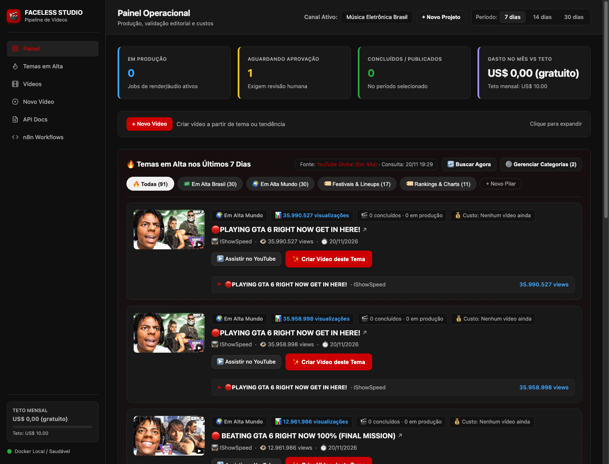
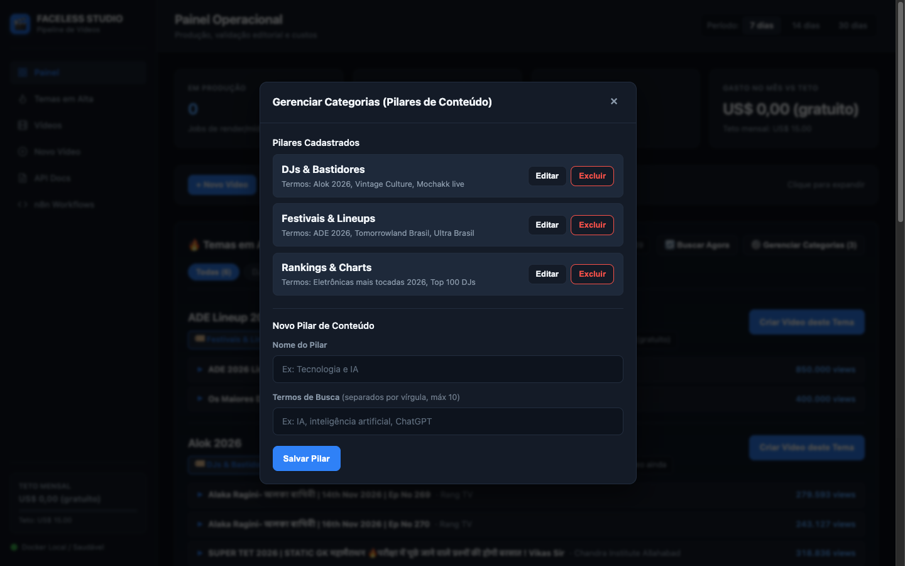
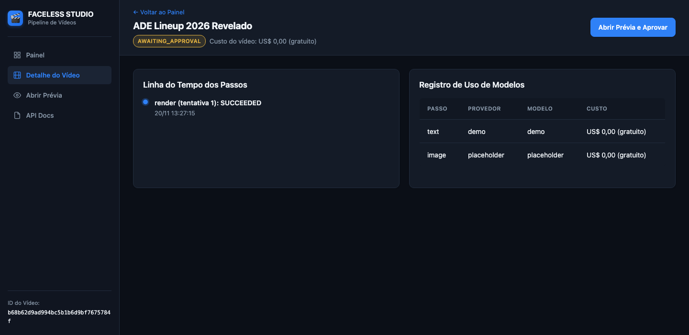

# 18. Painel do Faceless Studio (Guia do Operador)

O painel do Faceless Studio é a interface visual para acompanhar a produção de vídeos, inspecionar custos reais, verificar o progresso das etapas e abrir prévias para aprovação humana, sem precisar interagir com IDs manuais ou nós do n8n.

## Como Acessar

- **Endereço:** `http://localhost:8000/studio/panel`
- **Ambientes:** Funciona da mesma forma no macOS e no Windows (Docker Desktop / WSL2).
- **Autenticação:** O navegador solicita usuário e senha (HTTP Basic Auth). Use os valores configurados nas variáveis de ambiente:
  - `STUDIO_BROWSER_USER`
  - `STUDIO_BROWSER_PASSWORD`
  *(Veja `docs/17-studio-auth.md` para detalhes de provisionamento).*

## O que a Tela Apresenta

### 1. Seletor Global de Canal/Projeto e Cadastro Rápido
- **Seletor no Cabeçalho (Topbar):** Dropdown global com todos os projetos cadastrados (`project_id`), permitindo alternar instantaneamente o contexto da esteira e das métricas sem sair da página.
- **Cadastro In-Page de Novo Projeto:**
  - O seletor inclui a opção `+ Novo Projeto...`, que abre um modal ágil na própria tela.
  - O modal envia requisição `POST /studio/projects` via fetch com nome do canal e teto de gastos mensal (`monthly_budget_usd`).
  - Ao salvar com sucesso, o novo projeto é selecionado automaticamente e o painel recarrega seus dados limpos.

### 2. Esteira de Produção (Workflow Pipeline Funnel)
- Cards visuais de funil destacam a evolução dos vídeos pelas etapas do workflow:
  - **Na Fila / Pendente:** Vídeos criados aguardando processamento.
  - **Em Produção:** Roteiro, imagens, áudio ou renderização FFmpeg em andamento.
  - **Aguardando Aprovação:** Vídeos renderizados prontos para inspeção humana.
  - **Aprovados:** Vídeos aprovados pelo operador, aguardando agendamento/publicação.
  - **Concluídos:** Vídeos publicados no YouTube com sucesso no período.
  - **Atenção / Falhas:** Casos de falha ou rejeição que requerem intervenção.
- Cada estágio exibe contagem ativa, badge de status e atalho de visualização rápida.

### 3. Resumo Operacional e Teto Orçamentário
- **Custo no Mês vs Teto:** Soma dos custos conhecidos de IA no mês corrente em comparação ao teto do projeto ativo (padrão US$ 15,00), com barra de progresso visual de consumo do orçamento.
- **Status do Pipeline:** Indicadores consolidados do volume de produção atual.

### 4. Filtro de Período
- Links rápidos no cabeçalho: **7 dias** (padrão), **14 dias** e **30 dias**. Funciona via parâmetro de URL (`?days=7`), mantendo o estado limpo e direto.

### 5. Cards de Vídeos e Temas (Visual Moderno)
- Vídeos com variações do mesmo assunto são agrupados pela chave normalizada do tema.
- **Cards e Linhas Modernizadas:** Apresentam formato do vídeo (`short` vertical ou `long` horizontal), badge de status de pipeline colorido no padrão YouTube Studio, estimativa de custos de IA e ações diretas:
  - **Ver Prévia:** Abre a página unificada `/studio/videos/{id}/preview` com player de vídeo, legendas, checagem de fatos e os botões de aprovar/rejeitar vinculados atomicamente ao render visualizado.
  - **Ver Progresso:** Abre `/studio/panel/videos/{id}` para ver a linha do tempo de execução dos passos.

### 6. Criando Vídeos pelo Painel
- Clique no botão **+ Novo Vídeo** para expandir o formulário.
- Selecione o projeto (pré-seleciona o projeto ativo), digite o tema (3 a 300 caracteres) e escolha o formato (`short` vertical ou `long` horizontal).
- O envio cria o registro na API (`POST /studio/videos`) e recarrega a lista.

### 7. Tela de Detalhe e Progresso (`/studio/panel/videos/{id}`)
- **Linha do Tempo dos Passos:** Exibe cada execução de passo (`script`, `storyboard`, `render`), o status (`SUCCEEDED`, `FAILED`), a data/hora e o erro detalhado se houver.
- **Auditoria de Custos:** Lista todas as chamadas de IA registradas para o vídeo (passo, provedor, modelo e custo em dólares).
- **Publicação:** Exibe o status da tentativa de upload e eventuais mensagens de erro de rede.

### 8. Radar de Temas em Alta Compacto com Expansão Interativa
- **Origem dos Dados:** Ingestão diária de tópicos e evidências da YouTube Data API v3 (workflow `05-trends-daily.json`) ou coleta sob demanda acionada diretamente no painel. O radar unifica tendências de **Em Alta Brasil**, **Em Alta Mundo** (`chart=mostPopular`) e buscas temáticas por pilares de conteúdo.
- **Layout Compacto e Despoluído:**
  - O radar inicia exibindo os principais tópicos em destaque para evitar sobrecarga cognitiva e rolagem excessiva.
  - Um botão interativo **"Mostrar mais tendências" / "Mostrar menos"** permite alternar suavemente a visualização entre o modo compacto e a lista completa de evidências.
- **Pílulas de Filtro (Estilo Oficial do YouTube):**
  - Barra de pílulas arredondadas (*chips/pills*) com visual fiel ao YouTube: **🔥 Todas (N)**, atalhos rápidos de região **🇧🇷 Em Alta Brasil (N)** e **🌍 Em Alta Mundo (N)**, cada pilar de categoria com seu contador e o botão de atalho **+ Novo Pilar**.
  - O clique em uma pílula filtra os tópicos na tela instantaneamente via JavaScript (sem recarregar a página), destacando apenas os temas correspondentes.
- **Cards de Tendência no Estilo YouTube Dark:**
  - **Miniaturas 16:9:** Exibição da thumbnail oficial do vídeo (`hqdefault.jpg`) com proporção 16:9, cantos arredondados e overlay de play (`▶`) ao passar o mouse.
  - **Links Diretos para o YouTube:** Links para assistir ao vídeo oficial tanto clicando na miniatura, no título (com ícone `↗`) quanto pelo botão de ação `▶ Assistir no YouTube` (abertura segura com `target="_blank"` e `rel="noopener noreferrer"`).
  - **Badges e Metadados:** Badges com destaque de região (`🇧🇷 Em Alta Brasil` / `🌍 Em Alta Mundo`), visualizações formatadas (`📊 X.XXX.XXX visualizações`), status dos vídeos no pipeline (`🎬 N concluídos · M em produção`) e custo acumulado. Abaixo do título, exibe o nome do canal (`📺`), contagem de views e data de publicação.
  - **Evidências:** Painel expansível com detalhes das evidências e contagem de views individuais.
- **Ações Rápidas e Interatividade:**
  - **🔄 Buscar Agora:** Dispara atualização sob demanda via YouTube Data API v3 (`POST /studio/projects/{id}/trends/refresh`), trazendo vídeos em alta e métricas recentes com spinner animado e desativação contra cliques duplos.
  - **⚙️ Gerenciar Categorias:** Abre o modal de gerenciamento de pilares para cadastrar novos pilares, ajustar termos de busca curados (até 10 por pilar) ou remover pilares existentes.
- **Criar Vídeo deste Tema:**
  - O botão `✨ Criar Vídeo deste Tema` preenche automaticamente o campo de tema no formulário `+ Novo Vídeo`, abre o formulário e realiza rolagem suave com foco imediato no campo de tema.
- **Verificabilidade e Status:**
  - Cada tema exibe a fonte oficial, link direto e data/hora da consulta.
  - Alerta de `Desatualizado` quando a última consulta for mais antiga que a janela do filtro.

### 9. Gerenciamento de Pilares de Conteúdo (Modal)
- O modal permite definir os eixos editoriais estratégicos do canal.
- Cada pilar possui um nome (1 a 100 caracteres) e até 10 termos curados de busca separados por vírgula.
- Permite criar, editar e excluir pilares mantendo a integridade dos tópicos já vinculados.

### 10. Tela de Prévia com Menu Lateral Unificado (`/studio/videos/{id}/preview`)
- **Layout Consistente com o Painel:** A tela de prévia não quebra mais o contexto visual do operador: ela mantém a mesma barra de navegação lateral (Painel, Temas em Alta, Vídeos, + Novo Vídeo, API Docs, n8n), seletor de canais e card de orçamento mensal.
- **Área de Inspeção Centralizada:**
  - Player de vídeo com suporte a legendas sincronizadas (`.vtt`).
  - Painel de metadados: título, descrição, tags e verificação de checagem de fatos (QA).
  - Ações atômicas de aprovação e rejeição vinculadas ao ID exato do render em exibição.

## Política de Custo Honesto
- Quando todos os modelos usados forem comprovadamente gratuitos (ex.: `:free`, placeholders ou síntese local Piper TTS), o painel exibe `US$ 0,00 (gratuito)`.
- Se houver modelos pagos cujo custo não foi informado pelo provedor, o painel **nunca** exibe zero falso. Ele informa claramente: `US$ X,XX + N chamadas sem custo informado`.
- Se nenhum passo de IA tiver sido executado ainda, exibe `sem registro de uso`.

## Segurança e Limitações
- **Proteção contra XSS:** Todo texto de tema, título e mensagens de erro é estritamente escapado em HTML.
- **Content Security Policy (CSP):** A página usa CSP estrita protegida por `nonce` aleatório a cada requisição, sem `unsafe-inline` e com `Cache-Control: no-store`.
- **Segredos protegidos:** A URL temporária de upload do YouTube (`upload_uri`), tokens de autenticação e caminhos internos do sistema de arquivos nunca são enviados nem exibidos no painel.
- **Aprovação atômica:** O painel apenas visualiza o estado; a decisão formal de aprovação ocorre na tela de prévia, que envia o ID do render inspecionado para validação atômica no banco de dados.

## Interface, Paleta YouTube Studio e Navegação Unificada

O painel e a tela de prévia utilizam a paleta neutra e profissional do **YouTube Studio Dark**:
- **Fundo do Sistema (`--bg-primary`):** `#0f0f0f` (preto neutro cinematográfico, sem tons azulados frios).
- **Cards e Superfícies (`--bg-surface`):** `#181818` para cards de destaque e `#222222` para sub-cards e áreas elevadas.
- **Bordas e Divisores (`--border-color`):** `#272727` suave e de alto contraste.
- **Destaques e Acentos (`--accent-blue` / `--accent-hover`):** `#3ea6ff` e `#65b8ff` (azul clássico do YouTube Studio).
- **Tipografia:** `#f1f1f1` para texto primário e `#aaaaaa` para metadados e legendas secundárias.

### Navegação e Menu Lateral Unificado
O menu lateral fixo (Painel, Temas em Alta, Vídeos, Novo Vídeo, API Docs, n8n) e o cabeçalho com o seletor global de canais permanecem presentes e consistentes tanto no `/studio/panel` quanto na página `/studio/videos/{id}/preview`. Isso garante transições sem quebra de contexto visual e permite ao operador inspecionar renders sem perder a navegação geral da aplicação.

A CSP libera `<style>` e `<script>` só com nonce; atributos `style=""` são permitidos
(`style-src-attr`) por serem apenas de apresentação, com todo texto escapado.
