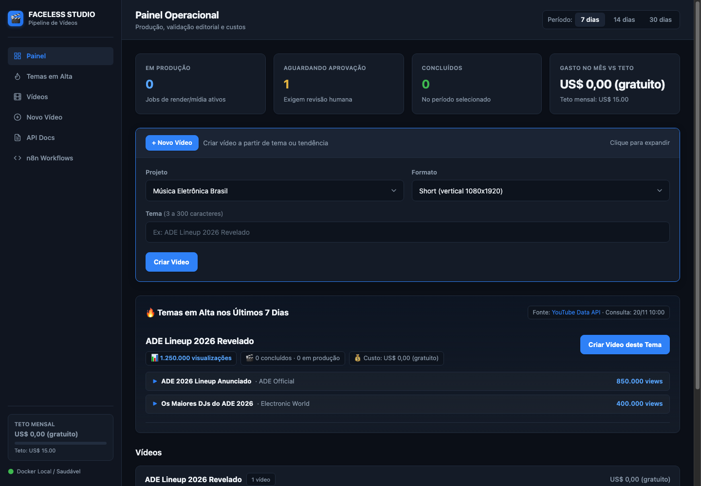
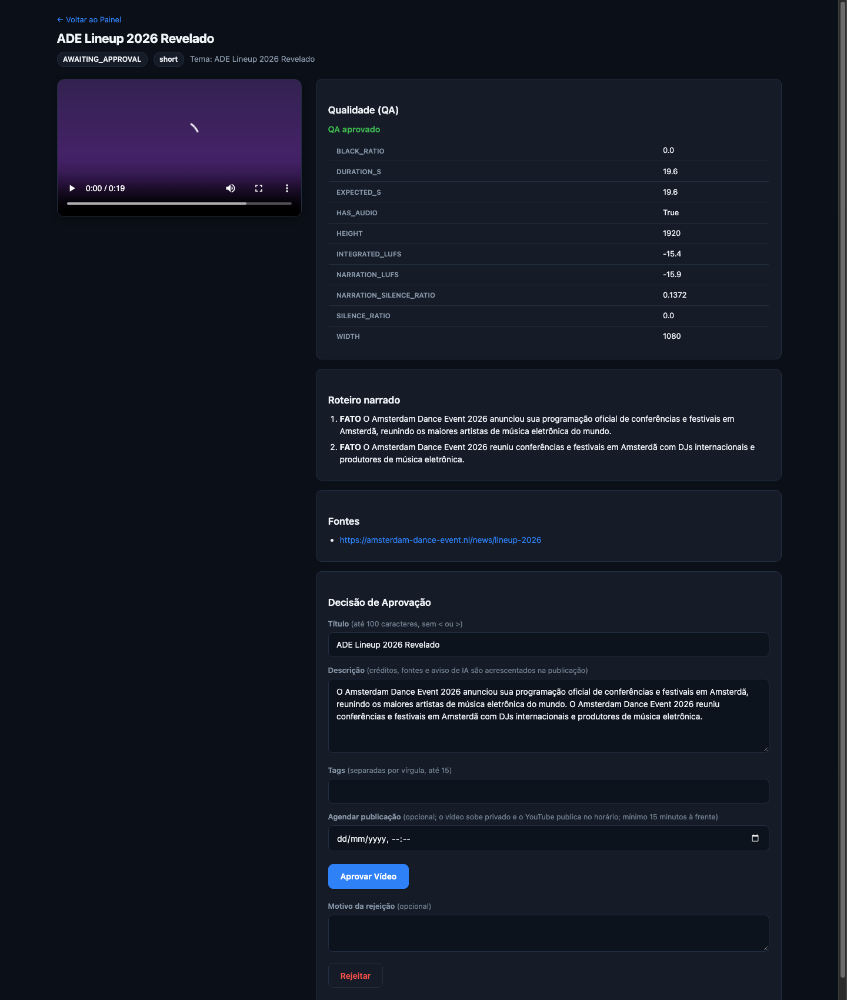

# 18. Painel do Faceless Studio (Guia do Operador)

O painel do Faceless Studio é a interface visual para acompanhar a produção de vídeos, inspecionar custos reais, verificar o progresso das etapas e abrir prévias para aprovação humana, sem precisar interagir com IDs manuais ou nós do n8n.

## Como Acessar

- **Endereço:** `http://localhost:8000/studio/panel`
- **Ambientes:** Funciona da mesma forma no macOS e no Windows (Docker Desktop / WSL2).
- **Autenticação:** O navegador solicita usuário e senha (HTTP Basic Auth). Use os valores configurados nas variáveis de ambiente:
  - `STUDIO_BROWSER_USER`
  - `STUDIO_BROWSER_PASSWORD`
  *(Veja `docs/17-studio-auth.md` para detalhes de provisionamento).*

## O que a Tela Apresenta

### 1. Resumo Operacional
- **Em Produção:** Contagem de vídeos com jobs de renderização ou passos de IA em execução.
- **Aguardando Aprovação:** Vídeos que já foram renderizados e estão prontos para inspeção humana.
- **Concluídos:** Vídeos aprovados ou já publicados no YouTube no período.
- **Custo no Mês vs Teto:** Soma dos custos conhecidos de IA no mês corrente em comparação ao teto do projeto (padrão US$ 15,00).

### 2. Filtro de Período
- Links rápidos no cabeçalho: **7 dias** (padrão), **14 dias** e **30 dias**. Funciona via parâmetro de URL (`?days=7`), sem depender de JavaScript.

### 3. Tabela de Vídeos e Temas
- Vídeos com variações do mesmo assunto são agrupados automaticamente pela chave normalizada do tema.
- **Etapas observáveis:**
  - `PENDING`: Vídeo criado, aguardando início dos passos.
  - `IN_PRODUCTION`: Roteiro, imagens, áudio ou renderização FFmpeg em andamento.
  - `AWAITING_APPROVAL`: Render concluído com QA aprovado (ou reprovado), pronto para revisão humana.
  - `APPROVED`: Aprovado pelo operador, aguardando publicação pelo n8n.
  - `COMPLETED`: Publicado com sucesso no YouTube.
  - `FAILED`: Falha em algum passo ou na publicação.
  - `REJECTED`: Rejeitado formalmente pelo operador.
- **Ações disponíveis por linha:**
  - **Ver Prévia:** Abre a página `/studio/videos/{id}/preview` com player de vídeo, legendas, checagem de fatos e os botões de aprovar/rejeitar vinculados atomicamente ao render visualizado.
  - **Ver Progresso:** Abre `/studio/panel/videos/{id}` para ver a linha do tempo de execução dos passos.

### 4. Criando Vídeos pelo Painel
- Clique no botão **+ Novo Vídeo** para expandir o formulário.
- Selecione o projeto, digite o tema (3 a 300 caracteres) e escolha o formato (`short` vertical ou `long` horizontal).
- O envio cria o registro na API (`POST /studio/videos`) e recarrega a lista.

### 5. Tela de Detalhe e Progresso (`/studio/panel/videos/{id}`)
- **Linha do Tempo dos Passos:** Exibe cada execução de passo (`script`, `storyboard`, `render`), o status (`SUCCEEDED`, `FAILED`), a data/hora e o erro detalhado se houver.
- **Auditoria de Custos:** Lista todas as chamadas de IA registradas para o vídeo (passo, provedor, modelo e custo em dólares).
- **Publicação:** Exibe o status da tentativa de upload e eventuais mensagens de erro de rede.

### 6. Seção de Temas em Alta (Fase B)
- **Origem dos Dados:** Ingestão diária de tópicos e evidências da YouTube Data API v3 (workflow `05-trends-daily.json`).
- **Verificabilidade:** Cada tema exibe a fonte oficial (`YouTube Data API`), o link direto, a data/hora da consulta e as visualizações agregadas dos principais vídeos da janela.
- **Status do Período:**
  - Se a consulta estiver dentro da janela do filtro, exibe os tópicos normalmente.
  - Se a última consulta for mais antiga que o filtro, exibe a etiqueta `Desatualizado`.
  - Se ainda não houve ingestão, exibe `Ainda não há coleta de tendências registrada para o período selecionado.` (sem inventar dados).
- **Criar Vídeo deste Tema:**
  - O botão preenche automaticamente o campo de tema no formulário `+ Novo Vídeo` e abre o formulário para o operador revisar o projeto e formato antes de criar.

## Política de Custo Honesto
- Quando todos os modelos usados forem comprovadamente gratuitos (ex.: `:free`, placeholders ou síntese local Piper TTS), o painel exibe `US$ 0,00 (gratuito)`.
- Se houver modelos pagos cujo custo não foi informado pelo provedor, o painel **nunca** exibe zero falso. Ele informa claramente: `US$ X,XX + N chamadas sem custo informado`.
- Se nenhum passo de IA tiver sido executado ainda, exibe `sem registro de uso`.

## Segurança e Limitações
- **Proteção contra XSS:** Todo texto de tema, título e mensagens de erro é estritamente escapado em HTML.
- **Content Security Policy (CSP):** A página usa CSP estrita protegida por `nonce` aleatório a cada requisição, sem `unsafe-inline` e com `Cache-Control: no-store`.
- **Segredos protegidos:** A URL temporária de upload do YouTube (`upload_uri`), tokens de autenticação e caminhos internos do sistema de arquivos nunca são enviados nem exibidos no painel.
- **Aprovação atômica:** O painel apenas visualiza o estado; a decisão formal de aprovação ocorre na tela de prévia, que envia o ID do render inspecionado para validação atômica no banco de dados.

## Interface (menu lateral)

O painel usa menu lateral fixo (Painel, Temas em Alta, Vídeos, Novo Vídeo, API Docs, n8n),
barra superior com o filtro de período e o card do teto mensal no rodapé do menu. Os campos
de formulário (inputs, selects, textareas) têm estilo próprio, com foco visível. O tema segue
o modo claro/escuro do sistema. A prévia de aprovação usa o mesmo visual.

A CSP libera `<style>` e `<script>` só com nonce; atributos `style=""` são permitidos
(`style-src-attr`) por serem apenas de apresentação, com todo texto escapado.
