# Modelo de dados (gerado)

> Gerado por `scripts/export_schema.py`. Não edite à mão.
> Fonte: `renderer/app/studio/adapters/postgres/migrations/` — 48 migrações
> (`0001_init` … `0053_usage_ledger_category`).
> DDL consolidado e executável: `docs/schema/studio.sql`.
> As colunas, chaves e índices abaixo vêm da **introspecção do banco real** após aplicar
> as migrações — não de leitura de texto —, para não documentar algo que o banco não tem.

## Visão geral

- Tabelas: **54**
- Chaves estrangeiras: **74**
- Índices: **117**

## Diagrama de relacionamentos

Cada seta é uma chave estrangeira. `||` = exatamente um; `o{` = zero ou mais
(coluna anulável); `|{` = um ou mais (coluna obrigatória).

```mermaid
erDiagram
    analytics_experiment_variants {
        text experiment_id PK,FK
        text variant_id PK
    }
    analytics_experiments {
        text experiment_id PK
        text project_id FK
        text video_id FK
    }
    analytics_recommendation_decisions {
        text recommendation_id PK
        text project_id FK
    }
    approval_history {
        text id PK
        text video_id FK
        text output_asset_id FK
    }
    approvals {
        text video_id PK,FK
        text output_asset_id FK
    }
    assets {
        text id PK
    }
    budget_reservations {
        text idempotency_key PK
        text video_id FK
        text project_id FK
    }
    byok_key_audit {
        bigint id PK
        text organization_id FK
        text key_id FK
        text actor_user_id FK
    }
    byok_keys {
        text id PK
        text organization_id FK
        text created_by FK
    }
    channel_authorizations {
        text grant_id PK,FK
        text youtube_channel_id PK,FK
    }
    channel_budgets {
        text project_id PK,FK
    }
    channel_creation_requests {
        text idempotency_key PK
        text project_id FK
    }
    channel_profile_revisions {
        text profile_id PK,FK
        integer version PK
    }
    channel_profiles {
        text id PK
        text project_id FK
        text style_id FK
        text youtube_channel_id FK
    }
    channel_youtube_channels {
        text project_id PK,FK
    }
    fact_checks {
        text id PK
        text video_id FK
    }
    google_accounts {
        text id PK
    }
    membership_audit {
        bigint id PK
        text organization_id FK
        text actor_user_id FK
    }
    memberships {
        text id PK
        text organization_id FK
        text user_id FK
    }
    metric_observations {
        text observation_id PK
        text project_id FK
        text video_id FK
        text pillar_id FK
        integer script_version FK
        text publication_id FK
        text experiment_id FK
        text variant_id FK
    }
    oauth_grants {
        text id PK
        text account_id FK
    }
    organizations {
        text id PK
    }
    paid_operations {
        text idempotency_key PK
        text video_id FK
        bigint ledger_id FK
        text project_id FK
    }
    plan_artifacts {
        text content_sha256 PK
        text location PK
    }
    production_outbox {
        bigint id PK
        text run_id FK
    }
    production_runs {
        text run_id PK
        text video_id FK
        text channel_id FK
    }
    project_categories {
        text id PK
        text project_id FK
    }
    projects {
        text id PK
        text organization_id FK
    }
    publication_intents {
        text video_id PK,FK
        text output_asset_id FK
    }
    publications {
        text id PK
        text video_id FK
    }
    render_cache_entries {
        text plan_id PK,FK
        integer revision FK
        text node_kind PK
        text node_key PK
        text fingerprint PK
    }
    render_jobs {
        text id PK
        text video_id FK
        text output_asset_id FK
    }
    render_plans {
        text plan_id PK
        integer revision PK
        text video_id FK
    }
    saved_trends {
        text project_id PK
        text video_id PK
    }
    scene_assets {
        uuid id PK
        character_varying_64_ scene_id FK
        character_varying_64_ asset_id FK
    }
    scene_revisions {
        text video_id PK,FK
        integer version PK,FK
        text scene_id PK
    }
    scenes {
        text id PK
        text video_id FK
        text asset_id FK
    }
    schema_migrations {
        text version PK
    }
    script_approvals {
        text video_id PK,FK
        integer version PK,FK
    }
    script_edit_requests {
        text video_id PK,FK
        text idempotency_key PK
    }
    script_plans {
        text video_id PK,FK
        integer version PK,FK
    }
    scripts {
        text id PK
        text video_id FK
    }
    source_snapshots {
        text id PK
        text video_id FK
    }
    stage_executions {
        text run_id PK,FK
        text stage_id PK
    }
    step_runs {
        text id PK
        text video_id FK
    }
    trend_topics {
        text id PK
        text project_id FK
        text category_id FK
    }
    usage_ledger {
        bigint id PK
        text video_id FK
        text organization_id FK
        text member_id FK
        text project_id FK
    }
    users {
        text id PK
    }
    video_metrics {
        text video_id PK,FK
        date date PK
    }
    videos {
        text id PK
        text project_id FK
        text style_id FK
    }
    visual_style_revisions {
        text style_id PK,FK
        integer version PK
    }
    visual_styles {
        text id PK
    }
    workspaces {
        text id PK
        text organization_id FK
    }
    youtube_channels {
        text youtube_channel_id PK
    }
    analytics_experiments ||--|{ analytics_experiment_variants : "analytics_experiment_variants_experiment_id_fkey"
    projects ||--|{ analytics_experiments : "analytics_experiments_project_id_fkey"
    videos ||--|{ analytics_experiments : "analytics_experiments_video_id_fkey"
    projects ||--|{ analytics_recommendation_decisions : "analytics_recommendation_decisions_project_id_fkey"
    assets ||--o{ approval_history : "approval_history_output_asset_id_fkey"
    videos ||--|{ approval_history : "approval_history_video_id_fkey"
    assets ||--o{ approvals : "approvals_output_asset_id_fkey"
    videos ||--|{ approvals : "approvals_video_id_fkey"
    projects ||--o{ budget_reservations : "budget_reservations_project_id_fkey"
    videos ||--o{ budget_reservations : "budget_reservations_video_id_fkey"
    users ||--o{ byok_key_audit : "byok_key_audit_actor_user_id_fkey"
    byok_keys ||--|{ byok_key_audit : "byok_key_audit_key_id_fkey"
    organizations ||--|{ byok_key_audit : "byok_key_audit_organization_id_fkey"
    users ||--o{ byok_keys : "byok_keys_created_by_fkey"
    organizations ||--|{ byok_keys : "byok_keys_organization_id_fkey"
    oauth_grants ||--|{ channel_authorizations : "channel_authorizations_grant_id_fkey"
    youtube_channels ||--|{ channel_authorizations : "channel_authorizations_youtube_channel_id_fkey"
    projects ||--|{ channel_budgets : "channel_budgets_project_id_fkey"
    projects ||--|{ channel_creation_requests : "channel_creation_requests_project_id_fkey"
    channel_profiles ||--|{ channel_profile_revisions : "channel_profile_revisions_profile_id_fkey"
    projects ||--|{ channel_profiles : "channel_profiles_project_id_fkey"
    visual_styles ||--o{ channel_profiles : "channel_profiles_style_id_fkey"
    youtube_channels ||--o{ channel_profiles : "channel_profiles_youtube_channel_id_fkey"
    projects ||--|{ channel_youtube_channels : "channel_youtube_channels_project_id_fkey"
    videos ||--|{ fact_checks : "fact_checks_video_id_fkey"
    users ||--o{ membership_audit : "membership_audit_actor_user_id_fkey"
    organizations ||--|{ membership_audit : "membership_audit_organization_id_fkey"
    organizations ||--|{ memberships : "memberships_organization_id_fkey"
    users ||--|{ memberships : "memberships_user_id_fkey"
    analytics_experiment_variants ||--o{ metric_observations : "metric_observations_experiment_variant_fk"
    project_categories ||--o{ metric_observations : "metric_observations_pillar_id_fkey"
    projects ||--|{ metric_observations : "metric_observations_project_id_fkey"
    publications ||--o{ metric_observations : "metric_observations_publication_id_fkey"
    scripts ||--o{ metric_observations : "metric_observations_script_version_fk"
    videos ||--|{ metric_observations : "metric_observations_video_id_fkey"
    google_accounts ||--|{ oauth_grants : "oauth_grants_account_id_fkey"
    usage_ledger ||--o{ paid_operations : "paid_operations_ledger_id_fkey"
    projects ||--o{ paid_operations : "paid_operations_project_id_fkey"
    videos ||--o{ paid_operations : "paid_operations_video_id_fkey"
    production_runs ||--|{ production_outbox : "production_outbox_run_id_fkey"
    channel_profiles ||--o{ production_runs : "production_runs_channel_id_fkey"
    videos ||--|{ production_runs : "production_runs_video_id_fkey"
    projects ||--|{ project_categories : "project_categories_project_id_fkey"
    organizations ||--o{ projects : "projects_organization_id_fkey"
    assets ||--|{ publication_intents : "publication_intents_output_asset_id_fkey"
    videos ||--|{ publication_intents : "publication_intents_video_id_fkey"
    videos ||--|{ publications : "publications_video_id_fkey"
    render_plans ||--|{ render_cache_entries : "render_cache_entries_plan_id_revision_fkey"
    assets ||--o{ render_jobs : "render_jobs_output_asset_id_fkey"
    videos ||--|{ render_jobs : "render_jobs_video_id_fkey"
    videos ||--|{ render_plans : "render_plans_video_id_fkey"
    assets ||--o{ scene_assets : "scene_assets_asset_id_fkey"
    scenes ||--|{ scene_assets : "scene_assets_scene_id_fkey"
    scripts ||--|{ scene_revisions : "scene_revisions_video_id_version_fkey"
    assets ||--o{ scenes : "scenes_asset_id_fkey"
    videos ||--|{ scenes : "scenes_video_id_fkey"
    scripts ||--|{ script_approvals : "script_approvals_video_id_version_fkey"
    videos ||--|{ script_edit_requests : "script_edit_requests_video_id_fkey"
    scripts ||--|{ script_plans : "script_plans_video_id_version_fkey"
    videos ||--|{ scripts : "scripts_video_id_fkey"
    videos ||--o{ source_snapshots : "source_snapshots_video_id_fkey"
    production_runs ||--|{ stage_executions : "stage_executions_run_id_fkey"
    videos ||--|{ step_runs : "step_runs_video_id_fkey"
    project_categories ||--o{ trend_topics : "trend_topics_category_id_fkey"
    projects ||--|{ trend_topics : "trend_topics_project_id_fkey"
    users ||--o{ usage_ledger : "usage_ledger_member_id_fkey"
    organizations ||--o{ usage_ledger : "usage_ledger_organization_id_fkey"
    projects ||--o{ usage_ledger : "usage_ledger_project_id_fkey"
    videos ||--o{ usage_ledger : "usage_ledger_video_id_fkey"
    videos ||--|{ video_metrics : "video_metrics_video_id_fkey"
    projects ||--|{ videos : "videos_project_id_fkey"
    visual_styles ||--o{ videos : "videos_style_id_fkey"
    visual_styles ||--|{ visual_style_revisions : "visual_style_revisions_style_id_fkey"
    organizations ||--|{ workspaces : "workspaces_organization_id_fkey"
```



## Relações (chaves estrangeiras)

| Filho (colunas) | → | Pai (colunas) | Regra | FK |
| --- | --- | --- | --- | --- |
| `analytics_experiment_variants` (experiment_id) | → | `analytics_experiments` (experiment_id) | obrigatória | `analytics_experiment_variants_experiment_id_fkey` |
| `analytics_experiments` (project_id) | → | `projects` (id) | obrigatória | `analytics_experiments_project_id_fkey` |
| `analytics_experiments` (video_id) | → | `videos` (id) | obrigatória | `analytics_experiments_video_id_fkey` |
| `analytics_recommendation_decisions` (project_id) | → | `projects` (id) | obrigatória | `analytics_recommendation_decisions_project_id_fkey` |
| `approval_history` (output_asset_id) | → | `assets` (id) | opcional | `approval_history_output_asset_id_fkey` |
| `approval_history` (video_id) | → | `videos` (id) | obrigatória | `approval_history_video_id_fkey` |
| `approvals` (output_asset_id) | → | `assets` (id) | opcional | `approvals_output_asset_id_fkey` |
| `approvals` (video_id) | → | `videos` (id) | obrigatória | `approvals_video_id_fkey` |
| `budget_reservations` (project_id) | → | `projects` (id) | opcional | `budget_reservations_project_id_fkey` |
| `budget_reservations` (video_id) | → | `videos` (id) | opcional | `budget_reservations_video_id_fkey` |
| `byok_key_audit` (actor_user_id) | → | `users` (id) | opcional | `byok_key_audit_actor_user_id_fkey` |
| `byok_key_audit` (key_id) | → | `byok_keys` (id) | obrigatória | `byok_key_audit_key_id_fkey` |
| `byok_key_audit` (organization_id) | → | `organizations` (id) | obrigatória | `byok_key_audit_organization_id_fkey` |
| `byok_keys` (created_by) | → | `users` (id) | opcional | `byok_keys_created_by_fkey` |
| `byok_keys` (organization_id) | → | `organizations` (id) | obrigatória | `byok_keys_organization_id_fkey` |
| `channel_authorizations` (grant_id) | → | `oauth_grants` (id) | obrigatória | `channel_authorizations_grant_id_fkey` |
| `channel_authorizations` (youtube_channel_id) | → | `youtube_channels` (youtube_channel_id) | obrigatória | `channel_authorizations_youtube_channel_id_fkey` |
| `channel_budgets` (project_id) | → | `projects` (id) | obrigatória | `channel_budgets_project_id_fkey` |
| `channel_creation_requests` (project_id) | → | `projects` (id) | obrigatória | `channel_creation_requests_project_id_fkey` |
| `channel_profile_revisions` (profile_id) | → | `channel_profiles` (id) | obrigatória | `channel_profile_revisions_profile_id_fkey` |
| `channel_profiles` (project_id) | → | `projects` (id) | obrigatória | `channel_profiles_project_id_fkey` |
| `channel_profiles` (style_id) | → | `visual_styles` (id) | opcional | `channel_profiles_style_id_fkey` |
| `channel_profiles` (youtube_channel_id) | → | `youtube_channels` (youtube_channel_id) | opcional | `channel_profiles_youtube_channel_id_fkey` |
| `channel_youtube_channels` (project_id) | → | `projects` (id) | obrigatória | `channel_youtube_channels_project_id_fkey` |
| `fact_checks` (video_id) | → | `videos` (id) | obrigatória | `fact_checks_video_id_fkey` |
| `membership_audit` (actor_user_id) | → | `users` (id) | opcional | `membership_audit_actor_user_id_fkey` |
| `membership_audit` (organization_id) | → | `organizations` (id) | obrigatória | `membership_audit_organization_id_fkey` |
| `memberships` (organization_id) | → | `organizations` (id) | obrigatória | `memberships_organization_id_fkey` |
| `memberships` (user_id) | → | `users` (id) | obrigatória | `memberships_user_id_fkey` |
| `metric_observations` (experiment_id, variant_id) | → | `analytics_experiment_variants` (experiment_id, variant_id) | opcional | `metric_observations_experiment_variant_fk` |
| `metric_observations` (pillar_id) | → | `project_categories` (id) | opcional | `metric_observations_pillar_id_fkey` |
| `metric_observations` (project_id) | → | `projects` (id) | obrigatória | `metric_observations_project_id_fkey` |
| `metric_observations` (publication_id) | → | `publications` (id) | opcional | `metric_observations_publication_id_fkey` |
| `metric_observations` (video_id, script_version) | → | `scripts` (video_id, version) | opcional | `metric_observations_script_version_fk` |
| `metric_observations` (video_id) | → | `videos` (id) | obrigatória | `metric_observations_video_id_fkey` |
| `oauth_grants` (account_id) | → | `google_accounts` (id) | obrigatória | `oauth_grants_account_id_fkey` |
| `paid_operations` (ledger_id) | → | `usage_ledger` (id) | opcional | `paid_operations_ledger_id_fkey` |
| `paid_operations` (project_id) | → | `projects` (id) | opcional | `paid_operations_project_id_fkey` |
| `paid_operations` (video_id) | → | `videos` (id) | opcional | `paid_operations_video_id_fkey` |
| `production_outbox` (run_id) | → | `production_runs` (run_id) | obrigatória | `production_outbox_run_id_fkey` |
| `production_runs` (channel_id) | → | `channel_profiles` (id) | opcional | `production_runs_channel_id_fkey` |
| `production_runs` (video_id) | → | `videos` (id) | obrigatória | `production_runs_video_id_fkey` |
| `project_categories` (project_id) | → | `projects` (id) | obrigatória | `project_categories_project_id_fkey` |
| `projects` (organization_id) | → | `organizations` (id) | opcional | `projects_organization_id_fkey` |
| `publication_intents` (output_asset_id) | → | `assets` (id) | obrigatória | `publication_intents_output_asset_id_fkey` |
| `publication_intents` (video_id) | → | `videos` (id) | obrigatória | `publication_intents_video_id_fkey` |
| `publications` (video_id) | → | `videos` (id) | obrigatória | `publications_video_id_fkey` |
| `render_cache_entries` (plan_id, revision) | → | `render_plans` (plan_id, revision) | obrigatória | `render_cache_entries_plan_id_revision_fkey` |
| `render_jobs` (output_asset_id) | → | `assets` (id) | opcional | `render_jobs_output_asset_id_fkey` |
| `render_jobs` (video_id) | → | `videos` (id) | obrigatória | `render_jobs_video_id_fkey` |
| `render_plans` (video_id) | → | `videos` (id) | obrigatória | `render_plans_video_id_fkey` |
| `scene_assets` (asset_id) | → | `assets` (id) | opcional | `scene_assets_asset_id_fkey` |
| `scene_assets` (scene_id) | → | `scenes` (id) | obrigatória | `scene_assets_scene_id_fkey` |
| `scene_revisions` (video_id, version) | → | `scripts` (video_id, version) | obrigatória | `scene_revisions_video_id_version_fkey` |
| `scenes` (asset_id) | → | `assets` (id) | opcional | `scenes_asset_id_fkey` |
| `scenes` (video_id) | → | `videos` (id) | obrigatória | `scenes_video_id_fkey` |
| `script_approvals` (video_id, version) | → | `scripts` (video_id, version) | obrigatória | `script_approvals_video_id_version_fkey` |
| `script_edit_requests` (video_id) | → | `videos` (id) | obrigatória | `script_edit_requests_video_id_fkey` |
| `script_plans` (video_id, version) | → | `scripts` (video_id, version) | obrigatória | `script_plans_video_id_version_fkey` |
| `scripts` (video_id) | → | `videos` (id) | obrigatória | `scripts_video_id_fkey` |
| `source_snapshots` (video_id) | → | `videos` (id) | opcional | `source_snapshots_video_id_fkey` |
| `stage_executions` (run_id) | → | `production_runs` (run_id) | obrigatória | `stage_executions_run_id_fkey` |
| `step_runs` (video_id) | → | `videos` (id) | obrigatória | `step_runs_video_id_fkey` |
| `trend_topics` (category_id) | → | `project_categories` (id) | opcional | `trend_topics_category_id_fkey` |
| `trend_topics` (project_id) | → | `projects` (id) | obrigatória | `trend_topics_project_id_fkey` |
| `usage_ledger` (member_id) | → | `users` (id) | opcional | `usage_ledger_member_id_fkey` |
| `usage_ledger` (organization_id) | → | `organizations` (id) | opcional | `usage_ledger_organization_id_fkey` |
| `usage_ledger` (project_id) | → | `projects` (id) | opcional | `usage_ledger_project_id_fkey` |
| `usage_ledger` (video_id) | → | `videos` (id) | opcional | `usage_ledger_video_id_fkey` |
| `video_metrics` (video_id) | → | `videos` (id) | obrigatória | `video_metrics_video_id_fkey` |
| `videos` (project_id) | → | `projects` (id) | obrigatória | `videos_project_id_fkey` |
| `videos` (style_id) | → | `visual_styles` (id) | opcional | `videos_style_id_fkey` |
| `visual_style_revisions` (style_id) | → | `visual_styles` (id) | obrigatória | `visual_style_revisions_style_id_fkey` |
| `workspaces` (organization_id) | → | `organizations` (id) | obrigatória | `workspaces_organization_id_fkey` |

## Tabelas e colunas

### `studio.analytics_experiment_variants`

| Coluna | Tipo | Nulo | Padrão |
| --- | --- | --- | --- |
| `experiment_id` | `text` | não | — |
| `variant_id` | `text` | não | — |
| `label` | `text` | não | — |
| `is_control` | `boolean` | não | `false` |

**Chave primária:** `experiment_id`, `variant_id`

**Restrições:**

- `analytics_experiment_variants_label_check` (check): `CHECK ((btrim(label) <> ''::text))`
- `analytics_experiment_variants_variant_id_check` (check): `CHECK ((btrim(variant_id) <> ''::text))`
- `analytics_experiment_variants_pkey` (PK): `PRIMARY KEY (experiment_id, variant_id)`

**Chaves estrangeiras:**

- `analytics_experiment_variants_experiment_id_fkey`: (experiment_id) → `analytics_experiments` (experiment_id)

**Índices:**

- `analytics_experiment_one_control_idx`: `CREATE UNIQUE INDEX analytics_experiment_one_control_idx ON studio.analytics_experiment_variants USING btree (experiment_id) WHERE is_control`
- `analytics_experiment_variants_pkey`: `CREATE UNIQUE INDEX analytics_experiment_variants_pkey ON studio.analytics_experiment_variants USING btree (experiment_id, variant_id)`

**Migrações que citam esta tabela:** 0026_analytics_learning

### `studio.analytics_experiments`

| Coluna | Tipo | Nulo | Padrão |
| --- | --- | --- | --- |
| `experiment_id` | `text` | não | — |
| `project_id` | `text` | não | — |
| `video_id` | `text` | não | — |
| `kind` | `text` | não | — |
| `status` | `text` | não | — |
| `platform_ab_supported` | `boolean` | não | `false` |
| `platform_note` | `text` | não | — |
| `approved_by` | `text` | não | — |
| `approved_at` | `timestamp with time zone` | não | `now()` |
| `window_start` | `timestamp with time zone` | sim | — |
| `window_end` | `timestamp with time zone` | sim | — |
| `conclusion` | `text` | sim | — |
| `conclusion_confidence` | `text` | sim | — |
| `conclusion_basis` | `text` | sim | — |
| `conclusion_observation_ids` | `text[]` | não | `'{}'::text[]` |
| `concluded_by` | `text` | sim | — |
| `concluded_at` | `timestamp with time zone` | sim | — |
| `created_at` | `timestamp with time zone` | não | `now()` |

**Chave primária:** `experiment_id`

**Restrições:**

- `analytics_experiments_approved_by_check` (check): `CHECK ((btrim(approved_by) <> ''::text))`
- `analytics_experiments_check` (check): `CHECK (((window_start IS NULL) = (window_end IS NULL)))`
- `analytics_experiments_check1` (check): `CHECK (((window_start IS NULL) OR (window_start < window_end)))`
- `analytics_experiments_check2` (check): `CHECK (((status <> ALL (ARRAY['running'::text, 'finished'::text])) OR (window_start IS NOT NULL)))`
- `analytics_experiments_check3` (check): `CHECK (((status <> 'finished'::text) OR ((conclusion IS NOT NULL) AND (conclusion_confidence IS NOT NULL) AND (conclusion_basis IS NOT NULL) AND (concluded_by IS NOT NULL) AND (concluded_at IS NOT NULL) AND (cardinality(conclusion_observation_ids) >= 1))))`
- `analytics_experiments_check4` (check): `CHECK (((status = 'finished'::text) OR (conclusion IS NULL)))`
- `analytics_experiments_conclusion_confidence_check` (check): `CHECK ((conclusion_confidence = ANY (ARRAY['low'::text, 'medium'::text, 'high'::text])))`
- `analytics_experiments_experiment_id_check` (check): `CHECK ((experiment_id ~ '^[0-9a-f]{32}$'::text))`
- `analytics_experiments_kind_check` (check): `CHECK ((kind = ANY (ARRAY['thumbnail'::text, 'title'::text])))`
- `analytics_experiments_platform_ab_supported_check` (check): `CHECK ((platform_ab_supported = false))`
- `analytics_experiments_platform_note_check` (check): `CHECK ((btrim(platform_note) <> ''::text))`
- `analytics_experiments_status_check` (check): `CHECK ((status = ANY (ARRAY['planned'::text, 'running'::text, 'finished'::text, 'abandoned'::text])))`
- `analytics_experiments_pkey` (PK): `PRIMARY KEY (experiment_id)`

**Chaves estrangeiras:**

- `analytics_experiments_project_id_fkey`: (project_id) → `projects` (id)
- `analytics_experiments_video_id_fkey`: (video_id) → `videos` (id)

**Índices:**

- `analytics_experiments_pkey`: `CREATE UNIQUE INDEX analytics_experiments_pkey ON studio.analytics_experiments USING btree (experiment_id)`
- `analytics_experiments_project_created_idx`: `CREATE INDEX analytics_experiments_project_created_idx ON studio.analytics_experiments USING btree (project_id, created_at DESC)`

**Migrações que citam esta tabela:** 0026_analytics_learning

### `studio.analytics_recommendation_decisions`

| Coluna | Tipo | Nulo | Padrão |
| --- | --- | --- | --- |
| `recommendation_id` | `text` | não | — |
| `project_id` | `text` | não | — |
| `decision` | `text` | não | — |
| `decided_by` | `text` | não | — |
| `decided_at` | `timestamp with time zone` | não | `now()` |
| `evidence` | `jsonb` | não | `'[]'::jsonb` |

**Chave primária:** `recommendation_id`

**Restrições:**

- `analytics_recommendation_decisions_decided_by_check` (check): `CHECK ((btrim(decided_by) <> ''::text))`
- `analytics_recommendation_decisions_decision_check` (check): `CHECK ((decision = ANY (ARRAY['accepted_for_review'::text, 'rejected'::text])))`
- `analytics_recommendation_decisions_evidence_check` (check): `CHECK ((jsonb_typeof(evidence) = 'array'::text))`
- `analytics_recommendation_decisions_recommendation_id_check` (check): `CHECK ((recommendation_id ~ '^[0-9a-f]{32}$'::text))`
- `analytics_recommendation_decisions_pkey` (PK): `PRIMARY KEY (recommendation_id)`

**Chaves estrangeiras:**

- `analytics_recommendation_decisions_project_id_fkey`: (project_id) → `projects` (id)

**Índices:**

- `analytics_recommendation_decisions_pkey`: `CREATE UNIQUE INDEX analytics_recommendation_decisions_pkey ON studio.analytics_recommendation_decisions USING btree (recommendation_id)`
- `analytics_recommendation_decisions_project_idx`: `CREATE INDEX analytics_recommendation_decisions_project_idx ON studio.analytics_recommendation_decisions USING btree (project_id, decided_at DESC)`

**Migrações que citam esta tabela:** 0026_analytics_learning

### `studio.approval_history`

| Coluna | Tipo | Nulo | Padrão |
| --- | --- | --- | --- |
| `id` | `text` | não | — |
| `video_id` | `text` | não | — |
| `previous_status` | `text` | não | — |
| `decision` | `text` | sim | — |
| `reason` | `text` | não | `''::text` |
| `qa_override` | `boolean` | não | `false` |
| `publish_at` | `timestamp with time zone` | sim | — |
| `output_asset_id` | `text` | sim | — |
| `render_id` | `text` | sim | — |
| `media_checksum` | `text` | sim | — |
| `qa_passed` | `boolean` | sim | — |
| `intent_qa_override` | `boolean` | sim | — |
| `visibility` | `text` | sim | — |
| `public_confirmed` | `boolean` | sim | — |
| `idempotency_key` | `text` | sim | — |
| `qa_report` | `jsonb` | sim | — |
| `approved_at` | `timestamp with time zone` | sim | — |
| `archived_at` | `timestamp with time zone` | não | `now()` |
| `archive_reason` | `text` | não | `'reopen_for_editing'::text` |
| `youtube_channel_id` | `text` | sim | — |
| `metadata_fingerprint` | `text` | sim | — |

**Chave primária:** `id`

**Restrições:**

- `approval_history_decision_check` (check): `CHECK ((decision = ANY (ARRAY['approved'::text, 'rejected'::text])))`
- `approval_history_id_check` (check): `CHECK ((id ~ '^[0-9a-f]{32}$'::text))`
- `approval_history_media_checksum_check` (check): `CHECK (((media_checksum IS NULL) OR (media_checksum ~ '^[0-9a-f]{64}$'::text)))`
- `approval_history_metadata_fingerprint_check` (check): `CHECK (((metadata_fingerprint IS NULL) OR (metadata_fingerprint ~ '^[0-9a-f]{64}$'::text)))`
- `approval_history_previous_status_check` (check): `CHECK ((previous_status = ANY (ARRAY['APPROVED'::text, 'PUBLISHED'::text])))`
- `approval_history_render_id_check` (check): `CHECK (((render_id IS NULL) OR (render_id ~ '^[0-9a-f]{32}$'::text)))`
- `approval_history_visibility_check` (check): `CHECK (((visibility IS NULL) OR (visibility = ANY (ARRAY['private'::text, 'unlisted'::text, 'public'::text]))))`
- `approval_history_pkey` (PK): `PRIMARY KEY (id)`

**Chaves estrangeiras:**

- `approval_history_output_asset_id_fkey`: (output_asset_id) → `assets` (id)
- `approval_history_video_id_fkey`: (video_id) → `videos` (id)

**Índices:**

- `approval_history_pkey`: `CREATE UNIQUE INDEX approval_history_pkey ON studio.approval_history USING btree (id)`
- `ix_approval_history_video`: `CREATE INDEX ix_approval_history_video ON studio.approval_history USING btree (video_id, archived_at DESC)`

**Migrações que citam esta tabela:** 0043_reopen_approved_video, 0045_publication_intent_destination_metadata

### `studio.approvals`

| Coluna | Tipo | Nulo | Padrão |
| --- | --- | --- | --- |
| `video_id` | `text` | não | — |
| `decision` | `text` | não | — |
| `reason` | `text` | não | `''::text` |
| `qa_override` | `boolean` | não | `false` |
| `publish_at` | `timestamp with time zone` | sim | — |
| `created_at` | `timestamp with time zone` | não | `now()` |
| `output_asset_id` | `text` | sim | — |

**Chave primária:** `video_id`

**Restrições:**

- `approvals_check` (check): `CHECK (((NOT qa_override) OR (reason !~ '^\s*$'::text)))`
- `approvals_decision_check` (check): `CHECK ((decision = ANY (ARRAY['approved'::text, 'rejected'::text])))`
- `approvals_pkey` (PK): `PRIMARY KEY (video_id)`

**Chaves estrangeiras:**

- `approvals_output_asset_id_fkey`: (output_asset_id) → `assets` (id)
- `approvals_video_id_fkey`: (video_id) → `videos` (id)

**Índices:**

- `approvals_pkey`: `CREATE UNIQUE INDEX approvals_pkey ON studio.approvals USING btree (video_id)`

**Migrações que citam esta tabela:** 0007_publish, 0010_approval_render

### `studio.assets`

| Coluna | Tipo | Nulo | Padrão |
| --- | --- | --- | --- |
| `id` | `text` | não | — |
| `kind` | `text` | não | — |
| `cache_key` | `text` | não | — |
| `path` | `text` | não | — |
| `provider` | `text` | não | — |
| `model` | `text` | não | — |
| `license` | `text` | não | — |
| `cost_usd` | `numeric(12,6)` | não | `0` |
| `created_at` | `timestamp with time zone` | não | `now()` |
| `attribution` | `text` | não | `''::text` |
| `source_url` | `text` | não | `''::text` |

**Chave primária:** `id`

**Restrições:**

- `assets_cache_key_check` (check): `CHECK ((cache_key ~ '^[0-9a-f]{64}$'::text))`
- `assets_cost_usd_check` (check): `CHECK ((cost_usd >= (0)::numeric))`
- `assets_id_check` (check): `CHECK ((id ~ '^[0-9a-f]{32}$'::text))`
- `assets_kind_check` (check): `CHECK ((kind = ANY (ARRAY['image'::text, 'voice'::text, 'music'::text, 'clip'::text, 'video'::text, 'thumbnail'::text])))`
- `assets_license_check` (check): `CHECK ((license <> ''::text))`
- `assets_license_nonblank` (check): `CHECK ((license !~ '^\s*$'::text))`
- `assets_pkey` (PK): `PRIMARY KEY (id)`
- `assets_cache_key_key` (único): `UNIQUE (cache_key)`

**Índices:**

- `assets_cache_key_key`: `CREATE UNIQUE INDEX assets_cache_key_key ON studio.assets USING btree (cache_key)`
- `assets_pkey`: `CREATE UNIQUE INDEX assets_pkey ON studio.assets USING btree (id)`

**Migrações que citam esta tabela:** 0001_init, 0004_asset_credits, 0005_license_nonblank, 0006_render, 0010_approval_render, 0028_publication_resilience, 0043_reopen_approved_video, 0046_scene_revisions, 0050_scene_assets

### `studio.budget_reservations`

| Coluna | Tipo | Nulo | Padrão |
| --- | --- | --- | --- |
| `idempotency_key` | `text` | não | — |
| `video_id` | `text` | sim | — |
| `amount_usd` | `numeric` | não | — |
| `monthly_limit_usd` | `numeric` | não | — |
| `video_limit_usd` | `numeric` | não | — |
| `created_at` | `timestamp with time zone` | não | `now()` |
| `project_id` | `text` | sim | — |

**Chave primária:** `idempotency_key`

**Restrições:**

- `budget_reservations_amount_usd_check` (check): `CHECK (((amount_usd >= (0)::numeric) AND (amount_usd < 'Infinity'::numeric)))`
- `budget_reservations_idempotency_key_check` (check): `CHECK ((length(idempotency_key) > 0))`
- `budget_reservations_monthly_limit_usd_check` (check): `CHECK (((monthly_limit_usd >= (0)::numeric) AND (monthly_limit_usd < 'Infinity'::numeric)))`
- `budget_reservations_video_limit_usd_check` (check): `CHECK (((video_limit_usd >= (0)::numeric) AND (video_limit_usd < 'Infinity'::numeric)))`
- `budget_reservations_pkey` (PK): `PRIMARY KEY (idempotency_key)`

**Chaves estrangeiras:**

- `budget_reservations_project_id_fkey`: (project_id) → `projects` (id)
- `budget_reservations_video_id_fkey`: (video_id) → `videos` (id)

**Índices:**

- `budget_reservations_created_at_idx`: `CREATE INDEX budget_reservations_created_at_idx ON studio.budget_reservations USING btree (created_at)`
- `budget_reservations_pkey`: `CREATE UNIQUE INDEX budget_reservations_pkey ON studio.budget_reservations USING btree (idempotency_key)`
- `budget_reservations_project_created_idx`: `CREATE INDEX budget_reservations_project_created_idx ON studio.budget_reservations USING btree (project_id, created_at)`
- `budget_reservations_video_idx`: `CREATE INDEX budget_reservations_video_idx ON studio.budget_reservations USING btree (video_id)`

**Migrações que citam esta tabela:** 0013_budget_reservations, 0017_paid_operations, 0019_ledger_estimate_and_attribution, 0020_paid_operation_attempt_and_budget_indexes, 0038_budget_scope_attribution

### `studio.byok_key_audit`

| Coluna | Tipo | Nulo | Padrão |
| --- | --- | --- | --- |
| `id` | `bigint` | não | `nextval('studio.byok_key_audit_id_seq'::regclass)` |
| `organization_id` | `text` | não | — |
| `key_id` | `text` | não | — |
| `actor_user_id` | `text` | sim | — |
| `action` | `text` | não | — |
| `created_at` | `timestamp with time zone` | não | `now()` |

**Chave primária:** `id`

**Restrições:**

- `byok_key_audit_action_check` (check): `CHECK ((action = ANY (ARRAY['created'::text, 'rotated'::text, 'revoked'::text, 'used'::text])))`
- `byok_key_audit_pkey` (PK): `PRIMARY KEY (id)`

**Chaves estrangeiras:**

- `byok_key_audit_actor_user_id_fkey`: (actor_user_id) → `users` (id)
- `byok_key_audit_key_id_fkey`: (key_id) → `byok_keys` (id)
- `byok_key_audit_organization_id_fkey`: (organization_id) → `organizations` (id)

**Índices:**

- `byok_key_audit_org_idx`: `CREATE INDEX byok_key_audit_org_idx ON studio.byok_key_audit USING btree (organization_id, created_at)`
- `byok_key_audit_pkey`: `CREATE UNIQUE INDEX byok_key_audit_pkey ON studio.byok_key_audit USING btree (id)`

**Migrações que citam esta tabela:** 0027_saas_multiuser_byok

### `studio.byok_keys`

| Coluna | Tipo | Nulo | Padrão |
| --- | --- | --- | --- |
| `id` | `text` | não | — |
| `organization_id` | `text` | não | — |
| `provider` | `text` | não | — |
| `mask` | `text` | não | — |
| `fingerprint` | `text` | não | — |
| `secret_scope` | `text` | não | — |
| `secret_name` | `text` | não | — |
| `created_by` | `text` | sim | — |
| `created_at` | `timestamp with time zone` | não | `now()` |
| `rotated_at` | `timestamp with time zone` | sim | — |
| `revoked_at` | `timestamp with time zone` | sim | — |
| `last_used_at` | `timestamp with time zone` | sim | — |

**Chave primária:** `id`

**Restrições:**

- `byok_keys_check` (check): `CHECK (((rotated_at IS NULL) OR (rotated_at >= created_at)))`
- `byok_keys_fingerprint_check` (check): `CHECK ((fingerprint ~ '^[0-9a-f]{64}$'::text))`
- `byok_keys_id_check` (check): `CHECK ((id ~ '^[0-9a-f]{32}$'::text))`
- `byok_keys_mask_check` (check): `CHECK (((length(mask) >= 6) AND (length(mask) <= 32)))`
- `byok_keys_provider_check` (check): `CHECK ((provider ~ '^[A-Za-z0-9][A-Za-z0-9._-]{0,63}$'::text))`
- `byok_keys_secret_name_check` (check): `CHECK ((secret_name ~ '^[A-Za-z0-9._-]+$'::text))`
- `byok_keys_secret_scope_check` (check): `CHECK (((length(secret_scope) >= 1) AND (length(secret_scope) <= 200)))`
- `byok_keys_pkey` (PK): `PRIMARY KEY (id)`

**Chaves estrangeiras:**

- `byok_keys_created_by_fkey`: (created_by) → `users` (id)
- `byok_keys_organization_id_fkey`: (organization_id) → `organizations` (id)

**Índices:**

- `byok_keys_active_provider_idx`: `CREATE UNIQUE INDEX byok_keys_active_provider_idx ON studio.byok_keys USING btree (organization_id, provider) WHERE (revoked_at IS NULL)`
- `byok_keys_pkey`: `CREATE UNIQUE INDEX byok_keys_pkey ON studio.byok_keys USING btree (id)`

**Migrações que citam esta tabela:** 0027_saas_multiuser_byok

### `studio.channel_authorizations`

| Coluna | Tipo | Nulo | Padrão |
| --- | --- | --- | --- |
| `grant_id` | `text` | não | — |
| `youtube_channel_id` | `text` | não | — |
| `status` | `text` | não | `'CONNECTED'::text` |
| `validated_at` | `timestamp with time zone` | sim | — |
| `created_at` | `timestamp with time zone` | não | `now()` |

**Chave primária:** `grant_id`, `youtube_channel_id`

**Restrições:**

- `channel_authorizations_status_check` (check): `CHECK ((status = ANY (ARRAY['CONNECTED'::text, 'EXPIRED'::text, 'REVOKED'::text, 'ERROR'::text])))`
- `channel_authorizations_pkey` (PK): `PRIMARY KEY (grant_id, youtube_channel_id)`

**Chaves estrangeiras:**

- `channel_authorizations_grant_id_fkey`: (grant_id) → `oauth_grants` (id)
- `channel_authorizations_youtube_channel_id_fkey`: (youtube_channel_id) → `youtube_channels` (youtube_channel_id)

**Índices:**

- `channel_authorizations_channel_idx`: `CREATE INDEX channel_authorizations_channel_idx ON studio.channel_authorizations USING btree (youtube_channel_id)`
- `channel_authorizations_pkey`: `CREATE UNIQUE INDEX channel_authorizations_pkey ON studio.channel_authorizations USING btree (grant_id, youtube_channel_id)`

**Migrações que citam esta tabela:** 0035_youtube_identity

### `studio.channel_budgets`

| Coluna | Tipo | Nulo | Padrão |
| --- | --- | --- | --- |
| `project_id` | `text` | não | — |
| `hard_monthly_usd` | `numeric(12,2)` | não | — |
| `soft_monthly_usd` | `numeric(12,2)` | não | — |
| `hard_video_usd` | `numeric(12,2)` | não | — |
| `soft_video_usd` | `numeric(12,2)` | não | — |
| `economic_profile` | `text` | não | `'BALANCED'::text` |
| `updated_at` | `timestamp with time zone` | não | `now()` |

**Chave primária:** `project_id`

**Restrições:**

- `channel_budgets_check` (check): `CHECK (((soft_monthly_usd >= (0)::numeric) AND (soft_monthly_usd <= hard_monthly_usd)))`
- `channel_budgets_check1` (check): `CHECK (((soft_video_usd >= (0)::numeric) AND (soft_video_usd <= hard_video_usd)))`
- `channel_budgets_economic_profile_check` (check): `CHECK ((economic_profile = ANY (ARRAY['ECONOMY'::text, 'BALANCED'::text, 'PREMIUM'::text])))`
- `channel_budgets_hard_monthly_usd_check` (check): `CHECK ((hard_monthly_usd >= (0)::numeric))`
- `channel_budgets_hard_video_usd_check` (check): `CHECK ((hard_video_usd >= (0)::numeric))`
- `channel_budgets_pkey` (PK): `PRIMARY KEY (project_id)`

**Chaves estrangeiras:**

- `channel_budgets_project_id_fkey`: (project_id) → `projects` (id)

**Índices:**

- `channel_budgets_pkey`: `CREATE UNIQUE INDEX channel_budgets_pkey ON studio.channel_budgets USING btree (project_id)`

**Migrações que citam esta tabela:** 0022_channel_management

### `studio.channel_creation_requests`

| Coluna | Tipo | Nulo | Padrão |
| --- | --- | --- | --- |
| `idempotency_key` | `text` | não | — |
| `project_id` | `text` | não | — |
| `request_hash` | `text` | não | — |
| `created_at` | `timestamp with time zone` | não | `now()` |

**Chave primária:** `idempotency_key`

**Restrições:**

- `channel_creation_requests_idempotency_key_check` (check): `CHECK ((idempotency_key ~ '^[a-z0-9._:-]{1,200}$'::text))`
- `channel_creation_requests_pkey` (PK): `PRIMARY KEY (idempotency_key)`

**Chaves estrangeiras:**

- `channel_creation_requests_project_id_fkey`: (project_id) → `projects` (id)

**Índices:**

- `channel_creation_requests_pkey`: `CREATE UNIQUE INDEX channel_creation_requests_pkey ON studio.channel_creation_requests USING btree (idempotency_key)`

**Migrações que citam esta tabela:** 0047_channel_preferences_and_production_mode

### `studio.channel_profile_revisions`

| Coluna | Tipo | Nulo | Padrão |
| --- | --- | --- | --- |
| `profile_id` | `text` | não | — |
| `version` | `integer` | não | — |
| `snapshot` | `jsonb` | não | — |
| `created_at` | `timestamp with time zone` | não | `now()` |

**Chave primária:** `profile_id`, `version`

**Restrições:**

- `channel_profile_revisions_snapshot_check` (check): `CHECK ((jsonb_typeof(snapshot) = 'object'::text))`
- `channel_profile_revisions_version_check` (check): `CHECK ((version >= 1))`
- `channel_profile_revisions_pkey` (PK): `PRIMARY KEY (profile_id, version)`

**Chaves estrangeiras:**

- `channel_profile_revisions_profile_id_fkey`: (profile_id) → `channel_profiles` (id)

**Índices:**

- `channel_profile_revisions_pkey`: `CREATE UNIQUE INDEX channel_profile_revisions_pkey ON studio.channel_profile_revisions USING btree (profile_id, version)`

**Migrações que citam esta tabela:** 0016_channel_profiles

### `studio.channel_profiles`

| Coluna | Tipo | Nulo | Padrão |
| --- | --- | --- | --- |
| `id` | `text` | não | — |
| `project_id` | `text` | não | — |
| `name` | `text` | não | — |
| `strategy` | `text` | não | `''::text` |
| `language` | `text` | não | `'pt-BR'::text` |
| `audience` | `text` | não | `''::text` |
| `pillars` | `text[]` | não | `'{}'::text[]` |
| `narrative` | `text` | não | `''::text` |
| `target_duration_s` | `integer` | não | `60` |
| `visual_identity` | `text` | não | `''::text` |
| `voice` | `text` | não | `''::text` |
| `audio` | `text` | não | `''::text` |
| `thumbnail` | `text` | não | `''::text` |
| `cta` | `text` | não | `''::text` |
| `version` | `integer` | não | `1` |
| `archived` | `boolean` | não | `false` |
| `created_at` | `timestamp with time zone` | não | `now()` |
| `updated_at` | `timestamp with time zone` | não | `now()` |
| `style_id` | `text` | sim | — |
| `youtube_channel_id` | `text` | sim | — |
| `style_patch` | `jsonb` | sim | — |
| `style_patch_revision` | `integer` | não | `0` |
| `default_mode` | `text` | não | `'piloto'::text` |
| `default_format` | `text` | não | `'short'::text` |

**Chave primária:** `id`

**Restrições:**

- `channel_profiles_audience_check` (check): `CHECK ((length(audience) <= 500))`
- `channel_profiles_audio_check` (check): `CHECK ((length(audio) <= 200))`
- `channel_profiles_cta_check` (check): `CHECK ((length(cta) <= 500))`
- `channel_profiles_default_format_check` (check): `CHECK ((default_format = ANY (ARRAY['short'::text, 'long'::text])))`
- `channel_profiles_default_mode_check` (check): `CHECK ((default_mode = ANY (ARRAY['piloto'::text, 'diretor'::text])))`
- `channel_profiles_id_check` (check): `CHECK ((id ~ '^[0-9a-f]{32}$'::text))`
- `channel_profiles_language_check` (check): `CHECK (((length(language) >= 2) AND (length(language) <= 20)))`
- `channel_profiles_name_check` (check): `CHECK (((length(name) >= 1) AND (length(name) <= 120)))`
- `channel_profiles_narrative_check` (check): `CHECK ((length(narrative) <= 4000))`
- `channel_profiles_pillars_check` (check): `CHECK ((cardinality(pillars) <= 20))`
- `channel_profiles_pillars_not_null_check` (check): `CHECK ((array_position(pillars, NULL::text) IS NULL))`
- `channel_profiles_strategy_check` (check): `CHECK ((length(strategy) <= 500))`
- `channel_profiles_style_patch_object` (check): `CHECK (((style_patch IS NULL) OR ((jsonb_typeof(style_patch) = 'object'::text) AND (style_patch <> '{}'::jsonb))))`
- `channel_profiles_style_patch_revision_check` (check): `CHECK ((style_patch_revision >= 0))`
- `channel_profiles_target_duration_s_check` (check): `CHECK (((target_duration_s >= 1) AND (target_duration_s <= 36000)))`
- `channel_profiles_thumbnail_check` (check): `CHECK ((length(thumbnail) <= 2000))`
- `channel_profiles_version_check` (check): `CHECK ((version >= 1))`
- `channel_profiles_visual_identity_check` (check): `CHECK ((length(visual_identity) <= 2000))`
- `channel_profiles_voice_check` (check): `CHECK ((length(voice) <= 200))`
- `channel_profiles_pkey` (PK): `PRIMARY KEY (id)`
- `channel_profiles_project_id_key` (único): `UNIQUE (project_id)`

**Chaves estrangeiras:**

- `channel_profiles_project_id_fkey`: (project_id) → `projects` (id)
- `channel_profiles_style_id_fkey`: (style_id) → `visual_styles` (id)
- `channel_profiles_youtube_channel_id_fkey`: (youtube_channel_id) → `youtube_channels` (youtube_channel_id)

**Índices:**

- `channel_profiles_active_name_idx`: `CREATE INDEX channel_profiles_active_name_idx ON studio.channel_profiles USING btree (name) WHERE (archived = false)`
- `channel_profiles_pkey`: `CREATE UNIQUE INDEX channel_profiles_pkey ON studio.channel_profiles USING btree (id)`
- `channel_profiles_project_id_key`: `CREATE UNIQUE INDEX channel_profiles_project_id_key ON studio.channel_profiles USING btree (project_id)`
- `channel_profiles_style_idx`: `CREATE INDEX channel_profiles_style_idx ON studio.channel_profiles USING btree (style_id) WHERE (style_id IS NOT NULL)`
- `channel_profiles_youtube_channel_idx`: `CREATE INDEX channel_profiles_youtube_channel_idx ON studio.channel_profiles USING btree (youtube_channel_id) WHERE (youtube_channel_id IS NOT NULL)`

**Migrações que citam esta tabela:** 0016_channel_profiles, 0018_production_runs, 0021_channel_pillars_constraints, 0034_channel_style, 0037_channel_youtube_target, 0040_style_patches, 0047_channel_preferences_and_production_mode

### `studio.channel_youtube_channels`

| Coluna | Tipo | Nulo | Padrão |
| --- | --- | --- | --- |
| `project_id` | `text` | não | — |
| `channel_id` | `text` | não | — |
| `title` | `text` | não | `''::text` |
| `scopes` | `jsonb` | não | `'[]'::jsonb` |
| `oauth_status` | `text` | não | `'CONNECTED'::text` |
| `token_expires_at` | `timestamp with time zone` | sim | — |
| `updated_at` | `timestamp with time zone` | não | `now()` |

**Chave primária:** `project_id`

**Restrições:**

- `channel_youtube_channels_channel_id_check` (check): `CHECK ((((length(channel_id) >= 1) AND (length(channel_id) <= 128)) AND (channel_id ~ '^[A-Za-z0-9._-]+$'::text)))`
- `channel_youtube_channels_oauth_status_check` (check): `CHECK ((oauth_status = ANY (ARRAY['CONNECTED'::text, 'EXPIRED'::text, 'REVOKED'::text, 'ERROR'::text])))`
- `channel_youtube_channels_title_check` (check): `CHECK ((length(title) <= 200))`
- `channel_youtube_channels_pkey` (PK): `PRIMARY KEY (project_id)`

**Chaves estrangeiras:**

- `channel_youtube_channels_project_id_fkey`: (project_id) → `projects` (id)

**Índices:**

- `channel_youtube_channels_pkey`: `CREATE UNIQUE INDEX channel_youtube_channels_pkey ON studio.channel_youtube_channels USING btree (project_id)`

**Migrações que citam esta tabela:** 0022_channel_management

### `studio.fact_checks`

| Coluna | Tipo | Nulo | Padrão |
| --- | --- | --- | --- |
| `id` | `text` | não | — |
| `video_id` | `text` | não | — |
| `passed` | `boolean` | não | — |
| `overridden` | `boolean` | não | `false` |
| `override_reason` | `text` | sim | — |
| `report` | `jsonb` | não | — |
| `created_at` | `timestamp with time zone` | não | `now()` |
| `script_version` | `integer` | sim | — |

**Chave primária:** `id`

**Restrições:**

- `fact_checks_check` (check): `CHECK (((NOT overridden) OR (length(btrim(COALESCE(override_reason, ''::text))) > 0)))`
- `fact_checks_id_check` (check): `CHECK ((id ~ '^[0-9a-f]{32}$'::text))`
- `fact_checks_script_version_check` (check): `CHECK ((script_version >= 1))`
- `fact_checks_pkey` (PK): `PRIMARY KEY (id)`

**Chaves estrangeiras:**

- `fact_checks_video_id_fkey`: (video_id) → `videos` (id)

**Índices:**

- `fact_checks_pkey`: `CREATE UNIQUE INDEX fact_checks_pkey ON studio.fact_checks USING btree (id)`
- `fact_checks_video_idx`: `CREATE INDEX fact_checks_video_idx ON studio.fact_checks USING btree (video_id, created_at DESC)`

**Migrações que citam esta tabela:** 0002_editorial, 0003_fact_check_version

### `studio.google_accounts`

| Coluna | Tipo | Nulo | Padrão |
| --- | --- | --- | --- |
| `id` | `text` | não | — |
| `email` | `text` | não | — |
| `display_name` | `text` | não | `''::text` |
| `created_at` | `timestamp with time zone` | não | `now()` |
| `updated_at` | `timestamp with time zone` | não | `now()` |

**Chave primária:** `id`

**Restrições:**

- `google_accounts_display_name_check` (check): `CHECK ((length(display_name) <= 200))`
- `google_accounts_email_check` (check): `CHECK (((length(btrim(email)) >= 3) AND (length(btrim(email)) <= 320)))`
- `google_accounts_id_check` (check): `CHECK ((id ~ '^[0-9a-f]{32}$'::text))`
- `google_accounts_pkey` (PK): `PRIMARY KEY (id)`

**Índices:**

- `google_accounts_email_idx`: `CREATE UNIQUE INDEX google_accounts_email_idx ON studio.google_accounts USING btree (lower(btrim(email)))`
- `google_accounts_pkey`: `CREATE UNIQUE INDEX google_accounts_pkey ON studio.google_accounts USING btree (id)`

**Migrações que citam esta tabela:** 0035_youtube_identity

### `studio.membership_audit`

| Coluna | Tipo | Nulo | Padrão |
| --- | --- | --- | --- |
| `id` | `bigint` | não | `nextval('studio.membership_audit_id_seq'::regclass)` |
| `organization_id` | `text` | não | — |
| `membership_id` | `text` | não | — |
| `actor_user_id` | `text` | sim | — |
| `action` | `text` | não | — |
| `role` | `text` | sim | — |
| `created_at` | `timestamp with time zone` | não | `now()` |

**Chave primária:** `id`

**Restrições:**

- `membership_audit_action_check` (check): `CHECK ((action = ANY (ARRAY['invited'::text, 'role_changed'::text, 'removed'::text])))`
- `membership_audit_membership_id_check` (check): `CHECK ((membership_id ~ '^[0-9a-f]{32}$'::text))`
- `membership_audit_role_check` (check): `CHECK ((role = ANY (ARRAY['owner'::text, 'editor'::text, 'reviewer'::text, 'viewer'::text])))`
- `membership_audit_pkey` (PK): `PRIMARY KEY (id)`

**Chaves estrangeiras:**

- `membership_audit_actor_user_id_fkey`: (actor_user_id) → `users` (id)
- `membership_audit_organization_id_fkey`: (organization_id) → `organizations` (id)

**Índices:**

- `membership_audit_org_idx`: `CREATE INDEX membership_audit_org_idx ON studio.membership_audit USING btree (organization_id, created_at)`
- `membership_audit_pkey`: `CREATE UNIQUE INDEX membership_audit_pkey ON studio.membership_audit USING btree (id)`

**Migrações que citam esta tabela:** 0031_membership_audit

### `studio.memberships`

| Coluna | Tipo | Nulo | Padrão |
| --- | --- | --- | --- |
| `id` | `text` | não | — |
| `organization_id` | `text` | não | — |
| `user_id` | `text` | não | — |
| `role` | `text` | não | — |
| `status` | `text` | não | `'invited'::text` |
| `created_at` | `timestamp with time zone` | não | `now()` |

**Chave primária:** `id`

**Restrições:**

- `memberships_id_check` (check): `CHECK ((id ~ '^[0-9a-f]{32}$'::text))`
- `memberships_role_check` (check): `CHECK ((role = ANY (ARRAY['owner'::text, 'editor'::text, 'reviewer'::text, 'viewer'::text])))`
- `memberships_status_check` (check): `CHECK ((status = ANY (ARRAY['active'::text, 'invited'::text])))`
- `memberships_pkey` (PK): `PRIMARY KEY (id)`
- `memberships_organization_id_user_id_key` (único): `UNIQUE (organization_id, user_id)`

**Chaves estrangeiras:**

- `memberships_organization_id_fkey`: (organization_id) → `organizations` (id)
- `memberships_user_id_fkey`: (user_id) → `users` (id)

**Índices:**

- `memberships_org_role_idx`: `CREATE INDEX memberships_org_role_idx ON studio.memberships USING btree (organization_id, role)`
- `memberships_organization_id_user_id_key`: `CREATE UNIQUE INDEX memberships_organization_id_user_id_key ON studio.memberships USING btree (organization_id, user_id)`
- `memberships_pkey`: `CREATE UNIQUE INDEX memberships_pkey ON studio.memberships USING btree (id)`

**Migrações que citam esta tabela:** 0027_saas_multiuser_byok

### `studio.metric_observations`

| Coluna | Tipo | Nulo | Padrão |
| --- | --- | --- | --- |
| `observation_id` | `text` | não | — |
| `project_id` | `text` | não | — |
| `video_id` | `text` | não | — |
| `youtube_video_id` | `text` | sim | — |
| `pillar_id` | `text` | sim | — |
| `metric` | `text` | não | — |
| `unit` | `text` | não | — |
| `value` | `double precision` | sim | — |
| `unavailable_reason` | `text` | sim | — |
| `window_start` | `timestamp with time zone` | não | — |
| `window_end` | `timestamp with time zone` | não | — |
| `source` | `text` | não | — |
| `origin` | `text` | não | — |
| `script_version` | `integer` | sim | — |
| `brief_version` | `integer` | sim | — |
| `packaging_version` | `integer` | sim | — |
| `publication_id` | `text` | sim | — |
| `missing_links` | `jsonb` | não | `'[]'::jsonb` |
| `experiment_id` | `text` | sim | — |
| `variant_id` | `text` | sim | — |
| `collected_at` | `timestamp with time zone` | não | — |

**Chave primária:** `observation_id`

**Restrições:**

- `metric_observations_brief_version_check` (check): `CHECK ((brief_version >= 1))`
- `metric_observations_check` (check): `CHECK ((window_start < window_end))`
- `metric_observations_check1` (check): `CHECK (((value IS NULL) <> (unavailable_reason IS NULL)))`
- `metric_observations_check2` (check): `CHECK (((youtube_video_id IS NULL) OR (publication_id IS NOT NULL)))`
- `metric_observations_check3` (check): `CHECK (((experiment_id IS NULL) = (variant_id IS NULL)))`
- `metric_observations_metric_check` (check): `CHECK ((metric = ANY (ARRAY['views'::text, 'impressions'::text, 'ctr'::text, 'average_view_percentage'::text, 'average_view_duration_s'::text, 'estimated_minutes_watched'::text, 'likes'::text, 'comments'::text, 'shares'::text, 'subscribers_gained'::text])))`
- `metric_observations_missing_links_check` (check): `CHECK ((jsonb_typeof(missing_links) = 'array'::text))`
- `metric_observations_observation_id_check` (check): `CHECK ((observation_id ~ '^[0-9a-f]{32}$'::text))`
- `metric_observations_origin_check` (check): `CHECK ((origin = ANY (ARRAY['youtube_analytics_api'::text, 'unknown_origin'::text])))`
- `metric_observations_packaging_version_check` (check): `CHECK ((packaging_version >= 1))`
- `metric_observations_script_version_check` (check): `CHECK ((script_version >= 1))`
- `metric_observations_source_check` (check): `CHECK ((btrim(source) <> ''::text))`
- `metric_observations_unit_check` (check): `CHECK ((btrim(unit) <> ''::text))`
- `metric_observations_value_check` (check): `CHECK (((value IS NULL) OR ((value >= (0)::double precision) AND (value < 'Infinity'::double precision) AND (value <> 'NaN'::double precision))))`
- `metric_observations_youtube_video_id_check` (check): `CHECK (((youtube_video_id IS NULL) OR (youtube_video_id ~ '^[A-Za-z0-9_-]{11}$'::text)))`
- `metric_observations_pkey` (PK): `PRIMARY KEY (observation_id)`
- `metric_observations_video_id_metric_window_start_window_end_key` (único): `UNIQUE (video_id, metric, window_start, window_end, source, origin)`

**Chaves estrangeiras:**

- `metric_observations_experiment_variant_fk`: (experiment_id, variant_id) → `analytics_experiment_variants` (experiment_id, variant_id)
- `metric_observations_pillar_id_fkey`: (pillar_id) → `project_categories` (id)
- `metric_observations_project_id_fkey`: (project_id) → `projects` (id)
- `metric_observations_publication_id_fkey`: (publication_id) → `publications` (id)
- `metric_observations_script_version_fk`: (video_id, script_version) → `scripts` (video_id, version)
- `metric_observations_video_id_fkey`: (video_id) → `videos` (id)

**Índices:**

- `metric_observations_pkey`: `CREATE UNIQUE INDEX metric_observations_pkey ON studio.metric_observations USING btree (observation_id)`
- `metric_observations_project_window_idx`: `CREATE INDEX metric_observations_project_window_idx ON studio.metric_observations USING btree (project_id, window_end DESC)`
- `metric_observations_video_id_metric_window_start_window_end_key`: `CREATE UNIQUE INDEX metric_observations_video_id_metric_window_start_window_end_key ON studio.metric_observations USING btree (video_id, metric, window_start, window_end, source, origin)`
- `metric_observations_video_metric_idx`: `CREATE INDEX metric_observations_video_metric_idx ON studio.metric_observations USING btree (video_id, metric, window_start)`

**Migrações que citam esta tabela:** 0026_analytics_learning

### `studio.oauth_grants`

| Coluna | Tipo | Nulo | Padrão |
| --- | --- | --- | --- |
| `id` | `text` | não | — |
| `account_id` | `text` | não | — |
| `scopes` | `jsonb` | não | `'[]'::jsonb` |
| `status` | `text` | não | `'CONNECTED'::text` |
| `token_expires_at` | `timestamp with time zone` | sim | — |
| `created_at` | `timestamp with time zone` | não | `now()` |
| `updated_at` | `timestamp with time zone` | não | `now()` |

**Chave primária:** `id`

**Restrições:**

- `oauth_grants_id_check` (check): `CHECK ((id ~ '^[0-9a-f]{32}$'::text))`
- `oauth_grants_scopes_check` (check): `CHECK ((jsonb_typeof(scopes) = 'array'::text))`
- `oauth_grants_status_check` (check): `CHECK ((status = ANY (ARRAY['CONNECTED'::text, 'EXPIRED'::text, 'REVOKED'::text, 'ERROR'::text])))`
- `oauth_grants_pkey` (PK): `PRIMARY KEY (id)`

**Chaves estrangeiras:**

- `oauth_grants_account_id_fkey`: (account_id) → `google_accounts` (id)

**Índices:**

- `oauth_grants_pkey`: `CREATE UNIQUE INDEX oauth_grants_pkey ON studio.oauth_grants USING btree (id)`

**Migrações que citam esta tabela:** 0035_youtube_identity

### `studio.organizations`

| Coluna | Tipo | Nulo | Padrão |
| --- | --- | --- | --- |
| `id` | `text` | não | — |
| `name` | `text` | não | — |
| `created_at` | `timestamp with time zone` | não | `now()` |

**Chave primária:** `id`

**Restrições:**

- `organizations_id_check` (check): `CHECK ((id ~ '^[0-9a-f]{32}$'::text))`
- `organizations_name_check` (check): `CHECK (((length(btrim(name)) >= 1) AND (length(btrim(name)) <= 120)))`
- `organizations_pkey` (PK): `PRIMARY KEY (id)`

**Índices:**

- `organizations_pkey`: `CREATE UNIQUE INDEX organizations_pkey ON studio.organizations USING btree (id)`

**Migrações que citam esta tabela:** 0027_saas_multiuser_byok, 0031_membership_audit

### `studio.paid_operations`

| Coluna | Tipo | Nulo | Padrão |
| --- | --- | --- | --- |
| `idempotency_key` | `text` | não | — |
| `video_id` | `text` | sim | — |
| `estimate_usd` | `numeric` | não | — |
| `monthly_limit_usd` | `numeric` | não | — |
| `video_limit_usd` | `numeric` | não | — |
| `state` | `text` | não | — |
| `confirmed_kind` | `text` | sim | — |
| `confirmed_amount_usd` | `numeric(12,6)` | sim | — |
| `ledger_id` | `bigint` | sim | — |
| `reason` | `text` | sim | — |
| `created_at` | `timestamp with time zone` | não | `now()` |
| `updated_at` | `timestamp with time zone` | não | `now()` |
| `attempt` | `integer` | não | `1` |
| `project_id` | `text` | sim | — |

**Chave primária:** `idempotency_key`

**Restrições:**

- `paid_operations_attempt_check` (check): `CHECK ((attempt >= 1))`
- `paid_operations_confirmed_kind_check` (check): `CHECK ((confirmed_kind = ANY (ARRAY['ACTUAL'::text, 'FREE'::text, 'ESTIMATE'::text])))`
- `paid_operations_estimate_usd_check` (check): `CHECK (((estimate_usd >= (0)::numeric) AND (estimate_usd < 'Infinity'::numeric)))`
- `paid_operations_idempotency_key_check` (check): `CHECK ((length(idempotency_key) > 0))`
- `paid_operations_monthly_limit_usd_check` (check): `CHECK (((monthly_limit_usd >= (0)::numeric) AND (monthly_limit_usd < 'Infinity'::numeric)))`
- `paid_operations_settlement_check` (check): `CHECK ((((state = 'RESERVED'::text) AND (confirmed_kind IS NULL) AND (confirmed_amount_usd IS NULL) AND (ledger_id IS NULL) AND (reason IS NULL)) OR ((state = 'CONFIRMED'::text) AND (confirmed_kind IS NOT NULL) AND (confirmed_amount_usd IS NOT NULL) AND (ledger_id IS NOT NULL) AND (reason IS NULL) AND (((confirmed_kind = 'ACTUAL'::text) AND (confirmed_amount_usd > (0)::numeric)) OR ((confirmed_kind = 'FREE'::text) AND (confirmed_amount_usd = (0)::numeric)) OR ((confirmed_kind = 'ESTIMATE'::text) AND (confirmed_amount_usd > (0)::numeric)))) OR ((state = ANY (ARRAY['RELEASED'::text, 'UNCERTAIN'::text])) AND (confirmed_kind IS NULL) AND (confirmed_amount_usd IS NULL) AND (ledger_id IS NULL) AND (reason IS NOT NULL) AND (reason ~ '[^[:space:]]'::text))))`
- `paid_operations_state_check` (check): `CHECK ((state = ANY (ARRAY['RESERVED'::text, 'CONFIRMED'::text, 'RELEASED'::text, 'UNCERTAIN'::text])))`
- `paid_operations_video_limit_usd_check` (check): `CHECK (((video_limit_usd >= (0)::numeric) AND (video_limit_usd < 'Infinity'::numeric)))`
- `paid_operations_pkey` (PK): `PRIMARY KEY (idempotency_key)`

**Chaves estrangeiras:**

- `paid_operations_ledger_id_fkey`: (ledger_id) → `usage_ledger` (id)
- `paid_operations_project_id_fkey`: (project_id) → `projects` (id)
- `paid_operations_video_id_fkey`: (video_id) → `videos` (id)

**Índices:**

- `paid_operations_pkey`: `CREATE UNIQUE INDEX paid_operations_pkey ON studio.paid_operations USING btree (idempotency_key)`
- `paid_operations_project_idx`: `CREATE INDEX paid_operations_project_idx ON studio.paid_operations USING btree (project_id)`
- `paid_operations_state_idx`: `CREATE INDEX paid_operations_state_idx ON studio.paid_operations USING btree (state)`
- `paid_operations_state_updated_at_idx`: `CREATE INDEX paid_operations_state_updated_at_idx ON studio.paid_operations USING btree (state, updated_at)`
- `paid_operations_video_idx`: `CREATE INDEX paid_operations_video_idx ON studio.paid_operations USING btree (video_id)`

**Migrações que citam esta tabela:** 0017_paid_operations, 0019_ledger_estimate_and_attribution, 0020_paid_operation_attempt_and_budget_indexes, 0038_budget_scope_attribution

### `studio.plan_artifacts`

| Coluna | Tipo | Nulo | Padrão |
| --- | --- | --- | --- |
| `content_sha256` | `text` | não | — |
| `location` | `text` | não | — |
| `codec` | `text` | sim | — |
| `media_type` | `text` | sim | — |
| `byte_size` | `bigint` | sim | — |
| `created_at` | `timestamp with time zone` | não | `now()` |

**Chave primária:** `content_sha256`, `location`

**Restrições:**

- `plan_artifacts_byte_size_check` (check): `CHECK (((byte_size IS NULL) OR (byte_size >= 0)))`
- `plan_artifacts_codec_check` (check): `CHECK (((codec IS NULL) OR (((length(codec) >= 1) AND (length(codec) <= 100)) AND (btrim(codec) <> ''::text))))`
- `plan_artifacts_content_sha256_check` (check): `CHECK ((content_sha256 ~ '^[0-9a-f]{64}$'::text))`
- `plan_artifacts_location_check` (check): `CHECK ((((length(location) >= 1) AND (length(location) <= 2000)) AND (btrim(location) <> ''::text)))`
- `plan_artifacts_media_type_check` (check): `CHECK (((media_type IS NULL) OR (media_type = ANY (ARRAY['image'::text, 'video'::text, 'graphic'::text, 'text'::text]))))`
- `plan_artifacts_pkey` (PK): `PRIMARY KEY (content_sha256, location)`

**Índices:**

- `plan_artifacts_pkey`: `CREATE UNIQUE INDEX plan_artifacts_pkey ON studio.plan_artifacts USING btree (content_sha256, location)`

**Migrações que citam esta tabela:** 0032_render_plan_cache

### `studio.production_outbox`

| Coluna | Tipo | Nulo | Padrão |
| --- | --- | --- | --- |
| `id` | `bigint` | não | — |
| `run_id` | `text` | não | — |
| `stage_id` | `text` | sim | — |
| `event_type` | `text` | não | — |
| `event_version` | `integer` | não | `1` |
| `payload` | `jsonb` | não | — |
| `created_at` | `timestamp with time zone` | não | `now()` |
| `acked_at` | `timestamp with time zone` | sim | — |

**Chave primária:** `id`

**Restrições:**

- `production_outbox_ack_order_check` (check): `CHECK (((acked_at IS NULL) OR (acked_at >= created_at)))`
- `production_outbox_event_type_check` (check): `CHECK ((event_type = ANY (ARRAY['production.run.created'::text, 'production.run.state_changed'::text, 'production.stage.claimed'::text, 'production.stage.completed'::text, 'production.stage.failed'::text, 'production.stage.revoked'::text, 'production.run.operation'::text])))`
- `production_outbox_event_version_check` (check): `CHECK ((event_version >= 1))`
- `production_outbox_payload_check` (check): `CHECK ((jsonb_typeof(payload) = 'object'::text))`
- `production_outbox_stage_id_check` (check): `CHECK (((stage_id IS NULL) OR (stage_id = ANY (ARRAY['research'::text, 'script'::text, 'factcheck'::text, 'storyboard'::text, 'assets'::text, 'render'::text, 'qa'::text, 'approval'::text, 'publish'::text]))))`
- `production_outbox_pkey` (PK): `PRIMARY KEY (id)`

**Chaves estrangeiras:**

- `production_outbox_run_id_fkey`: (run_id) → `production_runs` (run_id)

**Índices:**

- `production_outbox_pkey`: `CREATE UNIQUE INDEX production_outbox_pkey ON studio.production_outbox USING btree (id)`
- `production_outbox_unacked_idx`: `CREATE INDEX production_outbox_unacked_idx ON studio.production_outbox USING btree (id) WHERE (acked_at IS NULL)`

**Migrações que citam esta tabela:** 0018_production_runs, 0041_production_run_operation

### `studio.production_runs`

| Coluna | Tipo | Nulo | Padrão |
| --- | --- | --- | --- |
| `run_id` | `text` | não | — |
| `video_id` | `text` | não | — |
| `channel_id` | `text` | sim | — |
| `idempotency_key` | `text` | não | — |
| `state` | `text` | não | `'CREATED'::text` |
| `reason` | `text` | sim | — |
| `schema_version` | `integer` | não | `1` |
| `created_at` | `timestamp with time zone` | não | `now()` |
| `updated_at` | `timestamp with time zone` | não | `now()` |
| `config_status` | `text` | não | `'legacy'::text` |
| `config_snapshot` | `jsonb` | sim | — |
| `config_hash` | `text` | sim | — |
| `config_provenance` | `jsonb` | sim | — |
| `config_schema_version` | `integer` | sim | — |

**Chave primária:** `run_id`

**Restrições:**

- `production_runs_config_schema_version_check` (check): `CHECK (((config_schema_version IS NULL) OR (config_schema_version >= 1)))`
- `production_runs_config_snapshot_check` (check): `CHECK ((((config_status = 'legacy'::text) AND (config_snapshot IS NULL) AND (config_hash IS NULL) AND (config_provenance IS NULL) AND (config_schema_version IS NULL)) OR ((config_status = 'resolved'::text) AND (config_snapshot IS NOT NULL) AND (jsonb_typeof(config_snapshot) = 'object'::text) AND (config_hash ~ '^[0-9a-f]{64}$'::text) AND (config_provenance IS NOT NULL) AND (jsonb_typeof(config_provenance) = 'object'::text) AND (config_schema_version IS NOT NULL))))`
- `production_runs_config_status_check` (check): `CHECK ((config_status = ANY (ARRAY['legacy'::text, 'resolved'::text])))`
- `production_runs_idempotency_key_check` (check): `CHECK ((((length(idempotency_key) >= 1) AND (length(idempotency_key) <= 200)) AND (idempotency_key ~ '^[a-z0-9._:-]+$'::text)))`
- `production_runs_reason_check` (check): `CHECK (((reason IS NULL) OR (((length(reason) >= 1) AND (length(reason) <= 2000)) AND (btrim(reason) <> ''::text))))`
- `production_runs_run_id_check` (check): `CHECK ((run_id ~ '^[0-9a-f]{32}$'::text))`
- `production_runs_schema_version_check` (check): `CHECK ((schema_version >= 1))`
- `production_runs_state_check` (check): `CHECK ((state = ANY (ARRAY['CREATED'::text, 'RUNNING'::text, 'WAITING_HUMAN'::text, 'PAUSED'::text, 'FAILED'::text, 'CANCELLED'::text, 'SUCCEEDED'::text])))`
- `production_runs_terminal_reason_check` (check): `CHECK (((state <> ALL (ARRAY['WAITING_HUMAN'::text, 'FAILED'::text, 'CANCELLED'::text])) OR ((reason IS NOT NULL) AND (btrim(reason) <> ''::text))))`
- `production_runs_pkey` (PK): `PRIMARY KEY (run_id)`
- `production_runs_idempotency_key_key` (único): `UNIQUE (idempotency_key)`

**Chaves estrangeiras:**

- `production_runs_channel_id_fkey`: (channel_id) → `channel_profiles` (id)
- `production_runs_video_id_fkey`: (video_id) → `videos` (id)

**Índices:**

- `production_runs_idempotency_key_key`: `CREATE UNIQUE INDEX production_runs_idempotency_key_key ON studio.production_runs USING btree (idempotency_key)`
- `production_runs_pkey`: `CREATE UNIQUE INDEX production_runs_pkey ON studio.production_runs USING btree (run_id)`

**Migrações que citam esta tabela:** 0018_production_runs, 0039_production_run_config

### `studio.project_categories`

| Coluna | Tipo | Nulo | Padrão |
| --- | --- | --- | --- |
| `id` | `text` | não | — |
| `project_id` | `text` | não | — |
| `name` | `text` | não | — |
| `queries` | `text[]` | não | `'{}'::text[]` |
| `created_at` | `timestamp with time zone` | não | `now()` |
| `updated_at` | `timestamp with time zone` | não | `now()` |

**Chave primária:** `id`

**Restrições:**

- `project_categories_id_check` (check): `CHECK ((id ~ '^[0-9a-f]{32}$'::text))`
- `project_categories_name_check` (check): `CHECK (((length(name) >= 1) AND (length(name) <= 100)))`
- `project_categories_pkey` (PK): `PRIMARY KEY (id)`
- `project_categories_project_id_name_key` (único): `UNIQUE (project_id, name)`

**Chaves estrangeiras:**

- `project_categories_project_id_fkey`: (project_id) → `projects` (id)

**Índices:**

- `project_categories_pkey`: `CREATE UNIQUE INDEX project_categories_pkey ON studio.project_categories USING btree (id)`
- `project_categories_project_id_idx`: `CREATE INDEX project_categories_project_id_idx ON studio.project_categories USING btree (project_id)`
- `project_categories_project_id_name_key`: `CREATE UNIQUE INDEX project_categories_project_id_name_key ON studio.project_categories USING btree (project_id, name)`

**Migrações que citam esta tabela:** 0012_categories, 0026_analytics_learning

### `studio.projects`

| Coluna | Tipo | Nulo | Padrão |
| --- | --- | --- | --- |
| `id` | `text` | não | — |
| `name` | `text` | não | — |
| `niche` | `text` | não | `''::text` |
| `language` | `text` | não | `'pt-BR'::text` |
| `budget_usd_month` | `numeric(12,2)` | não | `15` |
| `config` | `jsonb` | não | `'{}'::jsonb` |
| `created_at` | `timestamp with time zone` | não | `now()` |
| `organization_id` | `text` | sim | — |

**Chave primária:** `id`

**Restrições:**

- `projects_budget_usd_month_check` (check): `CHECK ((budget_usd_month >= (0)::numeric))`
- `projects_id_check` (check): `CHECK ((id ~ '^[0-9a-f]{32}$'::text))`
- `projects_name_check` (check): `CHECK (((length(name) >= 1) AND (length(name) <= 120)))`
- `projects_pkey` (PK): `PRIMARY KEY (id)`

**Chaves estrangeiras:**

- `projects_organization_id_fkey`: (organization_id) → `organizations` (id)

**Índices:**

- `projects_organization_idx`: `CREATE INDEX projects_organization_idx ON studio.projects USING btree (organization_id)`
- `projects_pkey`: `CREATE UNIQUE INDEX projects_pkey ON studio.projects USING btree (id)`

**Migrações que citam esta tabela:** 0001_init, 0011_trends, 0012_categories, 0016_channel_profiles, 0022_channel_management, 0026_analytics_learning, 0027_saas_multiuser_byok, 0038_budget_scope_attribution, 0047_channel_preferences_and_production_mode

### `studio.publication_intents`

| Coluna | Tipo | Nulo | Padrão |
| --- | --- | --- | --- |
| `video_id` | `text` | não | — |
| `render_id` | `text` | não | — |
| `media_checksum` | `text` | não | — |
| `output_asset_id` | `text` | não | — |
| `qa_passed` | `boolean` | não | — |
| `qa_override` | `boolean` | não | `false` |
| `visibility` | `text` | não | — |
| `public_confirmed` | `boolean` | não | `false` |
| `idempotency_key` | `text` | não | — |
| `approved_at` | `timestamp with time zone` | não | `now()` |
| `youtube_channel_id` | `text` | sim | — |
| `metadata_fingerprint` | `text` | sim | — |

**Chave primária:** `video_id`

**Restrições:**

- `publication_intents_check` (check): `CHECK (((visibility <> 'public'::text) OR public_confirmed))`
- `publication_intents_idempotency_key_check` (check): `CHECK ((idempotency_key ~ '^[a-z0-9.:_-]{1,200}$'::text))`
- `publication_intents_media_checksum_check` (check): `CHECK ((media_checksum ~ '^[0-9a-f]{64}$'::text))`
- `publication_intents_metadata_fingerprint_check` (check): `CHECK (((metadata_fingerprint IS NULL) OR (metadata_fingerprint ~ '^[0-9a-f]{64}$'::text)))`
- `publication_intents_render_id_check` (check): `CHECK ((render_id ~ '^[0-9a-f]{32}$'::text))`
- `publication_intents_visibility_check` (check): `CHECK ((visibility = ANY (ARRAY['private'::text, 'unlisted'::text, 'public'::text])))`
- `publication_intents_pkey` (PK): `PRIMARY KEY (video_id)`
- `publication_intents_idempotency_key_key` (único): `UNIQUE (idempotency_key)`

**Chaves estrangeiras:**

- `publication_intents_output_asset_id_fkey`: (output_asset_id) → `assets` (id)
- `publication_intents_video_id_fkey`: (video_id) → `videos` (id)

**Índices:**

- `publication_intents_idempotency_key_key`: `CREATE UNIQUE INDEX publication_intents_idempotency_key_key ON studio.publication_intents USING btree (idempotency_key)`
- `publication_intents_pkey`: `CREATE UNIQUE INDEX publication_intents_pkey ON studio.publication_intents USING btree (video_id)`

**Migrações que citam esta tabela:** 0028_publication_resilience, 0045_publication_intent_destination_metadata

### `studio.publications`

| Coluna | Tipo | Nulo | Padrão |
| --- | --- | --- | --- |
| `id` | `text` | não | — |
| `video_id` | `text` | não | — |
| `youtube_video_id` | `text` | sim | — |
| `upload_uri` | `text` | sim | — |
| `status` | `text` | não | `'PENDING'::text` |
| `publish_at` | `timestamp with time zone` | sim | — |
| `privacy` | `text` | não | `'private'::text` |
| `thumbnail_set` | `boolean` | não | `false` |
| `error` | `text` | sim | — |
| `created_at` | `timestamp with time zone` | não | `now()` |
| `updated_at` | `timestamp with time zone` | não | `now()` |
| `attempt` | `integer` | não | `0` |
| `lease_until` | `timestamp with time zone` | sim | — |
| `attempt_base` | `integer` | não | `0` |
| `render_id` | `text` | sim | — |
| `media_checksum` | `text` | sim | — |
| `idempotency_key` | `text` | sim | — |
| `visibility` | `text` | não | `'private'::text` |
| `public_confirmed` | `boolean` | não | `false` |
| `offset_bytes` | `bigint` | não | `0` |
| `next_attempt_at` | `timestamp with time zone` | sim | — |
| `failure_class` | `text` | sim | — |
| `dead_letter` | `boolean` | não | `false` |
| `remote_state` | `text` | sim | — |
| `invalidated_at` | `timestamp with time zone` | sim | — |
| `invalidation_reason` | `text` | sim | — |

**Chave primária:** `id`

**Restrições:**

- `publications_attempt_base_valid` (check): `CHECK (((attempt_base >= 0) AND (attempt_base <= attempt)))`
- `publications_attempt_check` (check): `CHECK ((attempt >= 0))`
- `publications_failure_class_check` (check): `CHECK ((failure_class = ANY (ARRAY['TRANSIENT'::text, 'PERMANENT'::text, 'AMBIGUOUS'::text])))`
- `publications_id_check` (check): `CHECK ((id ~ '^[0-9a-f]{32}$'::text))`
- `publications_idempotency_key_check` (check): `CHECK (((idempotency_key IS NULL) OR (idempotency_key ~ '^[a-z0-9.:_-]{1,200}$'::text)))`
- `publications_media_checksum_check` (check): `CHECK (((media_checksum IS NULL) OR (media_checksum ~ '^[0-9a-f]{64}$'::text)))`
- `publications_offset_bytes_check` (check): `CHECK ((offset_bytes >= 0))`
- `publications_privacy_check` (check): `CHECK ((privacy = ANY (ARRAY['private'::text, 'unlisted'::text, 'public'::text])))`
- `publications_public_needs_confirmation` (check): `CHECK (((visibility <> 'public'::text) OR public_confirmed))`
- `publications_remote_state_check` (check): `CHECK ((remote_state = ANY (ARRAY['NONE'::text, 'SESSION'::text, 'UNKNOWN'::text, 'UPLOADED'::text])))`
- `publications_render_id_check` (check): `CHECK (((render_id IS NULL) OR (render_id ~ '^[0-9a-f]{32}$'::text)))`
- `publications_status_check` (check): `CHECK ((status = ANY (ARRAY['PENDING'::text, 'UPLOADING'::text, 'UPLOADED'::text, 'FAILED'::text])))`
- `publications_uploaded_has_id` (check): `CHECK (((status <> 'UPLOADED'::text) OR (youtube_video_id IS NOT NULL)))`
- `publications_visibility_check` (check): `CHECK ((visibility = ANY (ARRAY['private'::text, 'unlisted'::text, 'public'::text])))`
- `publications_youtube_id_format` (check): `CHECK (((youtube_video_id IS NULL) OR (youtube_video_id ~ '^[A-Za-z0-9_-]{11}$'::text)))`
- `publications_pkey` (PK): `PRIMARY KEY (id)`
- `publications_idempotency_key_key` (único): `UNIQUE (idempotency_key)`

**Chaves estrangeiras:**

- `publications_video_id_fkey`: (video_id) → `videos` (id)

**Índices:**

- `ix_publications_retry_due`: `CREATE INDEX ix_publications_retry_due ON studio.publications USING btree (next_attempt_at) WHERE ((status = ANY (ARRAY['PENDING'::text, 'FAILED'::text])) AND (NOT dead_letter))`
- `publications_idempotency_key_key`: `CREATE UNIQUE INDEX publications_idempotency_key_key ON studio.publications USING btree (idempotency_key)`
- `publications_pkey`: `CREATE UNIQUE INDEX publications_pkey ON studio.publications USING btree (id)`
- `uq_publications_active_video`: `CREATE UNIQUE INDEX uq_publications_active_video ON studio.publications USING btree (video_id) WHERE (invalidated_at IS NULL)`
- `uq_publications_youtube_id`: `CREATE UNIQUE INDEX uq_publications_youtube_id ON studio.publications USING btree (youtube_video_id) WHERE (youtube_video_id IS NOT NULL)`

**Migrações que citam esta tabela:** 0001_init, 0007_publish, 0008_publication_attempt_base, 0026_analytics_learning, 0028_publication_resilience, 0043_reopen_approved_video

### `studio.render_cache_entries`

| Coluna | Tipo | Nulo | Padrão |
| --- | --- | --- | --- |
| `plan_id` | `text` | não | — |
| `revision` | `integer` | não | — |
| `node_kind` | `text` | não | — |
| `node_key` | `text` | não | — |
| `fingerprint` | `text` | não | — |
| `artifact_sha256` | `text` | não | — |
| `artifact_uri` | `text` | não | — |
| `created_at` | `timestamp with time zone` | não | `now()` |

**Chave primária:** `plan_id`, `node_kind`, `node_key`, `fingerprint`

**Restrições:**

- `render_cache_entries_artifact_sha256_check` (check): `CHECK ((artifact_sha256 ~ '^[0-9a-f]{64}$'::text))`
- `render_cache_entries_artifact_uri_check` (check): `CHECK ((((length(artifact_uri) >= 1) AND (length(artifact_uri) <= 2000)) AND (btrim(artifact_uri) <> ''::text)))`
- `render_cache_entries_fingerprint_check` (check): `CHECK ((fingerprint ~ '^[0-9a-f]{64}$'::text))`
- `render_cache_entries_node_key_check` (check): `CHECK ((((length(node_key) >= 1) AND (length(node_key) <= 200)) AND (btrim(node_key) <> ''::text)))`
- `render_cache_entries_node_kind_check` (check): `CHECK ((node_kind = ANY (ARRAY['narration'::text, 'visual'::text, 'music'::text, 'concat'::text, 'final'::text])))`
- `render_cache_entries_revision_check` (check): `CHECK ((revision >= 1))`
- `render_cache_entries_pkey` (PK): `PRIMARY KEY (plan_id, node_kind, node_key, fingerprint)`

**Chaves estrangeiras:**

- `render_cache_entries_plan_id_revision_fkey`: (plan_id, revision) → `render_plans` (plan_id, revision)

**Índices:**

- `render_cache_entries_latest_idx`: `CREATE INDEX render_cache_entries_latest_idx ON studio.render_cache_entries USING btree (plan_id, node_kind, node_key, revision DESC)`
- `render_cache_entries_pkey`: `CREATE UNIQUE INDEX render_cache_entries_pkey ON studio.render_cache_entries USING btree (plan_id, node_kind, node_key, fingerprint)`

**Migrações que citam esta tabela:** 0032_render_plan_cache

### `studio.render_jobs`

| Coluna | Tipo | Nulo | Padrão |
| --- | --- | --- | --- |
| `id` | `text` | não | — |
| `video_id` | `text` | não | — |
| `status` | `text` | não | `'QUEUED'::text` |
| `attempt` | `integer` | não | `1` |
| `input_hash` | `text` | não | `''::text` |
| `output_asset_id` | `text` | sim | — |
| `error` | `text` | sim | — |
| `started_at` | `timestamp with time zone` | sim | — |
| `finished_at` | `timestamp with time zone` | sim | — |
| `created_at` | `timestamp with time zone` | não | `now()` |

**Chave primária:** `id`

**Restrições:**

- `render_jobs_attempt_check` (check): `CHECK ((attempt >= 1))`
- `render_jobs_id_check` (check): `CHECK ((id ~ '^[0-9a-f]{32}$'::text))`
- `render_jobs_status_check` (check): `CHECK ((status = ANY (ARRAY['QUEUED'::text, 'RUNNING'::text, 'SUCCEEDED'::text, 'FAILED'::text])))`
- `render_jobs_pkey` (PK): `PRIMARY KEY (id)`

**Chaves estrangeiras:**

- `render_jobs_output_asset_id_fkey`: (output_asset_id) → `assets` (id)
- `render_jobs_video_id_fkey`: (video_id) → `videos` (id)

**Índices:**

- `ix_render_jobs_video`: `CREATE INDEX ix_render_jobs_video ON studio.render_jobs USING btree (video_id, created_at DESC)`
- `render_jobs_pkey`: `CREATE UNIQUE INDEX render_jobs_pkey ON studio.render_jobs USING btree (id)`
- `uq_render_jobs_active`: `CREATE UNIQUE INDEX uq_render_jobs_active ON studio.render_jobs USING btree (video_id) WHERE (status = ANY (ARRAY['QUEUED'::text, 'RUNNING'::text]))`

**Migrações que citam esta tabela:** 0001_init, 0006_render

### `studio.render_plans`

| Coluna | Tipo | Nulo | Padrão |
| --- | --- | --- | --- |
| `plan_id` | `text` | não | — |
| `revision` | `integer` | não | — |
| `schema_version` | `integer` | não | `1` |
| `project_id` | `text` | não | — |
| `video_id` | `text` | não | — |
| `document` | `jsonb` | não | — |
| `created_at` | `timestamp with time zone` | não | `now()` |

**Chave primária:** `plan_id`, `revision`

**Restrições:**

- `render_plans_document_check` (check): `CHECK ((jsonb_typeof(document) = 'object'::text))`
- `render_plans_plan_id_check` (check): `CHECK ((((length(plan_id) >= 1) AND (length(plan_id) <= 200)) AND (btrim(plan_id) <> ''::text)))`
- `render_plans_project_id_check` (check): `CHECK ((((length(project_id) >= 1) AND (length(project_id) <= 200)) AND (btrim(project_id) <> ''::text)))`
- `render_plans_revision_check` (check): `CHECK ((revision >= 1))`
- `render_plans_schema_version_check` (check): `CHECK ((schema_version >= 1))`
- `render_plans_pkey` (PK): `PRIMARY KEY (plan_id, revision)`

**Chaves estrangeiras:**

- `render_plans_video_id_fkey`: (video_id) → `videos` (id)

**Índices:**

- `render_plans_pkey`: `CREATE UNIQUE INDEX render_plans_pkey ON studio.render_plans USING btree (plan_id, revision)`

**Migrações que citam esta tabela:** 0032_render_plan_cache

### `studio.saved_trends`

| Coluna | Tipo | Nulo | Padrão |
| --- | --- | --- | --- |
| `project_id` | `text` | não | — |
| `video_id` | `text` | não | — |
| `title` | `text` | não | — |
| `channel_title` | `text` | sim | — |
| `thumbnail_url` | `text` | sim | — |
| `video_url` | `text` | sim | — |
| `duration` | `text` | não | `''::text` |
| `views` | `bigint` | não | `0` |
| `category_name` | `text` | sim | — |
| `score` | `integer` | não | `0` |
| `created_at` | `timestamp with time zone` | não | `CURRENT_TIMESTAMP` |

**Chave primária:** `project_id`, `video_id`

**Restrições:**

- `saved_trends_pkey` (PK): `PRIMARY KEY (project_id, video_id)`

**Índices:**

- `saved_trends_pkey`: `CREATE UNIQUE INDEX saved_trends_pkey ON studio.saved_trends USING btree (project_id, video_id)`
- `saved_trends_project_idx`: `CREATE INDEX saved_trends_project_idx ON studio.saved_trends USING btree (project_id, created_at DESC)`

**Migrações que citam esta tabela:** 0049_saved_trends

### `studio.scene_assets`

| Coluna | Tipo | Nulo | Padrão |
| --- | --- | --- | --- |
| `id` | `uuid` | não | `gen_random_uuid()` |
| `scene_id` | `character varying(64)` | não | — |
| `asset_id` | `character varying(64)` | sim | — |
| `position` | `integer` | não | — |
| `start_s` | `numeric(8,3)` | não | — |
| `end_s` | `numeric(8,3)` | não | — |
| `role` | `character varying(16)` | não | `'base'::character varying` |
| `motion` | `character varying(16)` | não | `'none'::character varying` |
| `transition_kind` | `character varying(16)` | não | `'none'::character varying` |
| `transition_duration_s` | `numeric(8,3)` | não | `0.0` |
| `created_at` | `timestamp with time zone` | não | `now()` |

**Chave primária:** `id`

**Restrições:**

- `ck_scene_asset_timing` (check): `CHECK ((end_s > start_s))`
- `scene_assets_position_check` (check): `CHECK (("position" >= 0))`
- `scene_assets_start_s_check` (check): `CHECK ((start_s >= (0)::numeric))`
- `scene_assets_transition_duration_s_check` (check): `CHECK ((transition_duration_s >= (0)::numeric))`
- `scene_assets_pkey` (PK): `PRIMARY KEY (id)`
- `uq_scene_asset_pos` (único): `UNIQUE (scene_id, "position")`

**Chaves estrangeiras:**

- `scene_assets_asset_id_fkey`: (asset_id) → `assets` (id)
- `scene_assets_scene_id_fkey`: (scene_id) → `scenes` (id)

**Índices:**

- `ix_scene_assets_asset_id`: `CREATE INDEX ix_scene_assets_asset_id ON studio.scene_assets USING btree (asset_id)`
- `ix_scene_assets_scene_id`: `CREATE INDEX ix_scene_assets_scene_id ON studio.scene_assets USING btree (scene_id)`
- `scene_assets_pkey`: `CREATE UNIQUE INDEX scene_assets_pkey ON studio.scene_assets USING btree (id)`
- `uq_scene_asset_pos`: `CREATE UNIQUE INDEX uq_scene_asset_pos ON studio.scene_assets USING btree (scene_id, "position")`

**Migrações que citam esta tabela:** 0050_scene_assets

### `studio.scene_revisions`

| Coluna | Tipo | Nulo | Padrão |
| --- | --- | --- | --- |
| `video_id` | `text` | não | — |
| `version` | `integer` | não | — |
| `scene_id` | `text` | não | — |
| `idx` | `integer` | não | — |
| `narration` | `text` | não | — |
| `caption` | `text` | não | `''::text` |
| `label` | `text` | não | `''::text` |
| `image_prompt` | `text` | não | — |
| `claim_ids` | `jsonb` | não | `'[]'::jsonb` |
| `asset_id` | `text` | sim | — |
| `media_review_required` | `boolean` | não | `false` |
| `duration_s` | `real` | sim | — |
| `captured_at` | `timestamp with time zone` | não | `now()` |
| `visual_intent` | `text` | sim | `''::text` |
| `search_queries` | `jsonb` | sim | `'[]'::jsonb` |

**Chave primária:** `video_id`, `version`, `scene_id`

**Restrições:**

- `scene_revisions_asset_id_check` (check): `CHECK (((asset_id IS NULL) OR (asset_id ~ '^[0-9a-f]{32}$'::text)))`
- `scene_revisions_duration_s_check` (check): `CHECK (((duration_s IS NULL) OR (duration_s >= (0)::double precision)))`
- `scene_revisions_idx_check` (check): `CHECK ((idx >= 0))`
- `scene_revisions_scene_id_check` (check): `CHECK ((scene_id ~ '^[0-9a-f]{32}$'::text))`
- `scene_revisions_version_check` (check): `CHECK ((version >= 1))`
- `scene_revisions_pkey` (PK): `PRIMARY KEY (video_id, version, scene_id)`

**Chaves estrangeiras:**

- `scene_revisions_video_id_version_fkey`: (video_id, version) → `scripts` (video_id, version)

**Índices:**

- `ix_scene_revisions_video_version`: `CREATE INDEX ix_scene_revisions_video_version ON studio.scene_revisions USING btree (video_id, version, idx)`
- `scene_revisions_pkey`: `CREATE UNIQUE INDEX scene_revisions_pkey ON studio.scene_revisions USING btree (video_id, version, scene_id)`

**Migrações que citam esta tabela:** 0046_scene_revisions, 0051_scene_media_intelligence

### `studio.scenes`

| Coluna | Tipo | Nulo | Padrão |
| --- | --- | --- | --- |
| `id` | `text` | não | — |
| `video_id` | `text` | não | — |
| `idx` | `integer` | não | — |
| `narration` | `text` | não | — |
| `caption` | `text` | não | `''::text` |
| `label` | `text` | não | `''::text` |
| `image_prompt` | `text` | não | — |
| `asset_id` | `text` | sim | — |
| `duration_s` | `real` | sim | — |
| `claim_ids` | `jsonb` | não | `'[]'::jsonb` |
| `media_review_required` | `boolean` | não | `false` |
| `broll_enabled` | `boolean` | não | `false` |
| `broll_note` | `text` | sim | — |
| `visual_intent` | `text` | sim | `''::text` |
| `search_queries` | `jsonb` | sim | `'[]'::jsonb` |

**Chave primária:** `id`

**Restrições:**

- `scenes_duration_s_check` (check): `CHECK ((duration_s >= (0)::double precision))`
- `scenes_id_check` (check): `CHECK ((id ~ '^[0-9a-f]{32}$'::text))`
- `scenes_idx_check` (check): `CHECK ((idx >= 0))`
- `scenes_pkey` (PK): `PRIMARY KEY (id)`
- `scenes_video_id_idx_key` (único): `UNIQUE (video_id, idx)`

**Chaves estrangeiras:**

- `scenes_asset_id_fkey`: (asset_id) → `assets` (id)
- `scenes_video_id_fkey`: (video_id) → `videos` (id)

**Índices:**

- `scenes_pkey`: `CREATE UNIQUE INDEX scenes_pkey ON studio.scenes USING btree (id)`
- `scenes_video_id_idx_key`: `CREATE UNIQUE INDEX scenes_video_id_idx_key ON studio.scenes USING btree (video_id, idx)`

**Migrações que citam esta tabela:** 0001_init, 0002_editorial, 0042_scene_stable_identity, 0046_scene_revisions, 0048_scene_broll, 0050_scene_assets, 0051_scene_media_intelligence

### `studio.schema_migrations`

| Coluna | Tipo | Nulo | Padrão |
| --- | --- | --- | --- |
| `version` | `text` | não | — |
| `applied_at` | `timestamp with time zone` | não | `now()` |

**Chave primária:** `version`

**Restrições:**

- `schema_migrations_pkey` (PK): `PRIMARY KEY (version)`

**Índices:**

- `schema_migrations_pkey`: `CREATE UNIQUE INDEX schema_migrations_pkey ON studio.schema_migrations USING btree (version)`

**Migrações que citam esta tabela:** 0018_production_runs, 0032_render_plan_cache, 0039_production_run_config, 0041_production_run_operation, 0042_scene_stable_identity, 0044_script_edit_requests, 0046_scene_revisions

### `studio.script_approvals`

| Coluna | Tipo | Nulo | Padrão |
| --- | --- | --- | --- |
| `video_id` | `text` | não | — |
| `version` | `integer` | não | — |
| `content_hash` | `text` | não | — |
| `decision` | `text` | não | — |
| `reason` | `text` | não | `''::text` |
| `approved_by` | `text` | não | — |
| `approved_at` | `timestamp with time zone` | não | `now()` |

**Chave primária:** `video_id`, `version`

**Restrições:**

- `script_approvals_approved_by_check` (check): `CHECK ((btrim(approved_by) <> ''::text))`
- `script_approvals_check` (check): `CHECK (((decision <> 'rejected'::text) OR (btrim(reason) <> ''::text)))`
- `script_approvals_content_hash_check` (check): `CHECK ((content_hash ~ '^[0-9a-f]{64}$'::text))`
- `script_approvals_decision_check` (check): `CHECK ((decision = ANY (ARRAY['approved'::text, 'rejected'::text])))`
- `script_approvals_version_check` (check): `CHECK ((version >= 1))`
- `script_approvals_pkey` (PK): `PRIMARY KEY (video_id, version)`

**Chaves estrangeiras:**

- `script_approvals_video_id_version_fkey`: (video_id, version) → `scripts` (video_id, version)

**Índices:**

- `script_approvals_pkey`: `CREATE UNIQUE INDEX script_approvals_pkey ON studio.script_approvals USING btree (video_id, version)`

**Migrações que citam esta tabela:** 0023_longform_script_approval

### `studio.script_edit_requests`

| Coluna | Tipo | Nulo | Padrão |
| --- | --- | --- | --- |
| `video_id` | `text` | não | — |
| `idempotency_key` | `text` | não | — |
| `payload_sha256` | `text` | não | — |
| `result_json` | `jsonb` | não | — |
| `created_at` | `timestamp with time zone` | não | `now()` |

**Chave primária:** `video_id`, `idempotency_key`

**Restrições:**

- `script_edit_requests_idempotency_key_check` (check): `CHECK ((idempotency_key ~ '^[a-z0-9._:-]{1,200}$'::text))`
- `script_edit_requests_payload_sha256_check` (check): `CHECK ((payload_sha256 ~ '^[0-9a-f]{64}$'::text))`
- `script_edit_requests_pkey` (PK): `PRIMARY KEY (video_id, idempotency_key)`

**Chaves estrangeiras:**

- `script_edit_requests_video_id_fkey`: (video_id) → `videos` (id)

**Índices:**

- `script_edit_requests_pkey`: `CREATE UNIQUE INDEX script_edit_requests_pkey ON studio.script_edit_requests USING btree (video_id, idempotency_key)`

**Migrações que citam esta tabela:** 0044_script_edit_requests

### `studio.script_plans`

| Coluna | Tipo | Nulo | Padrão |
| --- | --- | --- | --- |
| `video_id` | `text` | não | — |
| `version` | `integer` | não | — |
| `structure` | `jsonb` | não | — |
| `content_hash` | `text` | não | — |
| `words_per_minute` | `numeric(6,2)` | não | — |
| `target_seconds` | `numeric(8,2)` | não | — |
| `created_at` | `timestamp with time zone` | não | `now()` |

**Chave primária:** `video_id`, `version`

**Restrições:**

- `script_plans_content_hash_check` (check): `CHECK ((content_hash ~ '^[0-9a-f]{64}$'::text))`
- `script_plans_target_seconds_check` (check): `CHECK ((target_seconds > (0)::numeric))`
- `script_plans_version_check` (check): `CHECK ((version >= 1))`
- `script_plans_words_per_minute_check` (check): `CHECK ((words_per_minute > (0)::numeric))`
- `script_plans_pkey` (PK): `PRIMARY KEY (video_id, version)`

**Chaves estrangeiras:**

- `script_plans_video_id_version_fkey`: (video_id, version) → `scripts` (video_id, version)

**Índices:**

- `script_plans_pkey`: `CREATE UNIQUE INDEX script_plans_pkey ON studio.script_plans USING btree (video_id, version)`

**Migrações que citam esta tabela:** 0023_longform_script_approval

### `studio.scripts`

| Coluna | Tipo | Nulo | Padrão |
| --- | --- | --- | --- |
| `id` | `text` | não | — |
| `video_id` | `text` | não | — |
| `version` | `integer` | não | — |
| `text` | `text` | não | — |
| `claim_ids` | `jsonb` | não | `'[]'::jsonb` |
| `created_at` | `timestamp with time zone` | não | `now()` |

**Chave primária:** `id`

**Restrições:**

- `scripts_id_check` (check): `CHECK ((id ~ '^[0-9a-f]{32}$'::text))`
- `scripts_version_check` (check): `CHECK ((version >= 1))`
- `scripts_pkey` (PK): `PRIMARY KEY (id)`
- `scripts_video_id_version_key` (único): `UNIQUE (video_id, version)`

**Chaves estrangeiras:**

- `scripts_video_id_fkey`: (video_id) → `videos` (id)

**Índices:**

- `scripts_pkey`: `CREATE UNIQUE INDEX scripts_pkey ON studio.scripts USING btree (id)`
- `scripts_video_id_version_key`: `CREATE UNIQUE INDEX scripts_video_id_version_key ON studio.scripts USING btree (video_id, version)`

**Migrações que citam esta tabela:** 0001_init, 0023_longform_script_approval, 0026_analytics_learning, 0046_scene_revisions

### `studio.source_snapshots`

| Coluna | Tipo | Nulo | Padrão |
| --- | --- | --- | --- |
| `id` | `text` | não | — |
| `video_id` | `text` | sim | — |
| `url` | `text` | não | — |
| `content_sha256` | `text` | não | — |
| `text` | `text` | não | — |
| `fetched_at` | `timestamp with time zone` | não | `now()` |

**Chave primária:** `id`

**Restrições:**

- `source_snapshots_content_sha256_check` (check): `CHECK ((content_sha256 ~ '^[0-9a-f]{64}$'::text))`
- `source_snapshots_id_check` (check): `CHECK ((id ~ '^[0-9a-f]{32}$'::text))`
- `source_snapshots_pkey` (PK): `PRIMARY KEY (id)`

**Chaves estrangeiras:**

- `source_snapshots_video_id_fkey`: (video_id) → `videos` (id)

**Índices:**

- `source_snapshots_pkey`: `CREATE UNIQUE INDEX source_snapshots_pkey ON studio.source_snapshots USING btree (id)`
- `source_snapshots_unique`: `CREATE UNIQUE INDEX source_snapshots_unique ON studio.source_snapshots USING btree (video_id, url, content_sha256)`

**Migrações que citam esta tabela:** 0001_init, 0002_editorial

### `studio.stage_executions`

| Coluna | Tipo | Nulo | Padrão |
| --- | --- | --- | --- |
| `run_id` | `text` | não | — |
| `stage_id` | `text` | não | — |
| `state` | `text` | não | `'PENDING'::text` |
| `attempt` | `integer` | não | `0` |
| `lease_owner` | `text` | sim | — |
| `lease_expires_at` | `timestamp with time zone` | sim | — |
| `fencing_token` | `bigint` | não | `0` |
| `checkpoint` | `jsonb` | sim | — |
| `checkpoint_version` | `integer` | sim | — |
| `error` | `text` | sim | — |
| `created_at` | `timestamp with time zone` | não | `now()` |
| `updated_at` | `timestamp with time zone` | não | `now()` |

**Chave primária:** `run_id`, `stage_id`

**Restrições:**

- `stage_executions_attempt_check` (check): `CHECK ((attempt >= 0))`
- `stage_executions_checkpoint_check` (check): `CHECK (((checkpoint IS NULL) OR (jsonb_typeof(checkpoint) = 'object'::text)))`
- `stage_executions_checkpoint_pair_check` (check): `CHECK ((((checkpoint IS NULL) AND (checkpoint_version IS NULL)) OR ((checkpoint IS NOT NULL) AND (checkpoint_version IS NOT NULL))))`
- `stage_executions_checkpoint_version_check` (check): `CHECK (((checkpoint_version IS NULL) OR (checkpoint_version >= 1)))`
- `stage_executions_error_check` (check): `CHECK (((error IS NULL) OR (((length(error) >= 1) AND (length(error) <= 2000)) AND (btrim(error) <> ''::text))))`
- `stage_executions_fencing_token_check` (check): `CHECK ((fencing_token >= 0))`
- `stage_executions_lease_check` (check): `CHECK ((((state = 'RUNNING'::text) AND (lease_owner IS NOT NULL) AND (lease_expires_at IS NOT NULL)) OR ((state <> 'RUNNING'::text) AND (lease_owner IS NULL) AND (lease_expires_at IS NULL))))`
- `stage_executions_lease_owner_check` (check): `CHECK (((lease_owner IS NULL) OR ((length(lease_owner) >= 1) AND (length(lease_owner) <= 200))))`
- `stage_executions_stage_id_check` (check): `CHECK ((stage_id = ANY (ARRAY['research'::text, 'script'::text, 'factcheck'::text, 'storyboard'::text, 'assets'::text, 'render'::text, 'qa'::text, 'approval'::text, 'publish'::text])))`
- `stage_executions_state_check` (check): `CHECK ((state = ANY (ARRAY['PENDING'::text, 'RUNNING'::text, 'WAITING_HUMAN'::text, 'SUCCEEDED'::text, 'FAILED'::text, 'CANCELLED'::text, 'SKIPPED'::text])))`
- `stage_executions_pkey` (PK): `PRIMARY KEY (run_id, stage_id)`

**Chaves estrangeiras:**

- `stage_executions_run_id_fkey`: (run_id) → `production_runs` (run_id)

**Índices:**

- `stage_executions_pkey`: `CREATE UNIQUE INDEX stage_executions_pkey ON studio.stage_executions USING btree (run_id, stage_id)`

**Migrações que citam esta tabela:** 0018_production_runs

### `studio.step_runs`

| Coluna | Tipo | Nulo | Padrão |
| --- | --- | --- | --- |
| `id` | `text` | não | — |
| `video_id` | `text` | não | — |
| `step` | `text` | não | — |
| `attempt` | `integer` | não | — |
| `status` | `text` | não | — |
| `input_hash` | `text` | não | `''::text` |
| `error_class` | `text` | sim | — |
| `error_message` | `text` | sim | — |
| `started_at` | `timestamp with time zone` | não | `now()` |
| `finished_at` | `timestamp with time zone` | sim | — |

**Chave primária:** `id`

**Restrições:**

- `step_runs_attempt_check` (check): `CHECK ((attempt >= 1))`
- `step_runs_id_check` (check): `CHECK ((id ~ '^[0-9a-f]{32}$'::text))`
- `step_runs_status_check` (check): `CHECK ((status = ANY (ARRAY['RUNNING'::text, 'SUCCEEDED'::text, 'FAILED'::text])))`
- `step_runs_pkey` (PK): `PRIMARY KEY (id)`
- `step_runs_video_id_step_attempt_key` (único): `UNIQUE (video_id, step, attempt)`

**Chaves estrangeiras:**

- `step_runs_video_id_fkey`: (video_id) → `videos` (id)

**Índices:**

- `step_runs_pkey`: `CREATE UNIQUE INDEX step_runs_pkey ON studio.step_runs USING btree (id)`
- `step_runs_video_id_step_attempt_key`: `CREATE UNIQUE INDEX step_runs_video_id_step_attempt_key ON studio.step_runs USING btree (video_id, step, attempt)`

**Migrações que citam esta tabela:** 0001_init

### `studio.trend_topics`

| Coluna | Tipo | Nulo | Padrão |
| --- | --- | --- | --- |
| `id` | `text` | não | — |
| `project_id` | `text` | não | — |
| `topic` | `text` | não | — |
| `topic_key` | `text` | não | — |
| `source_name` | `text` | não | — |
| `source_url` | `text` | não | — |
| `observed_at` | `timestamp with time zone` | não | — |
| `window_start` | `timestamp with time zone` | não | — |
| `window_end` | `timestamp with time zone` | não | — |
| `metric_name` | `text` | sim | — |
| `metric_value` | `double precision` | sim | — |
| `evidence` | `jsonb` | não | `'[]'::jsonb` |
| `created_at` | `timestamp with time zone` | não | `now()` |
| `category_id` | `text` | sim | — |

**Chave primária:** `id`

**Restrições:**

- `trend_topics_id_check` (check): `CHECK ((id ~ '^[0-9a-f]{32}$'::text))`
- `trend_topics_metric_value_check` (check): `CHECK ((metric_value >= (0)::double precision))`
- `trend_topics_source_name_check` (check): `CHECK (((length(source_name) >= 1) AND (length(source_name) <= 80)))`
- `trend_topics_source_url_check` (check): `CHECK ((source_url ~ '^https://'::text))`
- `trend_topics_topic_check` (check): `CHECK (((length(topic) >= 3) AND (length(topic) <= 300)))`
- `trend_topics_topic_key_check` (check): `CHECK ((length(topic_key) >= 1))`
- `trend_topics_pkey` (PK): `PRIMARY KEY (id)`
- `trend_topics_project_id_topic_key_source_name_window_end_key` (único): `UNIQUE (project_id, topic_key, source_name, window_end)`

**Chaves estrangeiras:**

- `trend_topics_category_id_fkey`: (category_id) → `project_categories` (id)
- `trend_topics_project_id_fkey`: (project_id) → `projects` (id)

**Índices:**

- `trend_topics_category_id_idx`: `CREATE INDEX trend_topics_category_id_idx ON studio.trend_topics USING btree (category_id)`
- `trend_topics_pkey`: `CREATE UNIQUE INDEX trend_topics_pkey ON studio.trend_topics USING btree (id)`
- `trend_topics_project_id_topic_key_source_name_window_end_key`: `CREATE UNIQUE INDEX trend_topics_project_id_topic_key_source_name_window_end_key ON studio.trend_topics USING btree (project_id, topic_key, source_name, window_end)`
- `trend_topics_project_window_idx`: `CREATE INDEX trend_topics_project_window_idx ON studio.trend_topics USING btree (project_id, window_end DESC)`

**Migrações que citam esta tabela:** 0011_trends, 0012_categories

### `studio.usage_ledger`

| Coluna | Tipo | Nulo | Padrão |
| --- | --- | --- | --- |
| `id` | `bigint` | não | `nextval('studio.usage_ledger_id_seq'::regclass)` |
| `video_id` | `text` | sim | — |
| `step` | `text` | não | — |
| `provider` | `text` | não | — |
| `model` | `text` | não | — |
| `input_tokens` | `integer` | sim | — |
| `output_tokens` | `integer` | sim | — |
| `cache_read_tokens` | `integer` | sim | — |
| `cache_write_tokens` | `integer` | sim | — |
| `cost_usd` | `numeric(12,6)` | não | `0` |
| `created_at` | `timestamp with time zone` | não | `now()` |
| `cost_zero_evidence` | `text` | sim | — |
| `cost_confirmation_kind` | `text` | sim | — |
| `cost_confirmed_amount` | `numeric(12,6)` | sim | — |
| `cost_confirmation_reference` | `text` | sim | — |
| `cost_confirmed_by` | `text` | sim | — |
| `cost_confirmed_at` | `timestamp with time zone` | sim | — |
| `organization_id` | `text` | sim | — |
| `member_id` | `text` | sim | — |
| `project_id` | `text` | sim | — |
| `category` | `text` | não | `'other'::text` |
| `duration_ms` | `integer` | sim | — |
| `attempt` | `integer` | não | `1` |

**Chave primária:** `id`

**Restrições:**

- `usage_ledger_cache_read_tokens_check` (check): `CHECK ((cache_read_tokens >= 0))`
- `usage_ledger_cache_write_tokens_check` (check): `CHECK ((cache_write_tokens >= 0))`
- `usage_ledger_cost_confirmation_check` (check): `CHECK ((((cost_confirmation_kind IS NULL) AND (cost_confirmed_amount IS NULL) AND (cost_confirmation_reference IS NULL) AND (cost_confirmed_by IS NULL) AND (cost_confirmed_at IS NULL)) OR ((cost_confirmation_kind IS NOT NULL) AND (cost_confirmed_amount IS NOT NULL) AND (cost_confirmation_reference IS NOT NULL) AND (cost_confirmed_by IS NOT NULL) AND (cost_confirmed_at IS NOT NULL) AND (cost_confirmation_reference ~ '[^[:space:]]'::text) AND (cost_confirmed_by ~ '[^[:space:]]'::text) AND (cost_usd <> 'NaN'::numeric) AND (cost_confirmed_amount = cost_usd) AND (((cost_confirmation_kind = 'ACTUAL'::text) AND (cost_usd > (0)::numeric)) OR ((cost_confirmation_kind = 'FREE'::text) AND (cost_usd = (0)::numeric)) OR ((cost_confirmation_kind = 'ESTIMATE'::text) AND (cost_usd > (0)::numeric))))))`
- `usage_ledger_cost_usd_check` (check): `CHECK ((cost_usd >= (0)::numeric))`
- `usage_ledger_input_tokens_check` (check): `CHECK ((input_tokens >= 0))`
- `usage_ledger_output_tokens_check` (check): `CHECK ((output_tokens >= 0))`
- `usage_ledger_zero_evidence_check` (check): `CHECK (((cost_zero_evidence IS NULL) OR ((cost_usd = (0)::numeric) AND (cost_zero_evidence ~ '[^[:space:]]'::text))))`
- `usage_ledger_pkey` (PK): `PRIMARY KEY (id)`

**Chaves estrangeiras:**

- `usage_ledger_member_id_fkey`: (member_id) → `users` (id)
- `usage_ledger_organization_id_fkey`: (organization_id) → `organizations` (id)
- `usage_ledger_project_id_fkey`: (project_id) → `projects` (id)
- `usage_ledger_video_id_fkey`: (video_id) → `videos` (id)

**Índices:**

- `usage_ledger_category_idx`: `CREATE INDEX usage_ledger_category_idx ON studio.usage_ledger USING btree (category)`
- `usage_ledger_created_at_idx`: `CREATE INDEX usage_ledger_created_at_idx ON studio.usage_ledger USING btree (created_at)`
- `usage_ledger_organization_idx`: `CREATE INDEX usage_ledger_organization_idx ON studio.usage_ledger USING btree (organization_id, created_at)`
- `usage_ledger_pkey`: `CREATE UNIQUE INDEX usage_ledger_pkey ON studio.usage_ledger USING btree (id)`
- `usage_ledger_project_created_idx`: `CREATE INDEX usage_ledger_project_created_idx ON studio.usage_ledger USING btree (project_id, created_at)`
- `usage_ledger_video_category_idx`: `CREATE INDEX usage_ledger_video_category_idx ON studio.usage_ledger USING btree (video_id, category)`
- `usage_ledger_video_id_idx`: `CREATE INDEX usage_ledger_video_id_idx ON studio.usage_ledger USING btree (video_id)`

**Migrações que citam esta tabela:** 0001_init, 0013_budget_reservations, 0014_ledger_cost_evidence, 0015_ledger_cost_confirmation, 0017_paid_operations, 0019_ledger_estimate_and_attribution, 0020_paid_operation_attempt_and_budget_indexes, 0027_saas_multiuser_byok, 0038_budget_scope_attribution, 0053_usage_ledger_category

### `studio.users`

| Coluna | Tipo | Nulo | Padrão |
| --- | --- | --- | --- |
| `id` | `text` | não | — |
| `email` | `text` | não | — |
| `display_name` | `text` | não | — |
| `created_at` | `timestamp with time zone` | não | `now()` |

**Chave primária:** `id`

**Restrições:**

- `users_display_name_check` (check): `CHECK (((length(btrim(display_name)) >= 1) AND (length(btrim(display_name)) <= 120)))`
- `users_email_check` (check): `CHECK (((email = lower(email)) AND ((length(email) >= 3) AND (length(email) <= 320))))`
- `users_id_check` (check): `CHECK ((id ~ '^[0-9a-f]{32}$'::text))`
- `users_pkey` (PK): `PRIMARY KEY (id)`
- `users_email_key` (único): `UNIQUE (email)`

**Índices:**

- `users_email_key`: `CREATE UNIQUE INDEX users_email_key ON studio.users USING btree (email)`
- `users_pkey`: `CREATE UNIQUE INDEX users_pkey ON studio.users USING btree (id)`

**Migrações que citam esta tabela:** 0027_saas_multiuser_byok, 0031_membership_audit

### `studio.video_metrics`

| Coluna | Tipo | Nulo | Padrão |
| --- | --- | --- | --- |
| `video_id` | `text` | não | — |
| `date` | `date` | não | — |
| `views` | `bigint` | sim | — |
| `estimated_minutes_watched` | `double precision` | sim | — |
| `average_view_duration_s` | `double precision` | sim | — |
| `average_view_percentage` | `double precision` | sim | — |
| `likes` | `bigint` | sim | — |
| `comments` | `bigint` | sim | — |
| `shares` | `bigint` | sim | — |
| `subscribers_gained` | `bigint` | sim | — |

**Chave primária:** `video_id`, `date`

**Restrições:**

- `video_metrics_pkey` (PK): `PRIMARY KEY (video_id, date)`

**Chaves estrangeiras:**

- `video_metrics_video_id_fkey`: (video_id) → `videos` (id)

**Índices:**

- `video_metrics_pkey`: `CREATE UNIQUE INDEX video_metrics_pkey ON studio.video_metrics USING btree (video_id, date)`

**Migrações que citam esta tabela:** 0001_init

### `studio.videos`

| Coluna | Tipo | Nulo | Padrão |
| --- | --- | --- | --- |
| `id` | `text` | não | — |
| `project_id` | `text` | não | — |
| `topic` | `text` | não | — |
| `format` | `text` | não | — |
| `status` | `text` | não | `'IDEA'::text` |
| `title` | `text` | não | `''::text` |
| `description` | `text` | não | `''::text` |
| `tags` | `jsonb` | não | `'[]'::jsonb` |
| `privacy` | `text` | não | `'private'::text` |
| `qa_report` | `jsonb` | sim | — |
| `schema_version` | `integer` | não | `1` |
| `created_at` | `timestamp with time zone` | não | `now()` |
| `updated_at` | `timestamp with time zone` | não | `now()` |
| `style_id` | `text` | sim | — |
| `style_patch` | `jsonb` | sim | — |
| `style_patch_revision` | `integer` | não | `0` |
| `production_mode` | `text` | não | `'piloto'::text` |
| `target_duration_s` | `integer` | sim | — |
| `pacing_preset` | `text` | não | `'dynamic'::text` |
| `budget_cap_usd` | `numeric(8,2)` | sim | `NULL::numeric` |
| `creative_brief` | `jsonb` | sim | — |

**Chave primária:** `id`

**Restrições:**

- `videos_format_check` (check): `CHECK ((format = ANY (ARRAY['short'::text, 'long'::text])))`
- `videos_id_check` (check): `CHECK ((id ~ '^[0-9a-f]{32}$'::text))`
- `videos_privacy_check` (check): `CHECK ((privacy = ANY (ARRAY['private'::text, 'unlisted'::text, 'public'::text])))`
- `videos_production_mode_check` (check): `CHECK ((production_mode = ANY (ARRAY['piloto'::text, 'diretor'::text])))`
- `videos_status_check` (check): `CHECK ((status = ANY (ARRAY['IDEA'::text, 'SCRIPTED'::text, 'FACT_CHECKED'::text, 'STORYBOARDED'::text, 'ASSETS_READY'::text, 'RENDERED'::text, 'AWAITING_APPROVAL'::text, 'APPROVED'::text, 'PUBLISHED'::text, 'REJECTED'::text, 'FAILED'::text])))`
- `videos_style_patch_object` (check): `CHECK (((style_patch IS NULL) OR ((jsonb_typeof(style_patch) = 'object'::text) AND (style_patch <> '{}'::jsonb))))`
- `videos_style_patch_revision_check` (check): `CHECK ((style_patch_revision >= 0))`
- `videos_topic_check` (check): `CHECK (((length(topic) >= 3) AND (length(topic) <= 300)))`
- `videos_pkey` (PK): `PRIMARY KEY (id)`

**Chaves estrangeiras:**

- `videos_project_id_fkey`: (project_id) → `projects` (id)
- `videos_style_id_fkey`: (style_id) → `visual_styles` (id)

**Índices:**

- `videos_pkey`: `CREATE UNIQUE INDEX videos_pkey ON studio.videos USING btree (id)`
- `videos_status_idx`: `CREATE INDEX videos_status_idx ON studio.videos USING btree (status)`
- `videos_style_idx`: `CREATE INDEX videos_style_idx ON studio.videos USING btree (style_id) WHERE (style_id IS NOT NULL)`

**Migrações que citam esta tabela:** 0001_init, 0002_editorial, 0007_publish, 0013_budget_reservations, 0017_paid_operations, 0018_production_runs, 0026_analytics_learning, 0028_publication_resilience, 0032_render_plan_cache, 0036_video_style, 0038_budget_scope_attribution, 0040_style_patches, 0043_reopen_approved_video, 0044_script_edit_requests, 0047_channel_preferences_and_production_mode, 0052_video_production_settings

### `studio.visual_style_revisions`

| Coluna | Tipo | Nulo | Padrão |
| --- | --- | --- | --- |
| `style_id` | `text` | não | — |
| `version` | `integer` | não | — |
| `snapshot` | `jsonb` | não | — |
| `created_at` | `timestamp with time zone` | não | `now()` |

**Chave primária:** `style_id`, `version`

**Restrições:**

- `visual_style_revisions_snapshot_check` (check): `CHECK ((jsonb_typeof(snapshot) = 'object'::text))`
- `visual_style_revisions_version_check` (check): `CHECK ((version >= 1))`
- `visual_style_revisions_pkey` (PK): `PRIMARY KEY (style_id, version)`

**Chaves estrangeiras:**

- `visual_style_revisions_style_id_fkey`: (style_id) → `visual_styles` (id)

**Índices:**

- `visual_style_revisions_pkey`: `CREATE UNIQUE INDEX visual_style_revisions_pkey ON studio.visual_style_revisions USING btree (style_id, version)`

**Migrações que citam esta tabela:** 0033_visual_styles

### `studio.visual_styles`

| Coluna | Tipo | Nulo | Padrão |
| --- | --- | --- | --- |
| `id` | `text` | não | — |
| `organization_id` | `text` | sim | — |
| `name` | `text` | não | — |
| `params` | `jsonb` | não | `'{}'::jsonb` |
| `version` | `integer` | não | `1` |
| `archived` | `boolean` | não | `false` |
| `created_at` | `timestamp with time zone` | não | `now()` |
| `updated_at` | `timestamp with time zone` | não | `now()` |

**Chave primária:** `id`

**Restrições:**

- `visual_styles_id_check` (check): `CHECK ((id ~ '^[0-9a-f]{32}$'::text))`
- `visual_styles_name_check` (check): `CHECK (((length(name) >= 1) AND (length(name) <= 120)))`
- `visual_styles_params_check` (check): `CHECK ((jsonb_typeof(params) = 'object'::text))`
- `visual_styles_version_check` (check): `CHECK ((version >= 1))`
- `visual_styles_pkey` (PK): `PRIMARY KEY (id)`

**Índices:**

- `visual_styles_active_name_idx`: `CREATE UNIQUE INDEX visual_styles_active_name_idx ON studio.visual_styles USING btree (lower(btrim(name))) WHERE (archived = false)`
- `visual_styles_pkey`: `CREATE UNIQUE INDEX visual_styles_pkey ON studio.visual_styles USING btree (id)`

**Migrações que citam esta tabela:** 0033_visual_styles, 0034_channel_style, 0036_video_style

### `studio.workspaces`

| Coluna | Tipo | Nulo | Padrão |
| --- | --- | --- | --- |
| `id` | `text` | não | — |
| `organization_id` | `text` | não | — |
| `name` | `text` | não | — |
| `created_at` | `timestamp with time zone` | não | `now()` |

**Chave primária:** `id`

**Restrições:**

- `workspaces_id_check` (check): `CHECK ((id ~ '^[0-9a-f]{32}$'::text))`
- `workspaces_name_check` (check): `CHECK (((length(btrim(name)) >= 1) AND (length(btrim(name)) <= 120)))`
- `workspaces_pkey` (PK): `PRIMARY KEY (id)`
- `workspaces_organization_id_name_key` (único): `UNIQUE (organization_id, name)`

**Chaves estrangeiras:**

- `workspaces_organization_id_fkey`: (organization_id) → `organizations` (id)

**Índices:**

- `workspaces_organization_id_name_key`: `CREATE UNIQUE INDEX workspaces_organization_id_name_key ON studio.workspaces USING btree (organization_id, name)`
- `workspaces_pkey`: `CREATE UNIQUE INDEX workspaces_pkey ON studio.workspaces USING btree (id)`

**Migrações que citam esta tabela:** 0027_saas_multiuser_byok

### `studio.youtube_channels`

| Coluna | Tipo | Nulo | Padrão |
| --- | --- | --- | --- |
| `youtube_channel_id` | `text` | não | — |
| `title` | `text` | não | `''::text` |
| `created_at` | `timestamp with time zone` | não | `now()` |
| `updated_at` | `timestamp with time zone` | não | `now()` |

**Chave primária:** `youtube_channel_id`

**Restrições:**

- `youtube_channels_title_check` (check): `CHECK ((length(title) <= 200))`
- `youtube_channels_youtube_channel_id_check` (check): `CHECK (((length(btrim(youtube_channel_id)) >= 1) AND (length(btrim(youtube_channel_id)) <= 128)))`
- `youtube_channels_pkey` (PK): `PRIMARY KEY (youtube_channel_id)`

**Índices:**

- `youtube_channels_pkey`: `CREATE UNIQUE INDEX youtube_channels_pkey ON studio.youtube_channels USING btree (youtube_channel_id)`

**Migrações que citam esta tabela:** 0035_youtube_identity, 0037_channel_youtube_target

## Histórico de migrações

Tabelas citadas por cada migração (busca literal por `studio.<tabela>`).

| Migração | Tabelas citadas |
| --- | --- |
| `0001_init` | `assets`, `projects`, `publications`, `render_jobs`, `scenes`, `scripts`, `source_snapshots`, `step_runs`, `usage_ledger`, `video_metrics`, `videos` |
| `0002_editorial` | `fact_checks`, `scenes`, `source_snapshots`, `videos` |
| `0003_fact_check_version` | `fact_checks` |
| `0004_asset_credits` | `assets` |
| `0005_license_nonblank` | `assets` |
| `0006_render` | `assets`, `render_jobs` |
| `0007_publish` | `approvals`, `publications`, `videos` |
| `0008_publication_attempt_base` | `publications` |
| `0010_approval_render` | `approvals`, `assets` |
| `0011_trends` | `projects`, `trend_topics` |
| `0012_categories` | `project_categories`, `projects`, `trend_topics` |
| `0013_budget_reservations` | `budget_reservations`, `usage_ledger`, `videos` |
| `0014_ledger_cost_evidence` | `usage_ledger` |
| `0015_ledger_cost_confirmation` | `usage_ledger` |
| `0016_channel_profiles` | `channel_profile_revisions`, `channel_profiles`, `projects` |
| `0017_paid_operations` | `budget_reservations`, `paid_operations`, `usage_ledger`, `videos` |
| `0018_production_runs` | `channel_profiles`, `production_outbox`, `production_runs`, `schema_migrations`, `stage_executions`, `videos` |
| `0019_ledger_estimate_and_attribution` | `budget_reservations`, `paid_operations`, `usage_ledger` |
| `0020_paid_operation_attempt_and_budget_indexes` | `budget_reservations`, `paid_operations`, `usage_ledger` |
| `0021_channel_pillars_constraints` | `channel_profiles` |
| `0022_channel_management` | `channel_budgets`, `channel_youtube_channels`, `projects` |
| `0023_longform_script_approval` | `script_approvals`, `script_plans`, `scripts` |
| `0026_analytics_learning` | `analytics_experiment_variants`, `analytics_experiments`, `analytics_recommendation_decisions`, `metric_observations`, `project_categories`, `projects`, `publications`, `scripts`, `videos` |
| `0027_saas_multiuser_byok` | `byok_key_audit`, `byok_keys`, `memberships`, `organizations`, `projects`, `usage_ledger`, `users`, `workspaces` |
| `0028_publication_resilience` | `assets`, `publication_intents`, `publications`, `videos` |
| `0031_membership_audit` | `membership_audit`, `organizations`, `users` |
| `0032_render_plan_cache` | `plan_artifacts`, `render_cache_entries`, `render_plans`, `schema_migrations`, `videos` |
| `0033_visual_styles` | `visual_style_revisions`, `visual_styles` |
| `0034_channel_style` | `channel_profiles`, `visual_styles` |
| `0035_youtube_identity` | `channel_authorizations`, `google_accounts`, `oauth_grants`, `youtube_channels` |
| `0036_video_style` | `videos`, `visual_styles` |
| `0037_channel_youtube_target` | `channel_profiles`, `youtube_channels` |
| `0038_budget_scope_attribution` | `budget_reservations`, `paid_operations`, `projects`, `usage_ledger`, `videos` |
| `0039_production_run_config` | `production_runs`, `schema_migrations` |
| `0040_style_patches` | `channel_profiles`, `videos` |
| `0041_production_run_operation` | `production_outbox`, `schema_migrations` |
| `0042_scene_stable_identity` | `scenes`, `schema_migrations` |
| `0043_reopen_approved_video` | `approval_history`, `assets`, `publications`, `videos` |
| `0044_script_edit_requests` | `schema_migrations`, `script_edit_requests`, `videos` |
| `0045_publication_intent_destination_metadata` | `approval_history`, `publication_intents` |
| `0046_scene_revisions` | `assets`, `scene_revisions`, `scenes`, `schema_migrations`, `scripts` |
| `0047_channel_preferences_and_production_mode` | `channel_creation_requests`, `channel_profiles`, `projects`, `videos` |
| `0048_scene_broll` | `scenes` |
| `0049_saved_trends` | `saved_trends` |
| `0050_scene_assets` | `assets`, `scene_assets`, `scenes` |
| `0051_scene_media_intelligence` | `scene_revisions`, `scenes` |
| `0052_video_production_settings` | `videos` |
| `0053_usage_ledger_category` | `usage_ledger` |

## Como regenerar

```bash
python scripts/export_schema.py --dsn "$STUDIO_TEST_DSN" --build   # escreve os dois arquivos
python scripts/export_schema.py --dsn "$STUDIO_TEST_DSN" --check   # confere divergência (CI)
```

