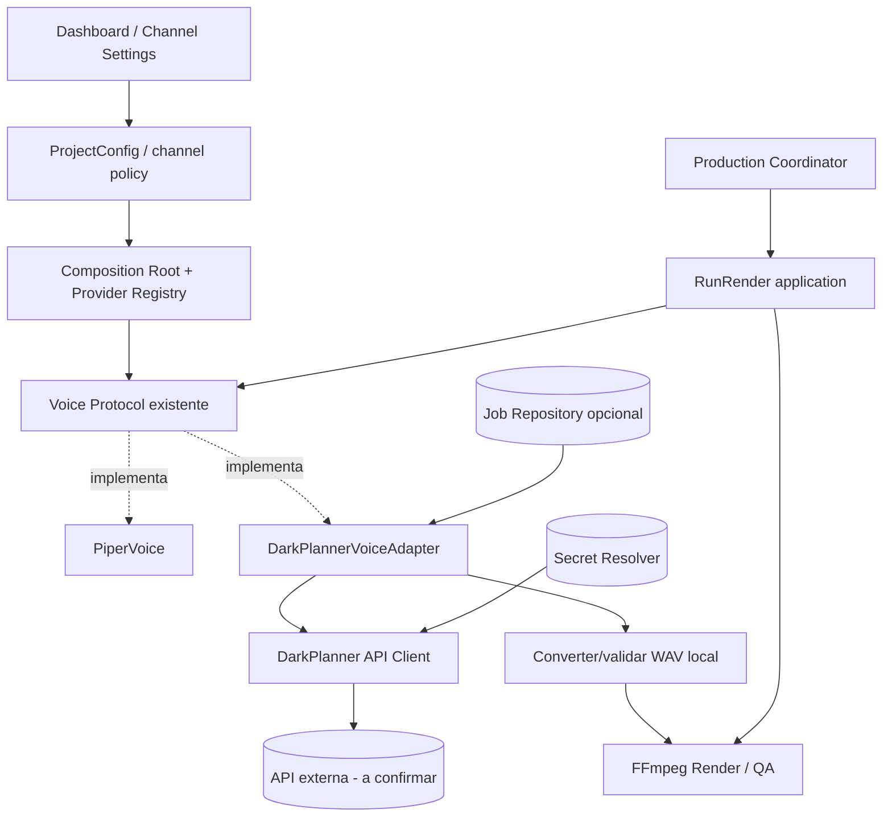
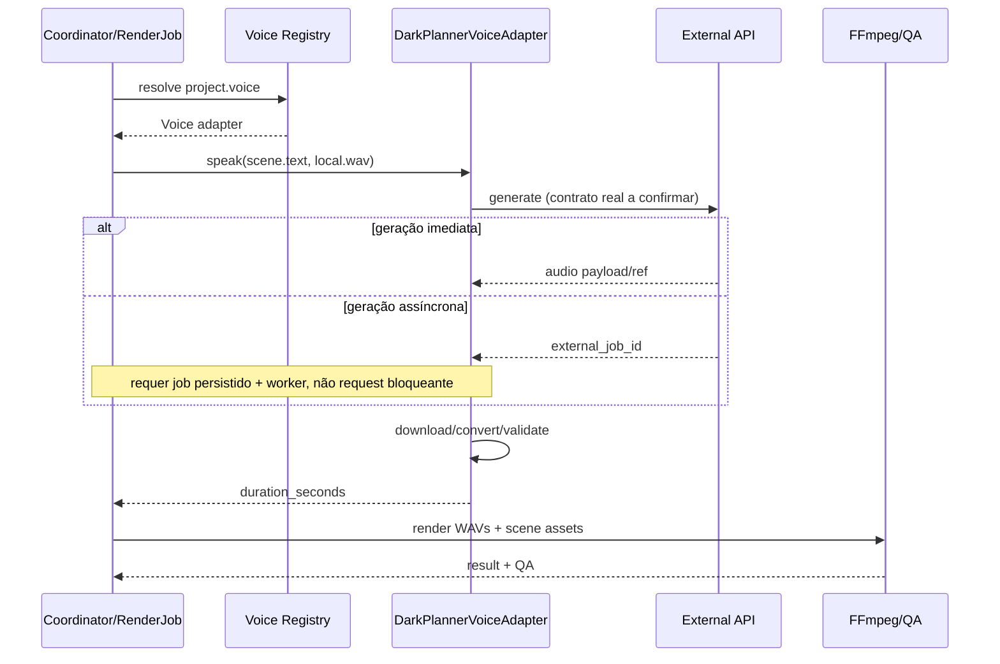

# Arquitetura — Anti-corruption layer de áudio

## Mudanças por arquivo no starter
| Arquivo | Ação |
|---|---|
| `application/ports.py` | **Preservar `Voice`**; criar protocolo estendido separado só se existir requisito comprovado (async jobs, SRT). |
| `application/config.py` | Reusar `ProjectConfig.voice` e registry; validar specs e capabilities sem enum de fornecedor no domínio. |
| `composition.py` | Registrar factory `darkplanner` e injetar dependências client, secrets, metrics sem `os.environ` no core. |
| `adapters/voice_piper.py` | Manter intacto, adicionar testes de conformidade. |
| `adapters/voice_darkplanner.py` (novo) | Adaptar protocolo, auth/client, normalize WAV, duration, erros; nenhuma regra de negócio. |
| `adapters/darkplanner_client.py` (novo) | HTTP isolado, timeouts, autenticação, polling se aplicável. |
| `application/render.py` | Preferir **nenhuma alteração** para MVP; usa `voice.speak` existente. Para jobs assíncronos, extrair etapa de síntese do render para worker/estado próprio após ADR. |
| `adapters/postgres/migrations/...` | Criar somente se a API for assíncrona ou se a auditoria de geração exigir novos registros; migration aditiva. |
| `api/panel.py` | F10/F6: provider/voz, status, diagnóstico; não mostrar tokens. |

## Restrições e escolhas
- `Voice.speak` atual é **síncrono**, grava WAV e retorna duração. Não mover chamadas remotas potencialmente longas para dentro de request HTTP.
- Se o DarkPlanner funcionar por polling, implementar worker/`AudioGenerationJob`; não simular synchronous esperando no request ou segurando o processo do usuário.
- Não aceitar qualquer URL externa de áudio sem validar host, esquema HTTPS, tamanho, formato e redirect (SSRF).
- Toda entrada remota deve virar WAV PCM compatível com FFmpeg por conversão local controlada; não confiar em duração declarada pelo fornecedor.
- Não enviar texto de roteiro a serviço externo antes da configuração/consentimento do canal.
- Separar credenciais (secret ref) de configuração pública (`voice` e `provider`).
- Não garantir exatamente-uma-cobrança a menos que a API externa suporte idempotência/reconciliação; adotar 'at-most-once submit sem confirmação' ou estado `NEEDS_RECONCILIATION`.

## Diagramas de sequência

## Questões para ADR futura
- Como expor jobs assíncronos sem alargar `Voice` síncrono: `VoiceJobProvider` separado vs nova etapa `GenerateAudio`.
- Esquema de permissões para credenciais BYOK por organização.
- Política de fallback: somente provider explicitamente autorizado e com reserva de custo.
