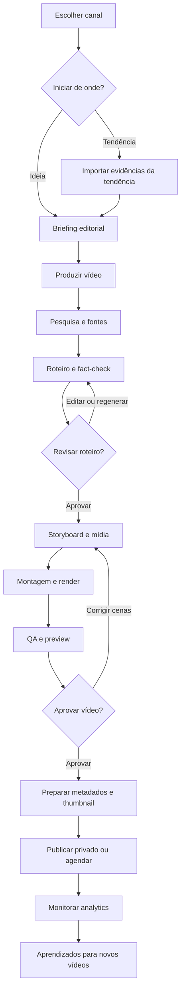
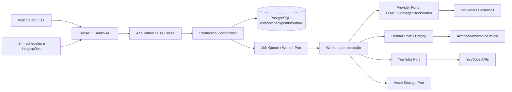
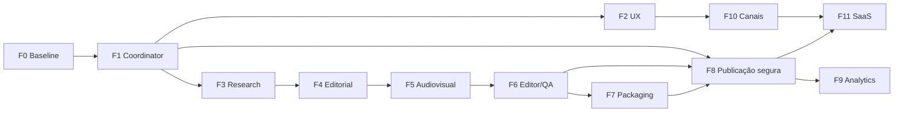

# Faceless Studio V2 — Plano de evolução do workflow

> **Visão:** "Quero transformar esta ideia em um vídeo publicado".
>
> **Fonte:** revisão do pacote `youtube-faceless-starter(1).zip`, em especial `README.md`, `docs/10-arquitetura.md`, `docs/12-editorial.md`, `docs/13-midia.md`, `docs/14-render.md`, `docs/15-publicacao.md`, `docs/18-painel.md`, `docs/19-tendencias.md`, `renderer/app/studio/{domain,application,adapters,api}` e `workflows/`.
>
> **Status:** proposta de implementação, **não** funcionalidade já implementada. A disponibilidade e o comportamento real de serviços externos dependem de validação integrada.

## 1. Objetivo e critérios de sucesso

Evoluir o produto de uma coleção de etapas técnicas em um fluxo único, seguro, observável e recuperável que transforma **tema ou tendência → pesquisa → roteiro → mídia → vídeo → revisão → publicação → aprendizado**.

**Metas de produto (propostas a validar):**
- Produzir vídeos faceless de aproximadamente **8 minutos**, em 16:9, com opção de Shorts.
- Planejar **2–4 vídeos por semana** por canal, sem presumir que esse volume já é atingido.
- Iniciar produção com um único CTA e visualizar progresso, custo projetado, pendências e próxima ação.
- Ter pontos de aprovação antes de gastar com mídia e antes de publicar.
- Permitir reprocessar somente uma cena/asset quando possível, sem reconstruir tudo.
- Nunca publicar automaticamente vídeo não aprovado ou sem publicação segura contra concorrência.
- Suportar providers intercambiáveis e, posteriormente, credenciais próprias do cliente (BYOK).

**Princípios:** domínio e estados permanecem autoridade; workflows são orquestração, não fonte da verdade; operações longas sempre assíncronas; retomada determinística; side effects idempotentes/fenced; custos e licenças auditáveis; UI orientada a tarefa; segurança por padrão; alterações incrementais e compatibilidade com APIs existentes sempre que possível.

## 2. Baseline encontrado no repositório

| Capacidade | Evidência atual | Lacuna para V2 |
|---|---|---|
| Separação técnica | `domain`, `application`, `adapters`, `api`, `composition.py` | Introduzir coordenação sem acoplar core ao n8n/FFmpeg/providers |
| Domínio editorial | `sources`, `script`, `fact-check`, storyboard e estados | Encaixar automaticamente pesquisa e revisão antes de gerar mídia |
| Produção audiovisual | `assets`, `render`, `resume`, FFmpeg, TTS, QA | Suporte a múltiplos visual beats e regeneração granular |
| Painel | `renderer/app/studio/api/{panel,preview}.py` | Jornada guiada, ações contextuais e status operacional |
| Radar de tendências | `trends/refresh`, categorias, evidências e YouTube API | Associar tendência → briefing → pesquisa com fonte |
| Publicação | aprovação, publicação/retry e workflow n8n | Concluir proteção de sessão resumable/lease e revalidar E2E |
| Analytics | workflow e adapters existentes | Transformar dados em aprendizados e sugestões explicáveis |
| Projeto/canal | entidade `Project`, endpoints e config | Configuração visual de estratégia, provider, voz e orçamento |
| Segurança de distribuição | pacote inclui `.env`, arquivos OAuth e backups locais | Remover de distribuição, rotacionar segredos e automatizar verificação |

**Atenção:** `/videos/{id}/assets` já possui um componente chamado `ProduceAssets`; ele é um passo de mídia, **não** um coordenador geral de produção. Evitar reutilizar nomes que confundam essas responsabilidades. Os docs `README.md` e `docs/01-como-o-workflow-executa.md` têm referências históricas: reconciliar com o código executável.

## 3. Experiência-alvo do usuário



### Telas propostas
1. **Visão geral:** canais, vídeos em andamento, pendências de aprovação, orçamento e alertas.
2. **Novo vídeo / briefing:** tema ou tendência, objetivo, público, duração, estilo, idioma, referências, orçamento máximo.
3. **Produção:** stepper por etapas, percentual aproximado por etapas concluídas (não ETA inventado), custo realizado/previsto, ações disponíveis, erro e retry.
4. **Research:** fontes e evidências, confiabilidade, origem e claims; aprovação/adição manual.
5. **Roteiro:** capítulos/cenas, narração, duração estimada, claims, editar/regerar cena, aprovar versão.
6. **Editor de vídeo:** player, timeline, visual beats por cena, assets e voz, regeneração localizada.
7. **Publicar:** título, descrição, tags, thumbnail variantes, visibilidade, agenda e confirmação.
8. **Analytics:** métricas observadas, histórico de publicação, hipóteses testáveis e recomendações rastreáveis.
9. **Canais/configurações:** identidade, estratégias, perfis de provider, orçamento, integração YouTube, saúde das conexões.
10. **Admin/operações:** fila, execuções, custos, traces, DLQ, logs técnicos, auditoria e roles.

**UX:** em cada etapa exibir sempre **o que aconteceu**, **o que está acontecendo**, **o que precisa da atenção humana**. Esconder detalhes de infraestrutura em painel avançado. Tratar estados vazio, executando, aguardando humano, bloqueado, falha recuperável, falha definitiva e concluído.

## 4. Arquitetura proposta e fronteiras



### Regra fundamental de responsabilidade
- **Domínio:** entidades, invariantes, estados, decisões e políticas; nenhum import direto de n8n, FastAPI, FFmpeg ou SDK específico.
- **Application:** casos de uso, coordenação, guardas, idempotência, versionamento e contratos.
- **Adapters:** Postgres, provedores de IA, FFmpeg, mídia/objetos, YouTube, eventos, filas.
- **n8n:** triggers, agendamento, notificações e integrações; não deve gerenciar sozinho o estado transacional do vídeo.
- **UI:** apresenta estado materializado, solicita comandos e acompanha eventos; não executa lógica de produção em navegador.
- **Postgres:** verdade sobre `production_run`, `stage_execution`, decisões humanas, custos, versões e intents de side effect.

### Contratos candidatos (proposta, sem sobrescrever os existentes)

```text
POST   /studio/videos/{video_id}/production-runs
GET    /studio/videos/{video_id}/production-runs/{run_id}
POST   /studio/production-runs/{run_id}/pause
POST   /studio/production-runs/{run_id}/resume
POST   /studio/production-runs/{run_id}/cancel
POST   /studio/production-runs/{run_id}/stages/{stage}/retry
GET    /studio/production-runs/{run_id}/events
POST   /studio/videos/{video_id}/script-reviews
POST   /studio/videos/{video_id}/scenes/{scene_id}/regenerate
GET    /studio/videos/{video_id}/timeline
POST   /studio/videos/{video_id}/publication-intents
```

#### Contrato de execução (exemplo)
```json
{
  "video_id": "video-id",
  "idempotency_key": "client-generated-unique-value",
  "production_profile_id": "standard-long-form",
  "approval_policy": "script_and_final_video",
  "cost_limit_usd": 8,
  "start_from": "research"
}
```

**Observações:** `cost_limit_usd` é limite por execução, não previsão de custo. `start_from` só pode apontar para estágios cujos pré-requisitos e versões já foram validados. O servidor deve validar o contexto e emitir `run_id`; chamadas repetidas com a mesma chave retornam o mesmo run sem duplicar efeitos.

### Modelo de execução recomendado
- `ProductionRun(id, video_id, project_id, desired_state, status, version, created_at)`.
- `StageExecution(id, run_id, stage, attempt, status, input_fingerprint, output_version, started_at, completed_at, error_code)`.
- `HumanDecision(id, run_id, stage, artifact_version, decision, reason, actor, at)`.
- `ProviderInvocation(id, run_id, stage, provider, request_hash, cost_estimate, actual_cost, result_ref)`.
- `ArtifactVersion(id, run_id, artifact_type, parent_id, checksum, metadata)`.
- `SideEffectIntent(id, run_id, external_system, idempotency_key, fencing_token, status, external_id)`.
- Outbox de eventos para notificar UI/triggers com at-least-once e deduplicação por event ID.

Estados internos do coordenador: `PENDING`, `RUNNING`, `WAITING_HUMAN`, `PAUSED`, `RETRYABLE_FAILED`, `BLOCKED`, `FAILED`, `CANCELED`, `COMPLETED`. **Não substituir** os estados editoriais atuais do vídeo; esses são dois níveis de estado diferentes.

### Padrões de resiliência
- Operações longas enfileiradas; request HTTP retorna 202 + `run_id`.
- Worker reivindica estágio com lease, heartbeat e fencing token monotônico; completar estágio exige comparar token/versão.
- Checkpoint por estágio com hashes de inputs; no restart reaproveitar outputs íntegros e válidos.
- Retry com limites por estágio, backoff+jitter e distinção erro transitório/permanente; DLQ e retry manual após correção.
- `CANCEL_REQUESTED` é cooperativo; não assumir cancelamento instantâneo do provedor externo.
- Custos estimados antes de estágio pago; reservar orçamento de forma transacional antes de chamar provider e reconciliar após resposta.
- Side effects YouTube usam intent/fencing e reconciliação de sessão/remote video ID; não alegar exactly-once apenas com lock local.

## 5. Roadmap por fases

### F0 — Higiene, segurança, baseline e documentação (P0)
**Objetivo:** estabilizar a base antes de adicionar novas funcionalidades.

**Tarefas**
- F0-01 Rotacionar tokens/chaves OAuth/API encontrados no pacote; revisar acesso e histórico de distribuição.
- F0-02 Criar `scripts/package-starter.sh` com allowlist de código/docs, sem `.env`, `credentials/`, `storage/`, backups, `.git/` ou dados pessoais.
- F0-03 Adicionar secret scanning no CI e teste que inspeciona ZIP gerado.
- F0-04 Gerar inventário das rotas, estados, providers, workflows, capacidades e gaps; marcar adapters `working/experimental/disabled`.
- F0-05 Reconciliar `README` e docs com comportamento executável; arquivar materiais históricos.
- F0-06 Criar baseline de testes, migrations, segurança, custo, fixture de 8 min e relatório de cobertura; corrigir CI.
- F0-07 Definir flags e rollout progressivo para V2.

**Aceite:** pacote sem segredos; credenciais comprometidas substituídas; docs refletem executável; CI consistente; baseline reproduzível.

### F1 — Production Coordinator, checkpoints e recuperação (P0)
**Objetivo:** implementar a jornada sob comando único sem acoplar o domínio ao orquestrador.

**Tarefas**
- F1-01 Criar `ProductionRun`/`StageExecution`/outbox e migrations.
- F1-02 Definir DAG de estágios, dependências e contratos I/O; manter checkpoints do vídeo atuais.
- F1-03 Criar `ProductionCoordinator` e executor/worker port; avaliar se aproveitar worker atual ou adapter assíncrono dedicado.
- F1-04 Criar `POST production-runs`, status e eventos de progresso.
- F1-05 Implementar etapas research/script/factcheck/storyboard/assets/render/QA/approval/publish como handlers; nenhum efeito irreversível sem gate.
- F1-06 Idempotency key, CAS, lease, heartbeat, fencing, checkpoint e replay determinístico.
- F1-07 Pausa humana persistida: liberar worker e retomar com versão aprovada; sem processo aguardando bloqueado.
- F1-08 Retry seletivo, cancelamento, DLQ e trilha de auditoria.
- F1-09 Testes de falha entre persistência, provider call, commit e recuperação; concorrência entre 2 workers.

**Aceite:** iniciar uma vez pela UI/API; reexecutar chamada não duplica vídeo ou custos; crash/restart retoma corretamente; etapa humana não ocupa worker; execução concorrente não corrompe estado.

### F2 — UX do fluxo único, painel e acompanhamento (P0)
**Objetivo:** tornar o produto operável sem conhecimento de API ou pipeline.

**Tarefas**
- F2-01 Desenhar mapa de navegação, wireframes e estados vazios/erros.
- F2-02 Criar wizard `Novo vídeo`: canal, tema, briefing, duração, estilo, idioma, budget.
- F2-03 Botão primário `Produzir vídeo` chamando Production Coordinator.
- F2-04 Página de execução com stepper, próxima ação, tempo decorrido, custo estimado/real e eventos.
- F2-05 Ações `Pausar`, `Continuar`, `Cancelar`, `Tentar novamente`, `Revisar` condicionadas a permissões/estado.
- F2-06 Unificar lista `Vídeos` por estado de negócio e filtros `precisa de mim`, `em andamento`, `concluído`, `falhou`.
- F2-07 Mover IDs/traces/model usage para diagnóstico avançado.
- F2-08 Acessibilidade (teclado, contraste, feedback), responsividade, testes E2E com operador não técnico.

**Aceite:** usuário cria um vídeo, acompanha produção e resolve pendências pelo painel; nenhum passo manual escondido nos docs é necessário no fluxo feliz.

### F3 — Tendências → research → fontes verificáveis (P0)
**Objetivo:** transformar uma tendência em briefing com evidências, e não apenas texto.

**Tarefas**
- F3-01 Criar `ContentBrief` versionado com `trend_id`, hipótese de interesse, público, objetivo e referências.
- F3-02 Ao selecionar tendência, transportar IDs de evidências, timestamps e URLs para research; nunca confiar em claims de vídeos de terceiros sem checagem.
- F3-03 Criar `ResearchPort` com estratégias fonte oficial, feeds e busca permitida; fallback para fontes manuais.
- F3-04 Canonicalizar URLs, deduplicar, gravar `SourceSnapshot`, status de licença e proveniência.
- F3-05 Avaliar fonte por data, reputação, pertinência e suporte a claims; rejeitar fonte inacessível sem inventar conteúdo.
- F3-06 Criar UI de fontes (`aprovar`, `descartar`, `adicionar`, `inspecionar claims`).
- F3-07 Corrigir rotulagem de `regionCode=US` para EUA; `Global` somente como agregação real com origem explícita.
- F3-08 Observar custos/cotas YouTube e impor throttle/cache.

**Aceite:** tendência selecionada gera briefing rastreável; pesquisa gera fontes efetivamente utilizáveis pelo roteiro; falhas exibem ação humana possível; região refletida corretamente.

### F4 — Motor editorial long-form e aprovação de roteiro (P0)
**Objetivo:** roteiro projetado para duração/retensão, e não apenas resolução horizontal.

**Tarefas**
- F4-01 Expandir briefing com `target_duration_seconds`, público, voz, ritmo, estrutura, linguagem e restrições.
- F4-02 Separar prompt short vs long; long deve gerar estrutura por blocos/chapters, hook, contexto, desenvolvimento, payoff/CTA.
- F4-03 Definir estimativa configurável de palavras/minuto e duração por cena, validada contra velocidade real do TTS.
- F4-04 Criar roteiro em duas passagens: outline/chapter plan e script de cenas com referências.
- F4-05 Validar continuidade, redundância, duração estimada, claims e ausência de invenção; aproveitar gate de fact-check atual.
- F4-06 Versionar scripts e criar aprovação humana atrelada a hash/versão.
- F4-07 Tela para editar/regerar cenas, inspecionar fontes e fazer override justificado.
- F4-08 Edição invalida somente outputs downstream dependentes; testar propagação de invalidation.
- F4-09 Criar teste de roteiro de aproximadamente 480 s cobrindo 2–4 temas/estilos.

**Aceite:** modo long de 8 min fornece outline e cenas com durações compatíveis; usuário aprova roteiro antes de mídia paga; edição parcial invalida outputs afetados, não deixa fact-check de versão antiga passar.

### F5 — Motor audiovisual, mídia e montagem dinâmica (P1)
**Objetivo:** aumentar retenção com variação visual e custo controlado.

**Tarefas**
- F5-01 Introduzir `VisualBeat` (scene_id, start/end, asset_kind, reference, transition, provenance, license).
- F5-02 Permitir 1:N beats por cena e mídia `stock`, `AI image`, `AI clip`, `diagram`, `screen capture` fornecida, `text animation`.
- F5-03 Criar `MediaProviderPort` e capability registry (`SUPPORTED`, `EXPERIMENTAL`, `UNAVAILABLE`); Veo atualmente deve aparecer indisponível até implementação validada.
- F5-04 Reusar stock primeiro onde licença permite, imagens geradas quando agregam, clipes IA apenas em momentos-chave.
- F5-05 Storyboard define duração, beat, objetivo visual, safe area, asset fallback e proporção.
- F5-06 Evoluir render FFmpeg para beats múltiplos, trilha por camadas, crossfades, áudio, legendas e transições.
- F5-07 Regeração granular por beat/cena; cache por conteúdo e versão do provider; invalidation.
- F5-08 Auditoria de licença, uso de marca/pessoa e proveniência; QA de assets e falhas de download.
- F5-09 Perfis de custo `economy`, `balanced`, `premium` com fallback condicionado ao budget.

**Aceite:** render long-form usa beats múltiplos em pelo menos cenas configuradas; troca de asset não exige gerar novo roteiro; fontes/licenças permanecem auditáveis; output MP4 passa QA objetivo.

### F6 — Editor visual, preview e QA (P1)
**Objetivo:** permitir revisão e correção localizada sem conhecer ferramentas técnicas.

**Tarefas**
- F6-01 Player + timeline por cena/beat com thumbnails, waveforms opcional e navegação por timestamp.
- F6-02 Editor de narração, legenda e referência visual por cena (MVP: edição por formulário, não NLE completo).
- F6-03 Trocar asset/voz, regerar trecho e renderizar nova versão com status.
- F6-04 QA técnico: codec/dimensões, áudio, duração, picos/silêncio, legendas, artefatos, frame preto.
- F6-05 QA editorial: claims, consistência, pronúncia, ritmo, safe areas, repetição visual; checks heurísticos primeiro.
- F6-06 Mostrar severidade `blocking/warning/info`, evidências e ação de correção.
- F6-07 Aprovação final requer `render_id`/checksum mais recente e relatório QA compatível.
- F6-08 Testes de regressão visual e de mídia com fixtures curtas e longas.

**Aceite:** operador encontra cena ruim pelo preview, edita e re-renderiza versão atualizada; versão aprovada é exatamente a versão passível de publicação.

### F7 — Thumbnails, títulos, SEO e experimentos (P1)
**Objetivo:** melhorar apresentação e descoberta do vídeo sem alegar CTR garantido.

**Tarefas**
- F7-01 Criar `PackagingAgent` (contrato com título, descrição, tags, capítulos, fontes e CTA).
- F7-02 Gerar 3 conceitos de thumbnail e títulos correspondentes com justificativa editorial; sem clickbait enganoso.
- F7-03 Templates gráficos por canal; text overlays, safe areas, legibilidade mobile e exportação.
- F7-04 Review UI para comparar variantes, escolher e editar metadados.
- F7-05 Persistir versão escolhida junto a `publication_intent`.
- F7-06 Validar dimensões/formato/peso e regras vigentes da API do YouTube por integração.
- F7-07 Testes de conteúdo enganoso, imagem sem licença e edição de metadados pós-aprovação.

**Aceite:** operador escolhe thumbnail/título antes de publicar; pacote completo é versionado e anexado à publicação.

### F8 — Publicação YouTube resiliente, OAuth e agenda (P0)
**Objetivo:** efetuar uploads apenas aprovados e sem duplicações em falhas concorrentes.

**Tarefas**
- F8-01 Mapear fluxo atual: aprovações, claims, lease, resumable upload, sessão, recovery, workflow `03-publish-approved.json`.
- F8-02 Implementar `PublicationIntent` transacional com versão de vídeo e media checksum imutáveis.
- F8-03 Claim por lease+fencing; sessão de upload salva de forma segura; reconciliar remoto antes de iniciar sessão nova.
- F8-04 Controlar repetição, timeout, crash, lease expirado, upload parcial e callback atrasado; preservar remote video ID.
- F8-05 Validar canal autorizado, scopes e erro OAuth; mensagens de reconexão claras; não expor secrets nem URLs resumable.
- F8-06 Definir política de publicação privada por padrão; agendamento e visibilidade pública requerem regras explícitas/consentimento.
- F8-07 Reabilitar workflow automático apenas depois de testes de falha e concorrência passarem.
- F8-08 Teste manual de ponta a ponta em canal de teste, incluindo reconciliação depois de falha artificial.

**Aceite:** nenhum upload sem render/QA/aprovação válidos; concorrência e restart não criam dupla publicação em cenários ensaiados; operador vê estado verdadeiro e URL final.

### F9 — Analytics e loop de aprendizado (P2)
**Objetivo:** usar dados reais para melhorar as próximas produções.

**Tarefas**
- F9-01 Conectar dados observados às versões de briefing, roteiro, embalagem e publicação.
- F9-02 Coletar métricas autorizadas (views, CTR/impressões quando disponíveis, watch time e retenção conforme API/permissão).
- F9-03 Dashboard por canal, vídeo, pilar e período; mostrar quando dados ainda não estão disponíveis.
- F9-04 Criar insights com evidência e nível de confiança, separando observação de hipótese.
- F9-05 Recomendar temas/formatos e mudanças de hook ou pacing para revisão humana.
- F9-06 Histórico de experimentos thumbnail/título conforme recursos realmente oferecidos pelo YouTube.

**Aceite:** insights têm métrica, janela temporal e fonte; nenhum desempenho é inventado; sugestões não reconfiguram o canal automaticamente.

### F10 — Gerenciamento de canais, estratégias e providers (P1)
**Objetivo:** administrar perfis sem editar `.env` e sem trocar código.

**Tarefas**
- F10-01 CRUD de canais/projetos, arquivamento, estratégia, idioma, público e pilares.
- F10-02 `ChannelProfile` versionado: narrativa, duração, identidade visual, voz, áudio, thumbnail e CTA.
- F10-03 Tela de providers com capabilities, custo estimado, rate limits, disponibilidade e teste de conexão.
- F10-04 Profiles econômicos e roteamento de provider por tarefa/custo/qualidade; fallback controlado.
- F10-05 Budget por canal/produção, limites hard/soft e painéis de custo honesto.
- F10-06 Associar canal YouTube e status OAuth, sem mostrar secrets.
- F10-07 Manter configs sensíveis em vault/secret store, não no `Project.config` devolvido ao browser.

**Aceite:** adicionar canal, configurar estratégia/provedores/orçamento e iniciar vídeo sem alterações manuais no servidor; configuração versionada e auditável.

### F11 — Preparação SaaS, multiusuário e BYOK (P2)
**Objetivo:** permitir operação hospedada com isolamento e faturamento, somente após MVP estável.

**Tarefas**
- F11-01 Introduzir `Organization`, `Workspace`, `User`, `Role`, `Membership`, isolando `Project`/Video e storage por tenant.
- F11-02 Autenticação por sessão/OIDC, RBAC com `owner/editor/reviewer/viewer` e auditoria.
- F11-03 Isolamento de registros, storage, jobs, filas, custos, secrets e logs por tenant; testes de vazamento.
- F11-04 BYOK por tenant e provider; criptografia, rotação, autorização por uso, masks, revogação.
- F11-05 Metering e quotas de plataforma vs custo direto das APIs do cliente; modelo de cobrança transparente.
- F11-06 Billing com controle de créditos, uso, limites, falha de pagamento e webhooks idempotentes (provedor a escolher).
- F11-07 Deploy com API/worker separados, assets em object storage, observabilidade, backups/restore e retenção.
- F11-08 Revisar termos de n8n, modelos e stock para uso SaaS, mais direitos autorais, privacidade e YouTube policies vigentes.
- F11-09 Escalonamento de workers, rate limit por tenant/provider, antifraude, SLO e plano de incidentes.

**Aceite:** teste cross-tenant não acessa conteúdo/credenciais; custo de API do cliente é separado da taxa da plataforma; deploy pode recuperar-se sem inconsistência relevante; termos comerciais/licenças revisados.

## 6. Dependências, fatias verticais e ordem sugerida



**M0 — Hardening:** F0 concluída e baseline com CI.

**M1 — Primeiro vídeo guiado:** F1 + F2 mínimo, com etapas existentes e pesquisa manual; operador usa apenas painel.

**M2 — Long-form de qualidade:** F3 + F4 + F5 mínimo; 8 minutos, fontes rastreáveis, script aprovado, múltiplos beats em cenas selecionadas.

**M3 — Publicação automática segura:** F6 mínimo + F7 mínimo + F8 validada em canal de teste; publicação com versão imutável e reconciliação.

**M4 — Produto operacional:** F9 + F10; cadência de 2–4 vídeos/semana monitorada, não garantida.

**M5 — SaaS:** F11 após revisão de licenças, segurança e custos.

**Evitar big bang:** usar feature flags V2 e adaptar os casos de uso atuais. Manter endpoints existentes estáveis enquanto os novos contratos amadurecem.

## 7. Backlog prioritário de primeiro ciclo (sprints sugeridas, não estimativas de prazo)

### Sprint A — Segurança e kickoff técnico
- [ ] F0-01 rotacionar credenciais expostas; invalidar tokens compartilhados.
- [ ] F0-02/F0-03 empacotamento seguro + secret scan + CI.
- [ ] F0-04 mapear estados, endpoints, schema e dependências de provider.
- [ ] F1-01 schema de execução/checkpoints/outbox e ADR.

### Sprint B — Coordenador + API
- [ ] F1-02 DAG mínimo `research→script→factcheck→storyboard→assets→render→QA`.
- [ ] F1-03/F1-04 coordinator + comandos/status.
- [ ] F1-06 idempotência, CAS, lease e recovery.
- [ ] F1-07 aprovação humana sem worker bloqueado.
- [ ] Teste E2E com provider stub e crash/restart.

### Sprint C — UX e pesquisa
- [ ] F2-02 wizard com briefing de vídeo.
- [ ] F2-03 botão produzir e ligação ao run.
- [ ] F2-04 stepper e ações contextuais.
- [ ] F3-01/F3-02 tendência → briefing com evidências.
- [ ] F3-03/F3-04 fontes auditáveis e research fallback.

### Sprint D — Long-form
- [ ] F4-01/F4-02 prompts separados long/short e duração alvo.
- [ ] F4-04 outline e script com capítulos.
- [ ] F4-05 fact-check e estimação de duração.
- [ ] F4-06/F4-07 script review versionado.
- [ ] Teste 480s com TTS de verdade e tolerância formal de duração.

### Sprint E — Qualidade audiovisual
- [ ] F5-01/F5-02 `VisualBeat` e múltiplos assets.
- [ ] F5-03/F5-04 capabilities de providers e custo.
- [ ] F5-06 render multibeat.
- [ ] F6-01/F6-03 timeline básica e substituição de cenas.
- [ ] F6-04/F6-07 QA e aprovação consistente.

### Sprint F — Embalagem e publicação
- [ ] F7-01/F7-02 conceitos e versões de title/thumbnail.
- [ ] F7-04 escolha no preview.
- [ ] F8-01/F8-04 reconciliar resumption e side effects YouTube.
- [ ] F8-06 visibilidade/agendamento e confirmação humana.
- [ ] F8-08 teste real em canal de teste (falha simulada + recuperação).

### Sprint G — Operação e escala
- [ ] F9 métricas com fonte e insights não prescritivos.
- [ ] F10 CRUD canal/config/budget/providers.
- [ ] F11 ADR de tenancy e BYOK; implementá-lo apenas após testes de isolamento.

## 8. Estratégia de testes

| Nível | Verificação obrigatória |
|---|---|
| Unit/domain | estados, gates, duração, orçamento, validação, hashes e derivação de versão |
| Contract | schema JSON e OpenAPI, handlers e provider ports com fakes |
| Integration | Postgres transações/migrations, storage, ffmpeg, TTS, OAuth simulado, n8n |
| Fault injection | worker crash, lease expira, resposta tardia, timeout, quota, arquivo parcial, dupla chamada |
| E2E UI | tendência → criar → roteiro → editar → produzir → revisar → publicar (mock e teste de canal) |
| Media QA | 16:9 e 9:16, 480s alvo, transições, áudio, legendas, pixels pretos, codecs |
| Security | no secrets em pacote/log/API, CSRF, auth, cross-tenant, link temporário e auditoria |
| Cost | pré-checagem, reserva/reconciliação, teto por run/canal, modelos sem preço definido |

**Indicadores a acompanhar:** taxa de runs completos, falhas por etapa, intervenções humanas, retrabalho por cena, custo por vídeo e por minuto final, duração entregue vs meta, percentual de reutilização de asset, latência por etapa, uploads duplicados (alvo zero), cobertura de claims e qualidade factual. Taxas-alvo só devem ser fixadas após baseline observado.

## 9. Decisões arquiteturais (ADRs a produzir)

- ADR-001: coordinator interno vs LangGraph/n8n como executor de estado (recomendação: Postgres + coordinator interno e n8n na borda).
- ADR-002: checkpoints, idempotência, outbox, lease/fencing e falhas de processo.
- ADR-003: versionamento de roteiro, storyboard, mídia, render e downstream invalidation.
- ADR-004: `VisualBeat` e renderização incremental sem adotar NLE pesado no MVP.
- ADR-005: provider registry, roteamento por capability/custo, BYOK e fallback.
- ADR-006: publicação YouTube, reconciliação de upload retomável e visibilidade.
- ADR-007: tenancy, storage, secrets e cobrança SaaS.
- ADR-008: analytics, proveniência, retenção de dados e recomendações.

## 10. Fora de escopo do primeiro MVP

- Editor profissional com drag-and-drop em múltiplas pistas equivalentes a Premiere/CapCut.
- Produção de cenas integralmente com IA de vídeo custosa.
- Aprendizado autônomo que altera canal e publica sem revisão.
- Suporte a todos os provedores de mídia desde o lançamento.
- Marketplace, billing avançado e multi-tenant antes de estabilizar o fluxo individual.
- Garantia de crescimento, engajamento ou monetização do YouTube.

## 11. Definition of Done por card

- [ ] Contrato e validação de payload documentados.
- [ ] Permissões e segurança do fluxo verificadas.
- [ ] Estado durável, controle de concorrência e recuperação descritos.
- [ ] Custo/limite tratado antes da chamada paga.
- [ ] Logs e trace com correlação, sem secrets ou conteúdo sensível indevido.
- [ ] Testes unit + integração + erro/falha apropriados.
- [ ] UI possui loading, sucesso, falha e próxima ação.
- [ ] Documentação e migrations atualizadas.
- [ ] Feature flag/rollback onde aplicável.
- [ ] Critério de aceite demonstrado em cenário realista.

## 12. A primeira entrega a implementar

**Feature:** `Produce Video — One Click` (F1/F2 mínimo), sem construir todas as telas de uma vez.

**Fluxo:** criar vídeo → criar `ProductionRun` → estágio `research` (manual no primeiro corte) → script → fact-check → storyboard → assets → render → QA → `WAITING_HUMAN` → aprovar → publicar **somente** quando F8 segura estiver validada.

**Primeiros arquivos/módulos sugeridos:**
```text
renderer/app/studio/domain/production.py
renderer/app/studio/application/production.py
renderer/app/studio/application/ports.py            # ampliar interfaces
renderer/app/studio/adapters/postgres/production_repo.py
renderer/app/studio/api/routes.py                     # novos endpoints
renderer/app/studio/api/panel.py                      # wizard / run UI
contracts/v2/production-run.schema.json
contracts/v2/stage-execution.schema.json
migrations/                                         # seguir padrão existente
 tests/                                              # seguir estrutura real
 docs/adr/001-production-coordinator.md
```
**Nota:** esses caminhos são *propostos*; verificar padrões/migrations existentes antes de criar arquivos para evitar módulos duplicados.

**Cenário mínimo de aceite:** operador abre o painel, informa uma ideia e duração, clica `Produzir`, vê as etapas evoluírem, corrige falha ou aprova roteiro, assiste prévia, e chega a `APROVADO`. Publicação fica deliberadamente bloqueada até o critério de F8 ser atendido. Não é necessário usar Swagger ou n8n manualmente no fluxo feliz.

---

**Decisão de produto:** simplicidade na superfície, robustez no core. **O usuário compra o resultado — um vídeo publicado — não os passos técnicos usados para produzi-lo.**
