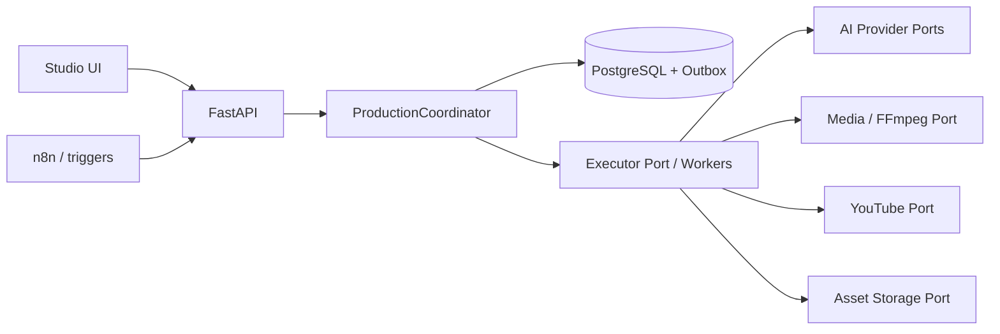

# Arquitetura, contratos e decisões

## Desenho lógico

## Contratos sugeridos (a confirmar com código/schema antes do PR)

- `POST /studio/videos/{video_id}/production-runs`: retorna 202, `run_id` e status; suporta `Idempotency-Key`.
- `GET /studio/videos/{video_id}/production-runs/{run_id}`: projeção completa e próxima ação.
- `GET /studio/production-runs/{run_id}/events`: stream ou polling de eventos sem secrets.
- `POST /studio/production-runs/{run_id}/pause|resume|cancel`: comando validado por estado e autorização.
- `POST /studio/production-runs/{run_id}/stages/{stage}/retry`: retry seletivo versionado.
- `POST /studio/videos/{video_id}/script-reviews`: aprovar/rejeitar com `artifact_version`.
- `POST /studio/videos/{video_id}/scenes/{scene_id}/regenerate`: invalidação seletiva downstream.
- `POST /studio/videos/{video_id}/publication-intents`: imutabilidade do render e do pacote editorial.

## Invariantes críticas

1. Estado do vídeo ≠ estado da execução; coordenador não sobrescreve domínio.
2. Requisição repetida com mesma chave não cria segunda execução.
3. Worker com fencing expirado não pode finalizar estágio.
4. Aprovação humana referencia versão/hash de artefato; edição invalida aprovação antiga.
5. Nenhum custo externo acima de budget sem decisão de bloqueio/fallback.
6. Nenhum upload automático sem render, QA e aprovação de versões atuais.
7. Resumable YouTube session requer reconciliação do estado remoto, não apenas lease local.
8. Todos os registros, eventos, assets e secrets exigem escopo de tenant após F11.

## ADRs a escrever antes de implementação relevante

- ADR-001 Coordenador interno versus workflow externo.
- ADR-002 Lease, fencing, outbox e replay.
- ADR-003 Versionamento e invalidação de artefatos.
- ADR-004 VisualBeat e render incremental.
- ADR-005 Capabilities e rotas de providers, fallback e BYOK.
- ADR-006 YouTube upload e session recovery.
- ADR-007 Auth, tenancy, storage e billing.
- ADR-008 Analytics e proveniência.

## Política de compatibilidade

Não remover endpoints antigos em F1. Colocar V2 atrás de flag, manter adapters existentes, testar compatibilidade e só descontinuar quando dashboard/workflows migrados.
