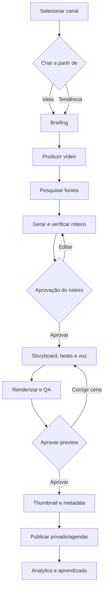

# Experiência orientada ao objetivo

**Proposta principal da UI:** “Quero transformar esta ideia em um vídeo publicado”.

## Telas da V2

| Tela | Ação primária | Informações essenciais |
|---|---|---|
| Home | Iniciar vídeo | runs ativos, atenção humana, orçamento, saúde de integrações |
| Tendências | Usar tendência | evidências, região real, frescor, origem, vídeo base |
| Novo vídeo | Produzir vídeo | tema, público, 480s default, estilo, teto de custo, idioma |
| Produção | Acompanhar / corrigir | stepper, etapa atual, próxima ação, custo, erros interpretáveis |
| Pesquisa | Aprovar fontes | proveniência, claims, data, licença |
| Roteiro | Aprovar versão | capítulos, duração, cenas, edição, fact-check |
| Editor | Regenerar cena | player, timeline, beats, voz, legendas, assets |
| Preview | Aprovar vídeo | QA, render hash, alertas bloqueantes |
| Publicação | Publicar / agendar | título, thumbnails, visibilidade, canal, confirmação |
| Analytics | Aprender | CTR/retention quando disponíveis, hipóteses e recomendações |
| Canais | Configurar canal | nicho, identidade, voz, providers, budget, OAuth |
| Equipe (SaaS) | Gerir acesso | membros, roles, tenants, chaves BYOK e consumo |

## Regras UX

- Exibir sempre: **concluído**, **em execução**, **ação necessária**.
- Botão primário contextual; não mostrar comandos inválidos pelo estado.
- Mostrar custos reais vs estimados com rótulos explícitos.
- Exibir falhas com passo de correção e botão retry, não stack trace para operador.
- Logs, IDs, token usage e traces somente em seção técnica avançada.
- Modo mobile responsivo e acessível; confirmação extra para publicação pública.
