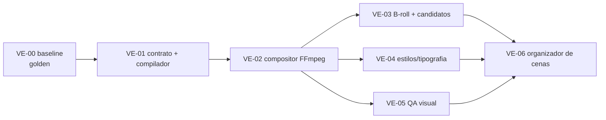

# Plano de execução — Visual Evolution (VE-001)

**Base:** [revisão VE-00](evidence/ve-00-review.md) (site fstudio.digital + projeto + aplicação + baseline).
**Status:** plano **para aprovação**. Nenhuma fase VE-01+ foi iniciada. Cada fase exige autorização própria (README §"Como executar").
**Estratégia em uma frase:** abrir a composição por camadas **dentro do segmento por cena que já existe**, sem compatibilidade com dados antigos (a base foi zerada em 22/11/2026, §0.1) e com a régua de qualidade do render atual (duração, áudio, legenda, disclosure).

> **Revisão 22/11/2026 (decisão do operador):** a base de dados é descartável e foi limpa; não há dados legados a preservar. As decisões D2, D4 e D6 abaixo foram **substituídas**. O cache e o digest antigos deixam de ser restrição.

## 0. Decisões de arquitetura (minhas; o operador pode revertê-las)

| # | Decisão | Por quê (evidência em ve-00-review) | Alternativa descartada |
|---|---|---|---|
| D1 | **Estender `Shot`** com `role: "base"\|"overlay"` (default `base`) e `z_index: int` (default 0). Não criar `Layer`. | RULES §1 e "Contratos mínimos"; §2.2-4: o domínio já aceita shots sobrepostos | Tipo `Layer` novo: duplica `Shot` e exige migração |
| D2 | ~~Sem bump de `SCHEMA_VERSION`~~ → **Livre para evoluir o contrato.** Se uma mudança for incompatível, sobe `SCHEMA_VERSION` e não se escreve migração de dados. | Base zerada (§0.1); nenhum plano persistido a ler | — |
| D3 | **Compor overlays no mesmo filter graph do segmento da cena base.** Segmento, `concat -c copy` e nós de cache `visual:<shot_base>` ficam como estão. | §2.2-5 e §2.2-6 | Um segmento por overlay: vídeo errado sem erro |
| D4 | ~~Digest/fingerprint legados idênticos~~ → **Régua de qualidade, não de digest:** o render sem overlay não pode piorar em duração, quadros, resolução, áudio, legenda e disclosure (ffprobe). Fingerprint pode mudar à vontade. | Cache purgado; digest idêntico deixou de proteger alguém | Manter D4 antigo: custo sem benefício |
| D5 | **Entrada por `RenderSpec.layers` (lista, default vazia)**, repassada ao `build_render_plan`. `RenderSpec` **é o caminho vivo** (`render.py:338`); trocá-lo pelo `RenderPlan` direto é refactor opcional, só se o custo se justificar. | §2.2-1: o plano nasce do `RenderSpec` | Reescrever o `RenderSpec`: fora do escopo (RULES §3, §13) |
| D6 | ~~Feature flag~~ → **Sem flag.** Camadas são o caminho normal; sem overlay o compilador se comporta como hoje. | Nada em produção a proteger (0 publicações) | Flag desligada por padrão |
| D7 | Execução de validação **só no container do renderer** (comando único, com `postgres-test`). Host macOS não é ambiente de teste. | §3 | Instalar ffmpeg/fonte no host |

### 0.1 Limpeza de dados executada (22/11/2026)

Autorizada pelo operador ("a base pode ser removida sem backup"). **Escopo executado:**

| Item | Antes | Depois |
|---|---|---|
| Schema `studio` no Postgres `n8n` (`DROP SCHEMA studio CASCADE`) | 3 vídeos, 1 `render_plans`, 21 `plan_artifacts`, 3 runs, 7 linhas de `usage_ledger`, 0 publicações | recriado pelas migrações na primeira requisição: 48 tabelas, 0 linhas de negócio |
| `storage/render-cache/plan_*` | 21 MB | vazio |
| Schema `public` do n8n | 3 credenciais, 0 workflows | **preservado** (3 credenciais) |

**Não tocado (decisão consciente):** o **banco `n8n` inteiro** (o Studio compartilha o banco com o n8n; derrubá-lo apagaria as 3 credenciais), `storage/projects/` (6 MB, ativos dos 3 vídeos apagados — órfãos) e `storage/cache/` (cache de imagens por hash de entrada; pode evitar custo de regeração). Ambos podem ser removidos quando você quiser.

**Achado:** a imagem do renderer em execução **está atrás do `HEAD`**: tem 32 migrações; o repositório tem 36 (faltam `0038`–`0041`: parece incluir patches de estilo e operação de run). Antes da limpeza o banco estava com 36 aplicadas, então alguém rodou código mais novo contra ele. **Reconstruir a imagem** (`docker compose build renderer`) antes de qualquer validação funcional; não fiz isso agora por estar fora da limpeza pedida.

## 1. Visão geral e dependências

Ordem recomendada: 00 → 01 → 02 → (03 ∥ 04) → 05 → 06. VE-03 e VE-04 tocam arquivos distintos (porta de mídia × estilo/overlays Pillow) e podem andar em paralelo **em worktrees separadas**; `composition.py` tem dono único em cada onda (precedente da V3.1).

## 2. Fases

Formato por fase: **entrega**, **arquivos**, **testes**, **riscos**, **aceite**, **gate**.

### VE-00b — Teste só no container e inventário de uso (nova, sem mudar comportamento)
- `scripts/test-container.sh`: roda a suíte na imagem do renderer com `postgres-test` (reduz os 775 *skips*); README e `conftest.py` avisam que o host não é ambiente válido.
- Inventário de **uso** de cada ocorrência de "legado/legacy" (140 em 40 arquivos). Classificação já feita em [ve-00-review §6](evidence/ve-00-review.md):  `RenderSpec`, `rich.py`, `panel as legacy`, `/videos`→410 estão **em uso/mantidos**; leitura de `qa_report` no formato antigo é candidata a remoção (0 linhas no formato antigo); `config_status='legacy'` tinha 2 de 3 runs (dados agora apagados: avaliar se o conceito ainda faz sentido); fallback de provider sem perfil, livro-caixa e analytics legados: **verificar uso antes de mexer**.
- Reconstruir a imagem do renderer (achado §0.1) e fixar o baseline do container.

### VE-00 — Baseline e golden (quase concluída)
- **Feito:** inventário, medição no host e no container, divergências ([ve-00-review](evidence/ve-00-review.md)).
- **Falta (sem alterar produção):**
  1. Script/teste que grava o **golden**: `CompiledRender.digest()` de 2–3 planos legados (short/long, com e sem música) + ffprobe (duração, quadros, resolução, stream de áudio) de um render real no container. Guardar como fixture textual, não MP4.
  2. Confirmar no container o estado dos 4 testes que falham no host (`test_contracts_snapshot`, `test_port_contracts`×2, `test_secrets_hygiene`).
  3. Registrar o `evidence/status.md` da V3.1 relido (README dela está defasado).
- **Aceite:** golden reproduzido duas vezes com o mesmo digest; falhas pré-existentes classificadas.

### VE-01 — Contrato e compilador multilayer mínimo
- **Entrega:** base + 1 overlay temporal por cena; planos legados inalterados.
- **Arquivos:**
  - `domain/render_plan.py`: `Shot.role`, `Shot.z_index`; validadores no `Timeline`: (a) a **cobertura contínua da cena deve ser feita só por shots `base`**; (b) overlay dentro da cena (já garantido); (c) `z_index` único entre overlays que se sobrepõem no tempo; (d) overlay referencia asset do manifesto (já garantido); (e) overlay em track `visual` distinta da track base da mesma cena.
  - `application/render_compiler.py`: substituir `_require_single_layer` por `_require_base_trajectory` (valida só os `base`) e agrupar overlays por cena; `ShotExecution.overlays: tuple[LayerExecution, ...]` (default `()`), incluído em `_shot_dict` **somente se não vazio** (D4).
  - `domain/render_plan_builder.py` e `ports.RenderSpec`: `layers` opcional (D5), sem lógica de seleção.
  - Config: flag D6.
- **Testes:** (1) legado: digest igual ao golden (**o teste que prova D4**); (2) `test_render_compiler.py:366` hoje fixa a recusa de camadas: ele **muda de intenção** (overlay passa a ser válido com a flag; sem flag continua recusado) — reescrever explicitando isso, sem afrouxar a asserção do caso inválido; (3) rejeições: overlay sem base, overlay fora da cena, `z_index` duplicado, overlay que "cobre" lacuna da base, referência ausente; (4) round-trip JSON antigo → modelo → JSON; (5) `test_architecture.py` continua verde (domínio e compilador sem I/O).
- **Riscos:** plano com overlay gravado e rollback do código (§2.3) → flag + nota de migração; ordenação não determinística → ordenar por `(z_index, start_tick, shot_id)`.
- **Aceite:** 1 base + 1 overlay compila de forma determinística (2 execuções, mesmo digest); render sem overlay mantém a régua de qualidade (D4).

### VE-02 — Compositor FFmpeg
- **Entrega:** overlay de imagem/vídeo/texto com janela temporal, sem lacunas, reprodutível.
- **Arquivos:** `render_compiler.py` (emissão do grafo), `adapters/render_plan_ffmpeg.py`, `domain/render_cache.py`.
  - Ordem de empilhamento: **base → overlays (por `z_index`) → selo/disclosure → legendas → fade**. Selo e legendas continuam por cima (paridade de áudio/legendas/disclosure).
  - Entradas FFmpeg: hoje `0` mídia, `1` selo, `2..` legendas. Para manter a string do legado idêntica, **as entradas dos overlays entram depois das legendas** e só quando existem.
  - Overlay de vídeo: `trim` + `setpts=PTS-STARTPTS+<início>/TB`, `scale` conforme `Composition.fit`, `overlay=enable='between(t,a,b)'`; áudio do overlay **descartado** (narração e música continuam sendo a única mixagem — evita regressão de loudness).
  - Executor: `_descriptors` deixa de fixar `media_type="image"` (`:420`, `:480`); vídeo é sondado por ffprobe (reuso de `adapters/qa_ffmpeg.py`, sem segundo motor).
  - **Segurança:** caminhos só vindos do `AssetDescriptor` resolvido; lista de argumentos (sem shell); saída final continua atômica (`_publish`).
  - Cache: termo `layers` no fingerprint do nó `visual` **somente se houver camadas** (D4); incluir hash de conteúdo, janela relativa, `z_index`, `fit`.
- **Testes:** unidade do grafo (string esperada); integração no container: render real de base + overlay, `ffprobe` (duração = plano ± 1 quadro, resolução, áudio presente) e extração de quadro dentro/fora da janela do overlay para provar que **aparece só na janela**; `test_render_reuse`/`regeneration`: alterar só o overlay invalida só aquela cena; mesmo plano duas vezes → hit de cache; segmento antigo sem overlay **não** é reusado após adicionar overlay.
- **Riscos:** deriva de sincronismo de vídeo com FPS diferente (forçar `fps=<rate>`); custo de CPU de scale em 1080p (medir com `application/benchmark.py`); overlay maior que a cena (validado em VE-01).
- **Aceite:** duas camadas coexistem em intervalo determinado; paridade de legendas/disclosure/áudio com o legado; benchmark registrado (tempo de render antes/depois, rótulo Real/Estimado).

### VE-03 — B-roll e seleção híbrida
- **Entrega:** candidatos de mídia normalizados, com licença, proveniência, hash, custo e fallback.
- **Arquivos:** nova porta `MediaSearch` em `application/ports.py` (+ `ProviderKind.MEDIA`/`Capability` em `domain/provider.py`, aditivo); contrato `MediaCandidate` (`asset_ref`, `source_provider`, `license`, `content_sha256?`, `estimated_cost: CostEstimate`, `relevance?`, `provenance`, `availability`) em `domain/`; adaptadores em `adapters/` (primeiro **Pexels vídeo**, que reaproveita a chave `PEXELS_API_KEY` já exigida; Pixabay depois); política de seleção **pura** reaproveitando `route_provider`/`RouteRequest`.
- **Custo e orçamento:** nenhuma chamada paga implícita (RULES §8): `paid_operation_key` já existe em `Shot`/`Scene`; reservar contra `application/budget.py`/`channel_budget.py` (F01.T03); cache por consulta.
- **Fallback:** sem candidato/licença válida → imagem atual (`ImageModel`), nunca cena vazia.
- **Honestidade de mídia:** `docs/13-midia.md` já avisa que stock não ilustra um evento específico; manter o aviso na UI e **registrar licença e atribuição no `AssetReference`** (campos já existem).
- **Testes:** adaptadores com `httpx.MockTransport` (padrão de `image_stock.py`); host confiável por allowlist (como `_trusted_image_url`); limite de tamanho; fallback; idempotência por chave.
- **A confirmar antes de codar [H]:** termos de uso da API de vídeo do Pexels/Pixabay (atribuição, hotlink, limites) — **não inventar comportamento de provider** (template de fase).
- **Aceite:** seleção reproduzível por contrato; custo/licença/proveniência no plano; fallback comprovado por teste.

### VE-04 — Estilos e tipografia
- **Entrega:** presets por nicho e intensidade, governados por `visual_style.py` + configuração efetiva.
- **Arquivos:** `domain/visual_style.py` (novos grupos/chaves em `KNOWN_PARAMS` e `PATCH_GROUP_FIELDS`, com `clean_params` e erro por chave), `domain/effective_config.py`, `adapters/render_plan_ffmpeg.py` (Pillow: `caption_layout`/`overlay_colors` já são o ponto de extensão).
- **Escopo realista de "tipografia cinética":** nível 1 (entregar) = presets de legenda (caixa, contorno, destaque de palavra por **cue**), entrada com *fade*/*pop* por expressão de alfa/escala no overlay. Nível 2 (só com evidência) = animação **por palavra**: exige tempo por palavra, e o TTS atual (Piper) devolve só a duração por cena **[H]** — confirmar antes de prometer.
- **`Transition`:** hoje inerte no compilador (§2.2-3). Fazer o compilador **consumir** `Shot.transition` é parte deste item; fade segue o default para planos legados (D4).
- **Motion:** o `Literal` `Motion` é a fonte única (`visual_style.MOTIONS = get_args(Motion)`); ampliar ali e só ali.
- **Fallback:** preset desconhecido → estilo atual; patches continuam por allowlist, `null` = reset (ADR fs31-004).
- **Colisão com V3.1:** ler `faceless-studio-v31` (status e ADR fs31-004/007) antes; mudança de UI da página de estilo (`panel_channel_style.py`/`panel_styles.py`) só depois do benchmark (gate do "Projeto B").
- **Aceite:** 3 presets (ex.: documentário, notícia, curiosidades) renderizando; estilo sem os novos campos produz overlay **byte a byte igual** ao de hoje (já existe teste de paridade em `test_render_plan_executor.py`).

### VE-05 — QA visual opcional
- **Entrega:** avaliação semântica **somente com provider real**; sem provider → `not_verified`.
- **Duas camadas:** (a) **determinística, sem LLM** (entrega primeiro): overlay realmente presente na janela, texto dentro da área segura, contraste mínimo, quadro preto/congelado, cobertura base sem lacuna, por ffprobe/ffmpeg; produz `QaFinding` `technical`. (b) **semântica** (porta `VisualQualityEvaluator`, provider de visão): achados `editorial`, com `evidence_refs` e `coverage`.
- **Arquivos:** `domain/quality.py` (novos `CHECK_*`; hoje o orphan check e a cobertura só consideram `scene.shots`, o que já inclui overlays), `domain/qa_report.py` (campos aditivos), nova porta em `application/ports.py`.
- **Regras:** score fabricado é proibido (RULES §10); falha técnica continua **bloqueante**; semântica não verificada aparece na UI com o mesmo tom do painel atual ("Ação necessária"/"não verificado").
- **Testes:** tabela de classificação de mensagens (como `test_quality.py`), provider ausente → `not_verified`, provider que falha → `not_verified` e não aprovação.
- **Aceite:** QA técnico bloqueante intacto; cobertura semântica explícita.

### VE-06 — Scene Organizer mínimo
- **Entrega:** trocar o asset de **uma cena**, gerar nova revisão do plano, prévia parcial e reaprovação.
- **Reuso:** `PlanRegeneration` já decide por fingerprint o que refazer; `RenderVersion(render_id, checksum)` amarra a aprovação ao artefato (`production.py:395`). **[H]** novo render ⇒ novo checksum ⇒ aprovação anterior não vale; **confirmar por teste** antes de afirmar (RULES §12: nenhum caminho pode ignorar o gate).
- **UI:** seção "Cenas" em `panel_videos.py`/`panel_production.py`: grade numerada com miniatura (quadro extraído do render), **origem** (banco/IA/imagem atual), estado e alternativas (candidatos da VE-03), seguindo o padrão do Organizador de Cenas do site. Miniaturas também resolvem o placeholder borrado dos cartões do Início.
- **Testes:** troca em 1 cena invalida só ela e `concat/final`; aprovação antiga não habilita publicação; auditoria da troca.
- **Fora do escopo:** timeline arrastável, edição de tempo, desfazer múltiplo.

## 3. Estratégia de teste (todas as fases)
1. Unidade (domínio/compilador) — rápida, sem ffmpeg.
2. `test_architecture.py` — o núcleo não importa `PIL`/`subprocess`/SDK.
3. Integração FFmpeg no container (`docker run …` do §3 da revisão).
4. Regressão: golden de digest do legado + cache (`test_render_reuse`/`regeneration`).
5. Benchmark rotulado Real/Estimado (`application/benchmark.py`).
6. Validação visual: extração de quadros e leitura da captura (não só "passou").
7. Suíte completa no container antes de cada gate; falhas pré-existentes só podem ser as já classificadas.

## 4. Riscos gerais
| Risco | Mitigação |
|---|---|
| Overlay some do cache ou cache invalida tudo | D4 + testes de reúso nos dois sentidos |
| Plano novo ilegível por código antigo (rollback) | D2/D6; documentar migração em `docs/contracts-versioning.md` |
| Custo de render sobe | benchmark por fase; limites de camadas/cena (começar com ≤ 2 overlays) |
| Direitos de mídia | licença/atribuição obrigatórias no `AssetReference`; host por allowlist |
| Escopo vira editor completo | exclusões do README mantidas; VE-06 só troca por cena |
| Colisão com V3.1 | leitura prévia por fase; um dono por arquivo compartilhado |

## 5. O que preciso que você decida (com meu padrão)
1. **Autorizar VE-01 agora?** Padrão: concluir o que falta de VE-00 (golden) e pedir sua autorização antes de editar código de produção.
2. **Provider de vídeo inicial:** padrão **Pexels** (já temos a chave e o padrão de adaptador).
3. **Tipografia cinética:** padrão nível 1 (por cue). Nível 2 depende de tempo por palavra.
4. **Identidade visual:** padrão **manter a paleta violeta**; adotar só os princípios do site (§1.3 da revisão).
5. **Commit:** padrão **sem commit** até você pedir (o README proíbe). A pasta `faceless-visual-evolution/` e `docker-compose.preview.yml` seguem não rastreados.
