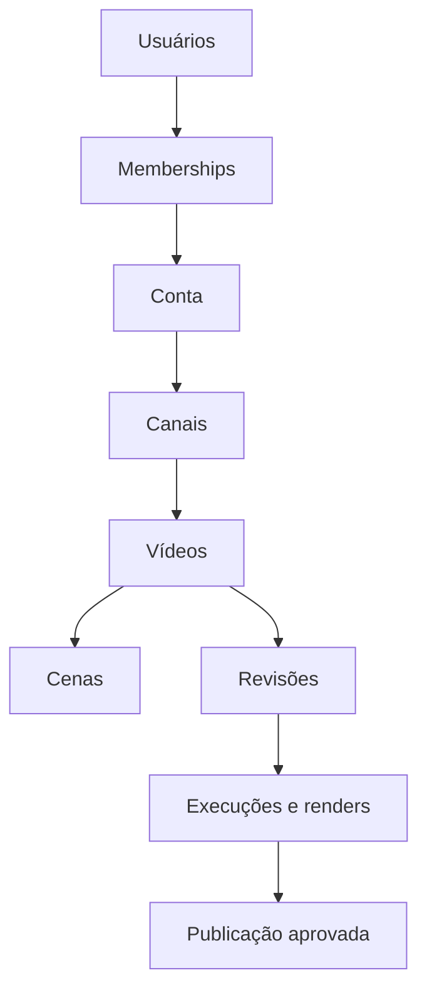
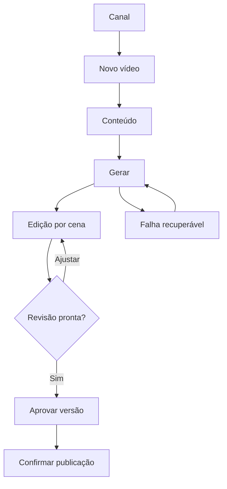
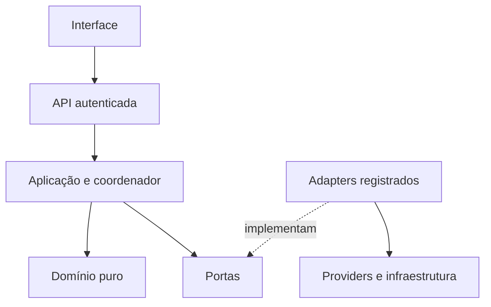
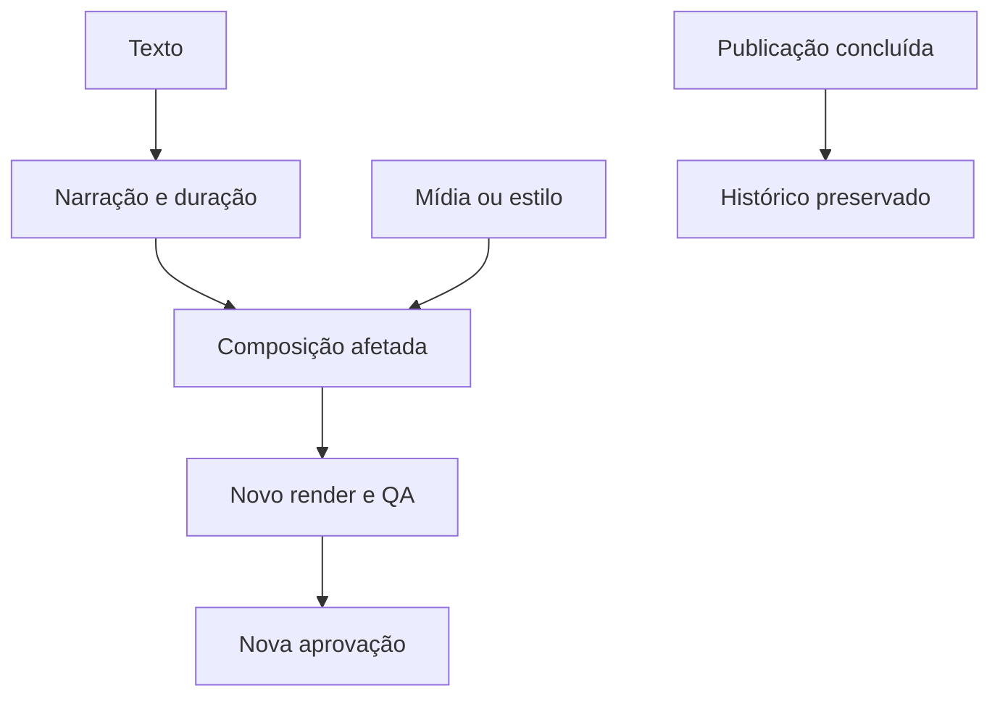

# Diagramas — arquitetura alvo

## Propriedade

## Jornada com revisão contextual

## Dependências Clean Architecture

## Invalidação

Os diagramas são conceituais. Schema e endpoints atuais precisam ser mapeados antes de implementar. n8n aciona os mesmos casos de uso; não recebe uma cópia das regras de domínio.
