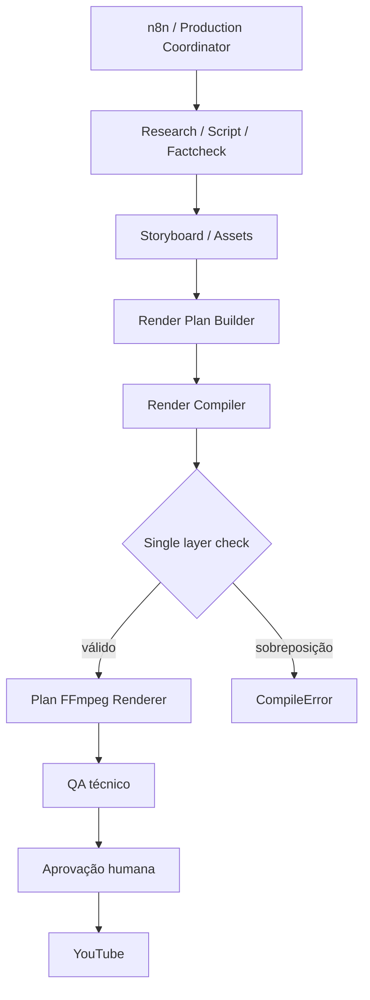
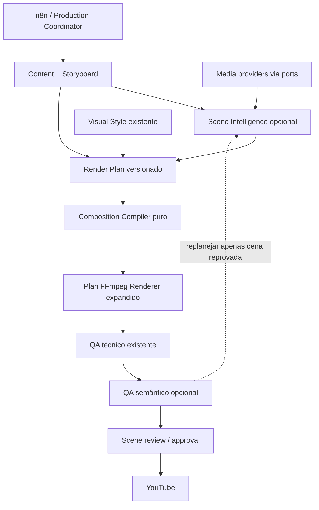
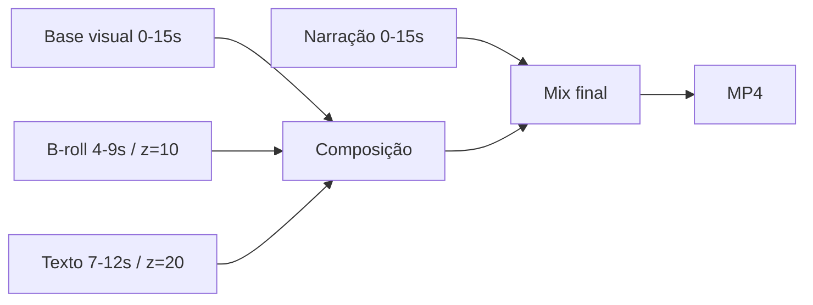
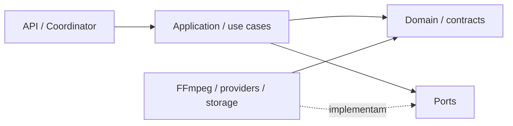
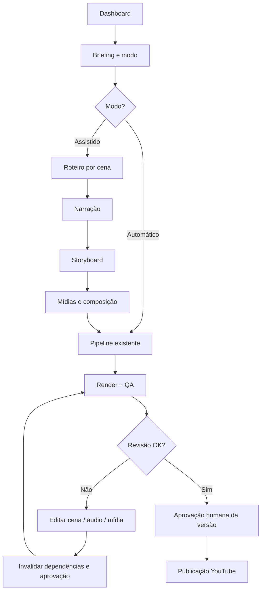
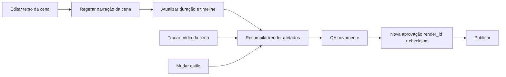

# Diagramas de arquitetura

## Hoje — caminho observado

## Depois — arquitetura alvo

## Camadas em uma cena (exemplo ilustrativo)

## Fronteiras de dependência

## VE-07 — Jornada do usuário

## VE-07 — Invalidação de dependências

