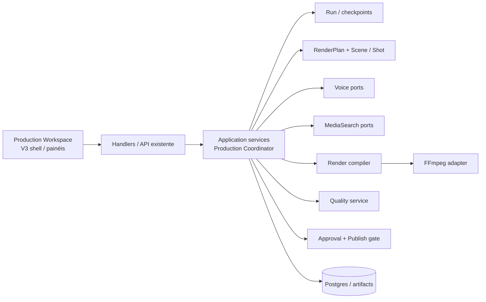

# VE-07 — Production Workspace (proposta de fase nova)

**Status:** proposta de UX e implementação, NÃO implementada. **Dependências:** VE-00/00b concluídas; VE-01/02 motor multilayer; VE-03 mídia; VE-04 presets; VE-05 QA; VE-06 regeneração/preview/organizador. Pode iniciar investigação de UX antes; implementação exige contratos disponíveis.

## 1. Resultado
Um workspace por vídeo que ofereça **Automático** (tema → pipeline → revisão → aprovação) e **Assistido** (configuração → roteiro → narração → storyboard → mídia → composição → QA → aprovação → publicação). Ambos usam **o mesmo** Production Coordinator, RenderPlan, cache, renderer, provider routing, budget e gate humano. Sem segundo workflow.

## 2. Escopo MVP
- Continuar produção existente, estados de execução e mensagens de erro acionáveis.
- Formulário de briefing: canal, tema, formato, estilo, duração-alvo (meta, não garantia), modo.
- Roteiro por cena: editar texto, adicionar, remover, reordenar; preservar identificadores estáveis das cenas não afetadas.
- Narração: escolher provider/voz disponível, pré-escutar áudio real (quando disponível), regerar só áudio afetado; mostrar duração real e desvio do alvo. Não prometer alinhamento por palavra sem provider.
- Storyboard: texto + duração + intenção visual + mídia por cena; indicar falta de mídia e dependências.
- Organizador: candidatos, licença/proveniência, substituição, preview de cena, custo antes de operação paga.
- Composição: mostrar tracks somente leitura, opções permitidas pela configuração efetiva, iniciar render e progresso por estado; não construir timeline drag-and-drop.
- QA: findings técnicos com evidência, semântico opcional e `not_verified`, correções por cena, rerender seletivo.
- Aprovação: preview do artefato atual; gate com `render_id` + `checksum`; qualquer mutação relevante invalida aprovação.
- Publicação: metadados, canal OAuth selecionado, privacidade, revisão explícita, idempotência; sem publicação automática sem aprovação.

## 3. Fora do escopo
Editor NLE (arrastar faixas, keyframes livres, color grading), TTS word-level sem alinhador, clonagem de voz, SaaS multi-tenant, reescrita do n8n, duplicação do pipeline, IA paga implícita, publicação sem consentimento.

## 4. Telas e UX
| ID | Tela | Objetivo | Ações principais | Estados / feedback |
|---|---|---|---|---|
| UX-01 | Dashboard | retomar vídeo | continuar, novo vídeo, filtrar status | vazio, em andamento, erro, concluído |
| UX-02 | Briefing | configurar produção | tema, canal, formato, estilo, modo | obrigatório, erro, orçamento |
| UX-03 | Roteiro | controlar narrativa | editar texto, adicionar, remover, reordenar | rascunho, salvo, sujo, conflito |
| UX-04 | Narração | ouvir e ajustar voz | provider/voz, prévia, regenerar trecho | pendente, gerando, pronto, erro, duração |
| UX-05 | Storyboard | relacionar áudio e visual | selecionar cena, intenção, duração | sem mídia, pronto, divergente |
| UX-06 | Mídias | trocar imagem/vídeo | ver candidatos, licenças, substituir | indisponível, licença pendente, custo |
| UX-07 | Composição | entender render | presets, tracks read-only, renderizar | compilando, renderizando, cache hit, falha |
| UX-08 | Qualidade | corrigir problemas | ver evidência, ir à cena, regenerar | pass, fail, warning, not_verified |
| UX-09 | Aprovação | validar versão exata | reproduzir MP4, aprovar/rejeitar | aguardando, aprovado, obsoleto |
| UX-10 | Publicação | publicar com segurança | título, descrição, privacidade, canal | pronto, bloqueado, enviando, publicado |

## 5. Fluxos críticos
**F1 Automático:** briefing → iniciar produção → estados por etapa → QA → revisão → aprovação → publicação. Se bloqueado: ir à cena, corrigir, rerender, QA e aprovar novamente.

**F2 Assistido:** briefing → roteiro → narração → storyboard → mídia → composição → QA → aprovação → publicação. Avanço entre telas não significa conclusão de estágio; exibir dependências pendentes.

**F3 Editar texto:** salvar alteração com versão esperada → invalidar narração da cena e dependentes → solicitar regeneração → atualizar duração real → recompilar RenderPlan → QA → nova aprovação.

**F4 Substituir mídia:** selecionar candidato licenciado → registrar provenance/hash → criar revisão → invalidar nó visual da cena e concat/final → manter outros segmentos se fingerprint não mudar → QA → nova aprovação.

**F5 Mudar estilo global:** calcular cenas/artefatos afetados, estimar custo, pedir confirmação → reprocessar só dependências impactadas → QA → aprovação.

**F6 Falha/cancelamento:** erro com etapa, causa, retry seguro; nunca apresentar sucesso prematuro; não perder rascunho; reentrância/idempotência.

**F7 Conflito:** edição em versão obsoleta retorna conflito; oferecer recarregar e comparar, não sobrescrever silenciosamente.

## 6. Contratos propostos — adaptar, NÃO duplicar
Os nomes abaixo são contratos conceituais. Antes de codar, mapear os modelos reais em `domain/production_run.py`, `domain/render_plan.py`, `domain/visual_style.py`, `application/ports.py`, `application/production.py`, `domain/render_cache.py`, `domain/quality.py` e adaptadores Postgres. Preferir extensão de entidades atuais.

```text
ProductionWorkspaceView {run_id, video_id, channel_id, mode, stage, status, revision,
  scene_summaries[], render_version?, qa_summary?, budget_summary?, permissions}
SceneEditCommand {run_id, scene_id, expected_revision, operation, payload, idempotency_key}
SceneEditResult {new_revision, invalidated_nodes[], affected_scenes[], next_required_actions[]}
NarrationRegenerationRequest {run_id, scene_ids[], voice_profile_ref, expected_revision,
  cost_estimate?, idempotency_key}
MediaReplacementRequest {run_id, scene_id, asset_ref, license_ref,
  expected_revision, idempotency_key}
RenderRequest {run_id, expected_revision, quality_preset, idempotency_key}
ApprovalCommand {run_id, render_id, checksum, expected_revision, actor_id}
PublicationCommand {run_id, channel_id, render_id, checksum, metadata, idempotency_key}
```

**Invariantes:** revisão otimista; estados server-authoritative; IDs de cena estáveis; orçamento antes de provider pago; render só com assets resolvidos; QA técnico bloqueante; semântico `not_verified` nunca se converte em `pass`; publicação só com aprovação do checksum atual; invalidar approval após qualquer edição que afete render; não expor tokens OAuth; nunca confiar apenas em controles de UI.

## 7. Arquitetura e fronteiras


**Frontend:** reaproveitar `shell_v3.py`, `shell_v3_css.py`, `panel_videos.py`, `panel_production.py`, `panel_channel_style.py` onde compatível; confirmar rotas reais e propriedade dos módulos após VE-06. Sem SPA obrigatória. API sem lógica de domínio; adapters isolam FFmpeg, providers, filesystem e DB.

## 8. Plano incremental (cada tarefa com gate)
- **VE07-00 — Reconhecimento:** mapear UI V3.1 e endpoints existentes, matriz do que já funciona; documentar ADRs de V3.1 e status de VE-06. Entrega: mapa de reuso e lacunas.
- **VE07-01 — Navegação/estado:** tela por vídeo, modo, estados pendentes, leitura somente; testes de rotas, acessibilidade e autorização.
- **VE07-02 — Roteiro por cena:** operações versionadas (editar/adicionar/remover/reordenar), persistência, auditoria, invalidadores e conflitos; testes de idempotência e corrida.
- **VE07-03 — Narração/Storyboard:** regeneração seletiva de áudio, duração real, preview, dependências; testes de falha do provider e consistência temporal.
- **VE07-04 — Mídias/Composição:** conectar VE-03/04/06, candidatos e licenças, custo, render progress, tracks read-only; teste E2E da substituição.
- **VE07-05 — QA/Revisão:** evidências e correções direcionadas; não verificado explícito; teste de bloqueio.
- **VE07-06 — Aprovação/Publicação:** checksum, OAuth canal selecionado, metadados, privacidade, confirmação e idempotência; testes de publicação negada em revisão obsoleta.
- **VE07-07 — UX polish:** responsividade, teclado, empty/loading/error states, textos simples, instrumentação e testes de jornada.

## 9. Critérios de aceite objetivos
1. Automático e Assistido produzem o **mesmo tipo de run**; nenhum segundo pipeline.
2. Edição de uma cena preserva IDs e conteúdo das demais; invalidadores mostram artefatos afetados.
3. Uma troca de mídia regenera só a cena e a composição final quando cache permitir; testes cobrem hit/miss.
4. Mudança no texto exige narração atualizada antes de render aprovado; duração real refletida na timeline.
5. Toda edição relevante revoga aprovação anterior, e tentativa de publicar versão antiga é bloqueada no servidor.
6. QA técnico falho bloqueia; QA semântico ausente aparece como `not_verified`.
7. Custos pagos são exibidos e autorizados antes da chamada; licença e proveniência de mídia registradas.
8. Erros de provider e de render são recuperáveis sem perda de rascunho; retry idempotente.
9. Interface utilizável em desktop e 390px, navegação por teclado, contraste ≥ 4.5:1 onde aplicável.
10. Testes de domínio, contrato, API, Postgres e E2E no container, com evidência de screenshots e benchmark.

## 10. Riscos e decisões em aberto
- **Escopo de edição:** o protótipo mostra edição de roteiro, duração e escolha de voz como VE-07 **proposta**, não como funcionalidade já existente.
- **Duração:** mudar texto pode alterar duração real; UI deve distinguir alvo/estimativa/medida.
- **Voz:** suporte a preview e seleção depende das portas e dos providers disponíveis.
- **Canal YouTube:** confirmar vínculo token/canal na integração real; nunca inferir que token de uma conta autoriza todos os canais.
- **Migração:** base descartável em 22/11/2026 não implica que futuras bases sejam descartáveis; preparar versionamento de contratos e upgrade seguro.
- **Plano VE-00–06 recebido:** contém referências residuais a feature flag e digest legado apesar de D4/D6 revisadas. Corrigir antes de implementar; não reescrever histórico.
