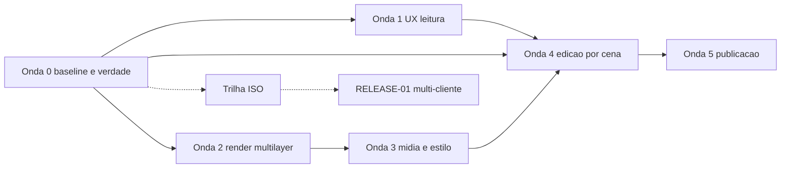

# Plano de integração — proposta revisão 3 sobre o core e a UX atuais

**Regra deste plano (decisão do operador, 22/11/2026):** a proposta **segue a UX atual** e as melhorias são **adicionadas ao core e à UX que já existem**. Sem SPA, sem segundo shell, sem segundo coordenador/renderer/RenderPlan, sem copiar HTML ou lógica do protótipo.
**Base factual:** [REPO-VALIDATION](../evidence/REPO-VALIDATION.md). **Status:** revisão 2 (22/11/2026). O operador aprovou **W0 e W1** com os ajustes da §9 (decisões D-A a D-D). W2 em diante continua sem autorização para implementar.
**Convenção:** IDs do [BACKLOG-V2](BACKLOG-V2.md) (BASE, UX, SET, EDIT, VE, PUB, ISO, QA). Tamanho: P (≤1 dia), M (2–3 dias), G (>3 dias).

## 1. Como a UX atual absorve a proposta

| Proposta | Onde entra na UX atual | Como (sem reescrever) |
|---|---|---|
| Navegação global (7 itens) | `shell_v3.py` (`NAV` linhas 408-414) | "Biblioteca" vira item que aponta para `/studio/panel/estilos` (a biblioteca de estilos que já existe); "Tendências" e "Desempenho" já existem; "Novo vídeo" = "Criar vídeo" (só rótulo) |
| 8 áreas do vídeo | `/studio/panel/videos/{id}` (`panel.py:3504`, hoje uma página de cartões) | **Abas como rotas**: `/studio/panel/videos/{id}/{visao-geral\|fontes\|narracao\|cenas\|composicao\|qualidade\|publicacao\|producao}`. Cada aba é um `<nav aria-label>` de **links** com `aria-current="page"` (não `role=tab`), com `overflow-x:auto`. Os blocos atuais (fontes, estilo do vídeo, produção, publicação) migram para a aba certa sem mudar contrato. Rotas antigas (`/roteiro`, `/preview`, `.../production-runs/{run}`) **continuam funcionando** e passam a ser acessíveis também pela aba |
| Configurações (7 seções) | `SETTINGS_SECTIONS` (`shell_v3.py:430-439`, 6 itens) e o mapa de 7 chaves em `routes.py:1328-1336` | Promover `estrategia` e `producao` (hoje só âncoras dentro de `/studio/canais`) a páginas próprias, reutilizando os cartões existentes (`panel_channels.py:560`, `:746`, `:818`) |
| Canal ativo | `active_channel.py` | Nas páginas de vídeo o shell mostra o **canal dono do vídeo** (somente leitura), em vez de `projects=[]`. Trocar canal continua não movendo o vídeo (`active_channel.py:43-46` é deliberado) |
| Estados | `domain/panel.py:30-45` (`classify`) e `panel_videos.py` | Corrigir a projeção; **não** mudar o enum `VideoStatus` |
| Componentes novos | `shell_v3_css.py` | Um componente (`.abas-video`) e reuso de `.card.painel`, `.pill`, `.state`, `.grade-video`. Sem novos tokens |
| Feedback | padrão `form-feedback[role=status]` + `StudioLoading` | Reutilizar (`panel_channels.py:1355-1369`) |
| CSP e escape | `panel._headers(nonce)`; `preview.py` tem CSP própria | Páginas novas usam `_headers`. A aprovação continua na `preview.py` (CSP própria, `form-action 'none'`); a aba Publicação mostra o resumo e **linka** para ela na primeira onda |
| Dado de demonstração | `tests/test_ux_contract.py` (`MOCKUP_ONLY_TEXT`) | Acrescentar os textos do protótipo novo ("Por que Roma caiu?", "Histórias em 5 minutos", "Conta pessoal · demo") para que **nunca embarquem** no produto |

**Onde o código novo mora:** `api/panel_video_workspace.py` (abas e composição dos blocos) para não crescer `panel.py` (4.196 linhas), mais funções puras de ViewModel em `application/` (o domínio e `application/` continuam sem I/O, `tests/test_architecture.py`).

## 2. Princípios de implementação
1. **Honestidade primeiro:** controle sem consumidor no core **não é exibido como ativo** (rótulo "declarado, ainda não aplicado" ou ausente). Hoje isso já é violado (§REPO-VALIDATION R4); corrigir antes de acrescentar campos.
2. **Somente leitura antes de escrita:** cada aba nasce lendo o que o core já tem; escrita só quando existir contrato (CAS, idempotência, invalidação).
3. **Salvar rascunho não gera mídia**; geração tem confirmação, custo estimado e reserva (UX-05).
4. **Um conceito, um dono:** aprovação e publicação continuam em `publish_repo`/`publication_execution`; as abas não reimplementam gates.
5. **Aditivo em dados:** migrações aditivas com default; sem apagar nada (VE-D2). O banco está vazio hoje, então **backfill só é testável com dados sintéticos**.
6. **Testes só no container** (`scripts/test-container.sh`). Teste do protótipo (Node) não substitui.
7. **Sem pesquisa automática, sem TTS por palavra, sem NLE, sem billing** (fora do escopo, como na proposta).

## 3. Decisões que tomei (reversíveis)

| ID | Decisão | Motivo |
|---|---|---|
| P-01 | Abas do vídeo são **rotas com links**, não JavaScript de abas | acessível, linkável, sem SPA, reaproveita `render_document` |
| P-02 | "Biblioteca" no menu aponta para a biblioteca de estilos já existente; vozes e mídias entram quando houver provider/ativo para listar | evita página vazia que "parece funcional" (regra do FEATURE-COVERAGE) |
| P-03 | Manter breakpoints **820/1080** da casca; a meta 390/768/1280 é de teste visual | já cobrem os três tamanhos (§REPO-VALIDATION §2) |
| P-04 | **"Reabrir para edição"** (vídeo aprovado e **não publicado**): volta a `SCRIPTED`, cria nova revisão e **invalida** a aprovação, o render/QA dependentes e a intenção de envio pendente. **Bloqueada ou coordenada** se houver upload em andamento (`UPLOADING`/claim ativo). Vídeo **publicado** exige duplicar (DECISIONS: "duplicar cria vídeo independente"). A aprovação anterior fica no histórico e não vale para a nova revisão. **Aceita pelo operador com essa condição** | `states.py` não tem "reabrir"; esta é a menor transição que cumpre A06/A12/A18/A22 sem tocar em publicação histórica. **Precisa de ADR antes da W4.2** |
| P-05 | Camadas **conta** e **cena** da precedência **não** entram no MVP; só se expõe o patch de vídeo que o repositório já suporta | a precedência real tem 4 camadas; adicionar mais exige ADR (V3.1) |
| P-06 | BYOK no caminho de execução e isolamento multi-cliente ficam **fora** do MVP de **um único operador confiável** (RELEASE-01). **Correção do operador:** se outras pessoas com papéis diferentes puderem acessar — mesmo dentro de um único cliente — sessão, usuário real e autorização por papel (`EDIT_VIDEO`, `APPROVE_*`, `PUBLISH`) passam a ser requisito | exige sessão, RBAC e escopo por conta (R7) |
| P-07 | Ligar `STUDIO_BUDGET_GUARD` com `STUDIO_PRODUCTION_MODE=BUDGET_GUARDED`, **depois** de confirmar o valor aceito pelo código e de provar com teste que o limite por canal impede a chamada paga **antes** do efeito externo, inclusive sob concorrência. `docker compose config` mostrar a variável **não** comprova proteção. **Aprovada pelo operador com essa condição** (W0B.1) | R1; sem isso os limites por canal não protegem |
| P-08 | A pasta do backlog é `faceless-visual-evolution 2/`; a original na Lixeira não é restaurada. Documentos históricos ficam identificados como tais; referências ativas apontam para esta pasta | decisão do operador |

## 4. Ondas

### Onda 0 — Baseline e verdade
Separada em **W0A** (baseline e documentação, sem mudar comportamento de produto) e **W0B** (mudanças funcionais; cada uma com teste próprio e relato próprio).

#### W0A — Baseline (não muda comportamento)
| ID | Entrega | Arquivos | Aceite |
|---|---|---|---|
| W0A.1 (BASE-01) | Regenerar `contracts/v1/renderplan.schema.json` (só adições: `ConfigSnapshot`); isolar a dependência de ordem de `test_port_contracts` (registro esvaziado e restaurado pela fixture); corrigir `test_publish_api::test_preview_page_*` (causa: o texto da prévia passou a "QA Aprovado" no commit `9188d0f` e o teste esperava "QA aprovado") | `contracts/`, `tests/` | suíte completa sem falha não classificada |
| W0A.2 | Testes de banco: **mapear todas** as variáveis exigidas e apontá-las só para bancos descartáveis. Hoje: `STUDIO_TEST_DSN` (fixture `dsn`/`conn`), `STUDIO_BUDGET_DISPOSABLE_DSN` (orçamento, produção, SaaS, analytics, plano de render), `STUDIO_BUDGET_TEST_PROOF_FILE` (prova de descartabilidade, obrigatória nos dois). `scripts/test-container.sh` passa as três ao mesmo Postgres efêmero. Definir o DSN pode não bastar: **o relatório lista os skips restantes por motivo** | `scripts/test-container.sh` | zero skip de banco; skips restantes (Node, etc.) explicados |
| W0A.3 | `evidence/ve-00-closure.md` com baseline, classificação das falhas e dos skips | docs | números reproduzíveis |
| W0A.4 (COV-01) | Transformar `REPO-VALIDATION §3` na coluna "status" do `FEATURE-COVERAGE-V3.md` e manter atualizada | docs | toda linha com UI→API→caso de uso→domínio→persistência→pipeline |

#### W0B — Mudanças funcionais (comportamento muda; teste próprio)
| ID | Entrega | Arquivos | Aceite |
|---|---|---|---|
| W0B.1 (BASE-02, R1, P-07) | Verificar no código o valor aceito de `STUDIO_PRODUCTION_MODE`; encaminhar `STUDIO_BUDGET_GUARD` e `STUDIO_PRODUCTION_MODE` no Compose; **teste de que, com guard ligado, o limite por canal impede a chamada paga antes do efeito externo, inclusive com duas reservas concorrentes** | `docker-compose.yml`, `.env.example`, `tests/test_budget_*` | teste de bloqueio e de concorrência verdes; só então o default é ligado |
| W0B.2 (R8, antecipado de W5) | **Publicação sem destino validado:** o gate de autorização do canal YouTube deixa de ser fail-open; sem destino configurado a publicação é recusada com mensagem acionável, **antes de qualquer publicação real**. A reorganização visual da publicação continua em W5 | `application/publication_execution.py`, `domain/channel.py`, testes | teste: canal sem destino não publica; canal com destino e autorização continua publicando |
| W0B.3 (R9) | **Seleção efetiva congelada no run:** além de `provider_profile`, gravar o provider/modelo escolhidos por capacidade (texto, imagem, voz, renderer) no snapshot, para um retry reproduzir a escolha mesmo que o catálogo ou o orçamento mudem | `composition.py`, `effective_config.py`, `production_repo.py`, migração aditiva se preciso | teste: alterar catálogo/perfil depois de criar o run não muda a escolha do retry; run `legacy` intacto |
| W0B.4 (R4) | Rótulo honesto: "Voz do narrador" (`channel_profiles.voice`) e "Identidade visual aplicada a…" passam a "declarado, ainda não aplicado" até haver consumidor | `panel_channels.py` | teste de texto; nenhuma promessa sem consumidor |

### Onda 1 — UX: contexto, estados e abas de leitura (usa o core como está)
| ID | Entrega | Arquivos | Aceite |
|---|---|---|---|
| W1.1 (UX-01, R5) | `APPROVED` sai de "Publicados"; rótulo "Aprovado" ≠ "Publicado"; `classify` considera o estado do run | `panel_videos.py:63-70`, `panel_home.py:17-24`, `domain/panel.py:30-45` | A21: vídeo aprovado sem upload nunca aparece como publicado (teste de comportamento) |
| W1.2 (R6) | Shell das páginas de vídeo/prévia/roteiro/execução exibe o canal do vídeo | `panel.py:3985,4173`, `preview.py:158`, `panel_production.py:757`, `shell_v3.py` | A02/A36; teste: vídeo do canal B não mostra "Nenhum canal" |
| W1.3 (KEEP-01) | "Criar vídeo deste tema" preserva `project_id` | `panel_trends.py:164-170` | A33: tema e canal chegam ao novo vídeo |
| W1.4 (UX-03) | Abas do vídeo (P-01): Visão geral, Fontes e roteiro, Qualidade, Publicação, Produção **reaproveitando** os blocos atuais; Narração, Cenas e Composição aparecem **somente leitura** (lista de cenas com texto e legenda, voz e estilo efetivos, custo; sem controle falso, sem player de áudio) | novo `panel_video_workspace.py`, `shell_v3_css.py` (`.abas-video`), `routes.py` | A27 (390/768/1280, teclado), A36; nenhuma rota antiga quebrada; `MOCKUP_ONLY_TEXT` atualizado |
| W1.5 (SET) | Settings em 7 seções: páginas `estrategia` e `producao`, item "Biblioteca" no menu | `shell_v3.py:430-439`, `routes.py:1328-1349`, `panel_channels.py` | A30: sete seções navegáveis, sem cartão vazio |
| W1.6 (SET-01) | Expor **narrativa, duração padrão e CTA** do canal (consumidos pelo prompt, sem UI hoje) | `panel_channels.py`, `application/channel_*` | A32: o campo chega ao prompt (teste do consumidor) e snapshot anterior permanece |
| W1.7 (FLOW-01) | Aba Fontes deixa explícito: registrada ≠ extraída ≠ verificada; host fora da allowlist pede texto | `panel_video_workspace.py` | A34 |

### Onda 2 — Render multilayer (core)
| ID | Entrega | Referência | Aceite |
|---|---|---|---|
| W2.1 (VE-01) | Contrato `Shot.role`/`z_index`, compilador, builder, cache; executor **recusa** overlay até a VE-02 | [VE-01-render-overlay](VE-01-render-overlay.md) (T01–T28, A0–A11) | todos os critérios do §8 da spec |
| W2.2 (VE-02) | Compositor FFmpeg e cache | PLAN (VE-02) | overlay só na janela; áudio, legendas e duração preservados (golden em `evidence/golden/`) |
| W2.3 | Aba Composição passa a mostrar tracks (base/overlay) em leitura | `panel_video_workspace.py` | só mostra o que o plano tem |

### Onda 3 — Mídia e candidatos (depende de W0.3 e W2.2)
| ID | Entrega | Aceite |
|---|---|---|
| W3.1 (VE-03) | Porta `MediaSearch`, `MediaCandidate` (licença, proveniência, custo), Pexels primeiro; **termos de uso a conferir antes** | A31 parcial; fallback para a imagem atual sem cena vazia |
| W3.2 (VE-04) | Presets/legenda/motion sobre `visual_style.py`; `Shot.transition` consumido pelo compilador | paridade sem os novos campos; controles só dos grupos suportados |
| W3.3 (VE-05) | QA técnico do overlay + semântico opcional (`not_verified`) | A17, A28 |

### Onda 4 — Edição por cena (maior risco; precisa de ADR)
Ordem obrigatória:
| ID | Entrega | Arquivos | Aceite |
|---|---|---|---|
| W4.0 (R2) | **IDs de cena estáveis:** a identidade da cena **não** é `idx`; a ordem é atributo separado (inserir/reordenar muda a posição, não o ID). `_write_script` deixa de recriar as cenas. `asset_id` é preservado **só para cenas não afetadas**; se texto ou intenção visual mudar, a mídia é **marcada para revisão** (não mantida às cegas, pois pode ficar incompatível com a fala). Migração aditiva | `adapters/postgres/editorial_repo.py:77-81`, migração nova | A06: editar a cena 3 mantém IDs e `asset_id` das outras; a cena 3 sinaliza mídia a revisar; cache seletivo reaproveita entre versões |
| W4.1 (EDIT-01) | Rota de edição sobre o `EditScriptScene` existente, com `expected_version` (CAS) e `Idempotency-Key`; add/remover/reordenar | `routes.py`, `application/longform.py`, `editorial_repo.py` | A08, A10 (409 na 2ª aba, texto local recuperável), idempotência por hash de payload |
| W4.2 | Decisão **P-04** (editar após aprovar) em ADR + transição | `domain/states.py` | A18, A22: aprovação antiga não libera versão nova; publicação histórica intacta |
| W4.3 (EDIT-02) | Narração: rota para servir o WAV de uma cena e **medir/gravar `duration_s`**; regenerar uma cena (reserva e quote antes) | `application/render.py`, `routes.py` | A15, A14; autosave nunca gera |
| W4.4 (EDIT-03/VE-06) | Troca de mídia por cena com candidatos; invalida só a cena e o final | `media.py`, `PlanRegeneration` | A07 |
| W4.5 (EDIT-04) | **Histórico recuperável:** cada revisão guarda, por cena, **texto, ordem e vínculo de mídia** (tabela de revisão de cena). "Restaurar" cria uma nova revisão com esses três itens da revisão escolhida, não os da versão atual; mídia que já não existe é marcada como indisponível | migração, `scripts`, aba Visão geral | A12, A11: restaurar devolve texto, ordem **e** assets da revisão, comprovado por teste que muda os três antes |

### Onda 5 — Publicação e fechamento
| ID | Entrega | Aceite |
|---|---|---|
| W5.1 (PUB-01) | Extrair o formulário de aprovação da `preview.py` para a aba Publicação (mantendo CSP); invalidar intenção ao mudar destino/metadados (o **fail-open** foi antecipado para W0B.2) | A19, A37 |
| W5.2 (PUB-02) | Retry/reconciliação sem upload duplicado; esclarecer n8n × servidor (`preview.py:41` × `routes.py:1656`) | A20 |
| W5.3 (QA-01) | E2E com adapter falso, teclado, 390/768/1280 por Chrome headless | A27, A29, A36 |

### Trilha ISO (bloqueante só para clientes independentes)
ISO-01/02: sessão real, `organization_id` derivado da sessão, filtro por conta em vídeos/assets/preview/cache/jobs, RBAC nas rotas de vídeo (`CREATE_VIDEO`, `EDIT_VIDEO`, `APPROVE_*`, `PUBLISH` hoje declaradas e não aplicadas), BYOK no caminho de execução. **Não entra no MVP solo**; RELEASE-01 só após A23–A26.

## 5. Mapa dos cenários de aceite

| Cenários | Onda | Observação |
|---|---|---|
| A02, A21, A27, A29, A30, A33, A34, A35, A36 | 1 | testáveis sem mudar o core |
| A03, A04, A05, A32 | 1 | exige W1.6 e o patch de vídeo exposto (P-05) |
| A06–A08, A10–A12, A15 | 4 | dependem de W4.0 e do ADR P-04 |
| A09, A13, A14, A16 | 0/4 | A14 depende de W0.3 |
| A17, A28 | 3 | |
| A18–A20, A22, A37 | 4–5 | |
| A23–A26 | ISO | fora do MVP solo |
| A31 | 3 | só texto e imagem têm N providers hoje; voz e render têm 1 |

## 6. Dependências

Ondas 1 e 2 podem andar em paralelo em worktrees distintas (UX em `api/`, render em `domain/`, `application/`, `adapters/render_*`); `composition.py` tem um dono por onda.

## 7. Riscos do plano

| Risco | Mitigação |
|---|---|
| Abas movem blocos e quebram testes de tela antigos (42 testes de V2 já desatualizados segundo a V3.1) | manter rotas antigas; separar falhas pré-existentes; testes de comportamento novos por aba |
| W4.0 muda a identidade das cenas e afeta cache e plano | migração aditiva; teste de reuso entre versões; fazer **antes** de qualquer escrita por cena |
| P-04 altera a máquina de estados | ADR + aprovação; sem mudar o enum sem necessidade |
| Guard ligado bloqueia fluxos hoje "livres" | W0.3 define o default e documenta; teste de mensagem acionável |
| Dado de demonstração do protótipo vazar para o produto | `MOCKUP_ONLY_TEXT` |
| Escopo virar editor completo | fora do escopo: NLE, TTS por palavra, billing |

## 9. Decisões do operador (22/11/2026)
| ID | Decisão |
|---|---|
| D-A | Seguir com **W0 e W1**, nesta ordem: fechar o baseline e registrar `ve-00-closure.md`; corrigir orçamento e destino de publicação; entregar a navegação W1 reaproveitando blocos e rotas existentes. Áreas ainda incompletas mostram os dados disponíveis e a próxima ação |
| D-B | **P-04** aceita com a condição de bloqueio/coordenação de upload em andamento (acima) |
| D-C | **P-07** aprovada com a condição de prova por teste, inclusive sob concorrência |
| D-D | Pasta mantida (P-08). ISO: fora do MVP de um operador confiável; **dentro** se houver acesso com papéis diferentes |

Sequência: baseline → orçamento e destino de publicação → navegação W1 → render → edição versionada. Cada controle novo precisa de efeito comprovado no pipeline.

## 8. (histórico) O que precisei que você decidesse
1. **Aprovar W0 e W1 agora?** Padrão: sim, são reversíveis e não tocam o fluxo de geração.
2. **P-04** (editar após aprovar volta a `SCRIPTED` se não publicado; publicado exige duplicar). Padrão: aprovar antes da onda 4, não antes.
3. **P-07** (ligar o guard no Compose): é mudança de comportamento em custo. Padrão: ligar com `BUDGET_GUARDED` e documentar.
4. **Pasta do backlog:** a pasta original foi para a Lixeira e a proposta está em `faceless-visual-evolution 2/`. Padrão: manter este plano dentro dela.
