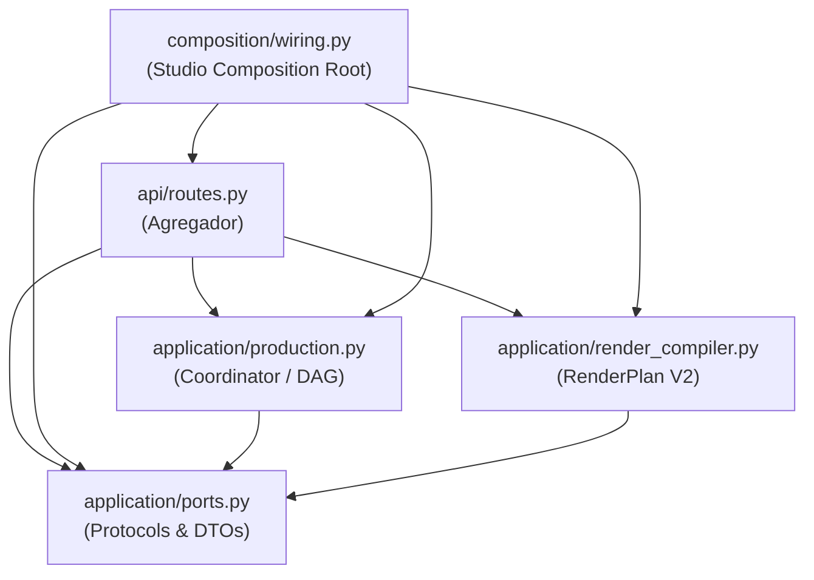

# Mapa de Dependências e Fronteiras Estruturais — FS-08.01
**Data:** 25/11/2026 | **Baseline:** `feat/foundation-stability` | **Quality Gate:** G6 (Estrutura)  
**Referência:** [STRUCTURAL-EVOLUTION.md](../STRUCTURAL-EVOLUTION.md) e [FS-08-modularization.md](FS-08-modularization.md)

---

## 1. Objetivo e Diretriz
O objetivo deste documento é estabelecer o inventário estático de dependências, acoplamentos, invariantes e testes de caracterização dos 5 módulos centrais do Faceless Studio, preparando o terreno para as extensões da **V4.1 (Audiovisual)** e **Finder Intelligence (FI)** sem incorrer em refatorações prematuras ou generalizadas.

---

## 2. Inventário dos 5 Módulos Centrais

### Módulo 1: `renderer/app/studio/api/routes.py`
* **Métricas:** ~3.153 linhas, 140 declarações de rotas `@router`.
* **Responsabilidade AS-IS:** Ponto único de agregação de endpoints FastAPI do Studio (autenticação HTTP Basic/Bearer, guards de browser/CSRF, DTOs de request/response e rotas de canais, vídeos, editorial, storyboard, render, publicação, conexões, analytics e providers).
* **Consumidores:** Interface FastHTML do Studio, workflows n8n e testes de API.
* **Invariantes Obrigatórias:**
  - Preservar métodos HTTP, paths, status codes (ex: 401, 403, 404, 409, 410, 422, 503), headers e redirecionamentos 302/303.
  - Ordem das rotas não pode introduzir colisões (ex: `/studio/canais/novo` antes de `/studio/canais/{channel_id}`).
  - Manter CSRF/Origin check em mutações via browser e rejeição de Origin para Bearer token.
* **Testes de Caracterização:**
  - `tests/test_panel_api.py`, `tests/test_editorial_api.py`, `tests/test_render_api.py`, `tests/test_publication_api.py`, `tests/test_channel_preferences_api.py`.

### Módulo 2: `renderer/app/studio/application/production.py`
* **Métricas:** ~1.320 linhas.
* **Responsabilidade AS-IS:** Orquestração assíncrona do pipeline de produção de vídeo (coordenador `ProductionCoordinator`, worker `ProductionWorker`, DAG de estágios, `ActiveRuns`, `CapacityExceeded`, leases com heartbeat, fencing CAS e recuperação periódica/boot).
* **Consumidores:** `Studio.production`, endpoints de produção da API, loops de recuperação em `main.py`.
* **Invariantes Obrigatórias:**
  - Exclusividade de estágio via CAS (`claim_stage`).
  - Renovação de lease via `LeaseHeartbeat` durante etapas longas.
  - Recuperação idempotente de órfãos (`recover_orphans` e `recover_in_flight`).
  - Preservação do snapshot de configuração imutável por execução (`frozen_provider_selection`).
* **Testes de Caracterização:**
  - `tests/test_production_coordinator.py`, `tests/test_lease_recovery_concurrency.py`, `tests/test_production_flow_db.py`, `tests/test_production_capacity.py`.

### Módulo 3: `renderer/app/studio/composition/wiring.py`
* **Métricas:** ~866 linhas.
* **Responsabilidade AS-IS:** Raiz única de injeção de dependências (`Studio._wire`), inicialização de repositórios PostgreSQL, resolução de providers, configuração imutável congelada (`_effective_config_for`), submissão controlada (`tracked_submit`) e lifecycle de shutdown.
* **Consumidores:** `app.main:studio`, testes integrados que instanciam `Studio`.
* **Invariantes Obrigatórias:**
  - Uma única raiz de composição; nenhum Service Locator global ou container DI paralelo.
  - Resolução de providers determinística com fallback seguro e respeito ao `STUDIO_PROVIDER_PRODUCTION`.
  - Controle de admissão e concorrência (`render_concurrency` e `max_active_runs`).
* **Testes de Caracterização:**
  - `tests/test_main_boot.py`, `tests/test_saas_application.py`, `tests/test_budget_guard_wiring.py`, `tests/test_provider_service.py`.

### Módulo 4: `renderer/app/studio/application/ports.py`
* **Métricas:** ~1.183 linhas.
* **Responsabilidade AS-IS:** Declaração de protocolos abstratos (`typing.Protocol`) e dataclasses de contratos internos (ex: `VideoRepository`, `TextModel`, `ImageModel`, `Voice`, `Renderer`, `RenderSpec`, `ChannelRepository`).
* **Consumidores:** Toda a camada `application` e adaptadores em `adapters/`.
* **Invariantes Obrigatórias:**
  - Preservar assinaturas de métodos, tipos de argumentos e tipos de retorno.
  - Nenhuma dependência de adaptadores de infraestrutura (banco, HTTP, subprocess).
* **Testes de Caracterização:**
  - `tests/test_architecture.py`, `tests/test_contracts.py`.

### Módulo 5: `renderer/app/studio/application/render_compiler.py`
* **Métricas:** ~486 linhas.
* **Responsabilidade AS-IS:** Compilação do `RenderPlan` e montagem do plano estruturado de camadas (`PlanStructure`: shots visuais, sincronização de áudio, trilha sonora e overlays).
* **Consumidores:** Adaptador `PlanFfmpegRenderer` e testes de render.
* **Invariantes Obrigatórias:**
  - Preservar contratos de ticks, framerate (25 fps), dimensões de vídeo e cálculo de envelopes LUFS.
  - Não alterar validação de assets e trajetórias sem migração documentada de schema.
* **Testes de Caracterização:**
  - `tests/test_render_plan_compiler_v2.py`, `tests/test_render_golden.py`, `tests/test_render_plan_builder.py`.

---

## 3. Matriz de Acoplamento e Recomendações de Extração (V4 / Finder)

### Regras de Ouro para Extrações Futuras:
1. **API (`FS-08.02`):** Extrair sub-routers contextuais (`routes_channels.py`, `routes_videos.py`, `routes_trends.py`) somente quando a interface do Finder (`FI-01`) ou da V4 exigir alteração profunda, mantendo `make_router` agregando os submódulos.
2. **Ports & Wiring (`FS-08.03 / FS-08.04`):** Realizar re-export transitório em `ports.py` mantendo compatibilidade retroativa absoluta de imports.
3. **Compiler (`FS-08.05`):** Preservar paridade total com o baseline do [render_baseline.json](../../../tests/golden/render_baseline.json).
4. **Sem Arquitetura Paralela:** É proibido criar um segundo motor de workflow, novo registry de estados ou broker distribuído. O monólito modular atual atende perfeitamente ao volume projetado.
