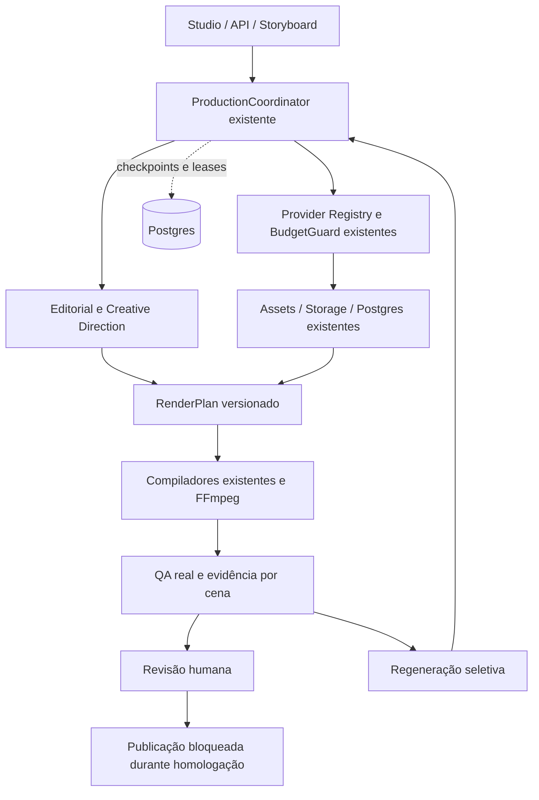

# V4 — Integration & Stabilization

Status: PROPOSTA / PENDING. Não equivale a homologação das fases V4-01–13.
Base auditada: develop `0257c045dbff8ef3f78b4f8ffba76b20db226433`; main `be0c463edc55ff567f9149d26c8fd350c803d745`.
A revisão estática encontrou componentes úteis, porém isolados, simulações apresentadas como evidência e incompatibilidades entre contratos e consumidores. Preservar o trabalho e integrar incrementalmente. Nenhum teste ou render foi executado pelo autor deste pacote.

## Entrada e ordem
1. Leia [regras e gates](QUALITY-GATES.md), [achados](AUDIT-FINDINGS.md) e [backlog](EXECUTION-BACKLOG.md).
2. Execute apenas [INT-01 — auditoria](prompts/INT-01-audit.md) com Neon High, se autorizado pelo operador. Auditoria sem alteração funcional.
3. Depois de aprovação explícita da matriz e do plano, executar INT-02 a INT-07 em ondas, uma atividade/vertical slice por vez. Não encadear automaticamente.
4. Registrar resultados em evidências versionadas sanitizadas; reabrir os IDs V4 originais afetados, sem apagar relatórios históricos ou criar outro MVP. Nenhum PASS herdado prova funcionalidade nova.

## Roteamento (somente Google)
| Onda | Executor | Reviewer independente |
|---|---|---|
| INT-01 | Neon High | Operador |
| INT-02 | Flash 3.8 / Hydrogen | Carbon; Neon para contratos/custo |
| INT-03 | Hydrogen / Carbon | Neon |
| INT-04 | Hydrogen | Neon nos riscos de estado/concorrência |
| INT-05 | Flash 3.8 / Hydrogen | Carbon |
| INT-06 | Flash 3.8 / Carbon | Carbon + operador |
| INT-07 | Neon High | Operador |
Se Flash não estiver disponível, usar Hydrogen. Não presumir cotas ou equivalências de preço. Medir variação percentual de cota semanal e de 5h por tarefa homologada; parar ao atingir reserva acordada com o operador. Não habilitar overages nem gastar APIs. Reutilizar contexto e testes válidos.

## Diagrama de integração (alvo, não estado comprovado)

Importação externa assistida genérica precede APIs opcionais. Não adicionar pipeline, registry, budget guard, cache ou coordenador paralelo.
