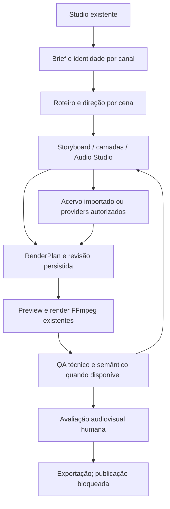

# V4 Product Completion — do motor integrado ao Studio profissional

Base fixa: develop `2e8b153c25b2d4a723f05e1f93f1a49c4dcbd1d6`. Recuperação REC-00–04: resultados técnicos reportados >=9,29; homologação humana pendente. Não reexecutar REC inteiro. A revisão estática externa confirmou os JUnit (4510/26 skips, 101, 27, 20; campanhas sobrepostas), melhorias reais e uma lacuna de integridade da edição. A matriz original tem 180 VERIFIED, 44 DEFERRED, 2 AWAITING_HUMAN_REVIEW e 1 IMPLEMENTED (review final separado). Não converter essas contagens em 100% entregue.

## Objetivo
Operador cria/edita vídeo profissional do início ao fim pelo Studio existente: identidade, direção por cena, voz, trilhas, mídia/camadas, transições, captions, preview, QA, regeneração seletiva e render. Manter caminho local econômico e importação assistida; provedores opcionais não condicionam o Core. Qualidade técnica e audiovisual >=9,0 em cada dimensão, não por contagem de classes.

## Comece aqui
[MASTER-PROMPT.md](MASTER-PROMPT.md) é entrada ativa da campanha quando autorizada. Leia [BACKLOG.md](BACKLOG.md), [SCOPE-MATRIX.md](SCOPE-MATRIX.md), [ACCEPTANCE.md](ACCEPTANCE.md), [MODEL-ROUTING.md](MODEL-ROUTING.md). Cada prompt PC é executado por tarefas, com dependências e reviewer independente. O usuário pode iniciar execução técnica contínua; isso não autoriza gastos, downloads de pesos sem autorização/licença, publicação, merge, exclusão de arquivos do usuário ou aceitar adiamentos em seu nome.

## Fluxo alvo (proposto, não evidência)

Caminho de execução único, contratos neutros, sem novo motor paralelo ou SPA. Resultados antigos ficam históricos. A matriz de escopo cobre os 44 IDs adiados, os 6 GAI pendentes e os gates humanos; tarefas obrigatórias não podem ser reclassificadas opcionais pelo agente. PC-00 confirma os IDs e contratos existentes antes de alterar código.
